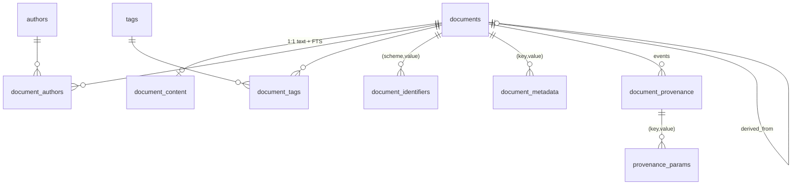
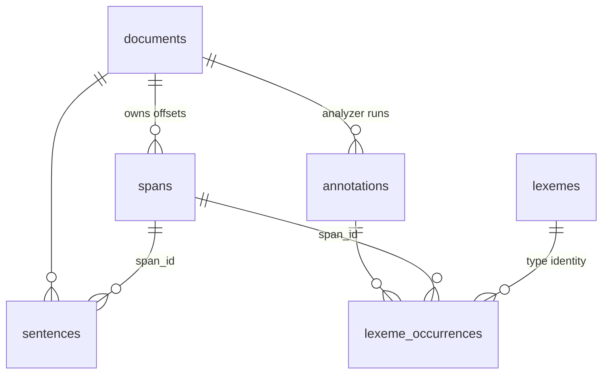
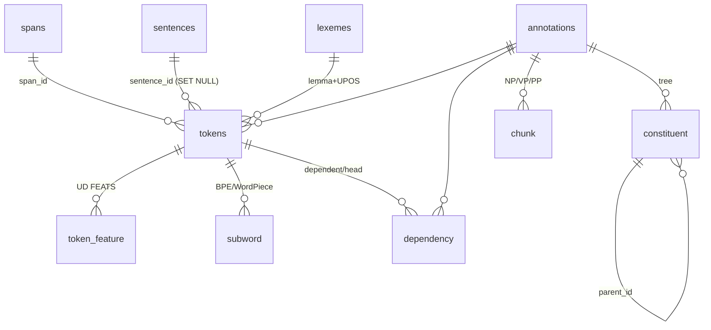
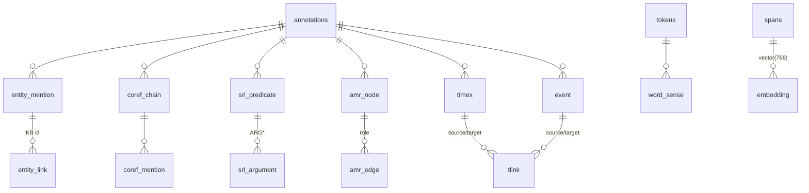
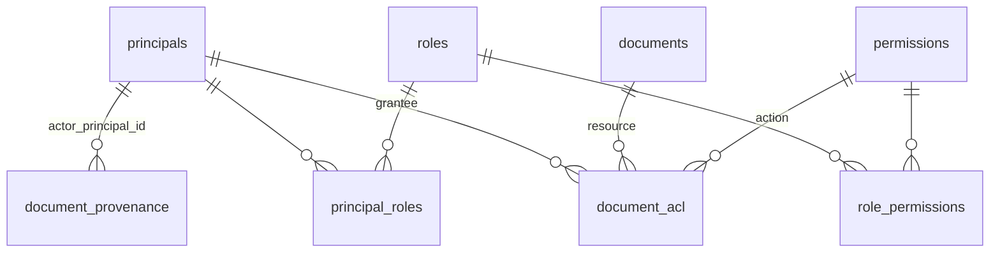

# doc-ray — Database ERD & Data Dictionary

**Schema version `1.17.0`** (SemVer) · 60 migrations applied

> Generated from the live schema by `scripts/gen_data_dictionary.py`. Do not edit by hand — re-run the generator.

## 1. Overview

**doc-ray** is a document-ingestion and NLP-corpus store on **PostgreSQL 16**
(with the **pgvector** and **pg_trgm** extensions) plus **MinIO/S3** for the
original bytes. A document is ingested (any of pdf/txt/md/html/epub/docx),
its text and metadata extracted, then annotated by real spaCy into the full
20-layer NLP stack. Everything queryable lives in Postgres; blobs never do.

**Design principles**

- **4NF normalization.** No arrays or JSON bags for independent multivalued
  facts — each becomes its own relation whose key determines a single value.
  Anything derivable is a view, not a stored column.
- **Stand-off annotation over a shared span registry.** Character offsets are
  a first-class entity (`spans`); every layer references a span by FK instead
  of repeating `(document_id, char_start, char_end)`.
- **Dual identity.** Top-level entities use `uuid` (`documents`, `spans`,
  `principals`); high-volume, time-ordered annotation rows use a **ULID**
  domain (Crockford base32, 26 chars) so `ORDER BY id` is time order.
- **Layer-aware runs.** An `annotations` row is one analyzer run over a
  document, scoped by `(layer, tool)`, so many tools/layers coexist without
  collision. Deleting a document cascades through the entire graph.
- **Document-level RBAC via RLS.** Access is decided per document and inherited
  by every document-scoped table through row-level-security policies.


## 2. Conventions

| Convention | Detail |
|---|---|
| `ulid` domain | `char(26)` matching `^[0-7][0-9A-HJKMNP-TV-Z]{25}$` (Crockford base32; excludes I/L/O/U). Sorts in creation-time order. |
| `uuid` ids | `gen_random_uuid()` defaults on top-level entities. |
| Content addressing | `content_sha256` / `text_sha256` dedupe + integrity; blob body is an `s3://` URI, never a row. |
| Offsets | Half-open `[char_start, char_end)` into `document_content.full_text`; owned by `spans`. |
| `ON DELETE` | Document-owned edges CASCADE (or SET NULL for advisory links); references to global dimensions (`lexemes`, `authors`, `tags`, `documents.derived_from`) do not. |
| Timestamps | `timestamptz`, default `now()`. |


## 3. Entity-Relationship Diagrams

_Rendered as Mermaid; attributes are catalogued in §5. Diagrams are grouped by domain for legibility (the full schema is one connected graph)._

### Document entity, 4NF satellites & provenance



### Segmentation, span registry & the annotation backbone



### Tokens, morphology & syntax



### Entities, reference, meaning, temporal & embeddings



### Access control (RBAC) — decided per document, inherited via RLS




## 4. Domains & enumerated types

- **domain `ulid`** = `character(26)` — `CHECK ((VALUE ~ '^[0-7][0-9A-HJKMNP-TV-Z]{25}$'::text))`
- **enum `provenance_kind`** ∈ { 'acquired', 'stored', 'extracted', 'decomposed', 'segmented', 'embedded', 'indexed', 'redacted', 'translated', 'superseded', 'annotated' }


## 5. Data dictionary

### 5.1 Document entity & bibliographic identity

The document is a first-class entity. Independent multivalued facts (authors, tags, identifiers,
format metadata) are decomposed to their own relations (4NF); blobs live in object storage, only an
`s3://` pointer + sha256 are stored.

#### `documents`

| Column | Type | Null | Key | Default | Notes |
|---|---|---|---|---|---|
| `id` | uuid |  | PK | `gen_random_uuid()` |  |
| `title` | text |  |  |  |  |
| `doc_type` | text |  |  |  |  |
| `source_uri` | text |  |  |  |  |
| `content_sha256` | character(64) |  | UQ |  |  |
| `byte_size` | bigint |  |  |  |  |
| `page_count` | integer | yes |  |  |  |
| `status` | text |  |  | `'pending'::text` |  |
| `error` | text | yes |  |  |  |
| `created_at` | timestamp with time zone |  |  | `now()` |  |
| `updated_at` | timestamp with time zone |  |  | `now()` |  |
| `subtitle` | text | yes |  |  |  |
| `language` | text | yes |  |  |  |
| `publisher` | text | yes |  |  |  |
| `published_on` | date | yes |  |  |  |
| `license` | text | yes |  |  |  |
| `mime_type` | text | yes |  |  |  |
| `char_count` | integer | yes |  |  |  |
| `text_sha256` | character(64) | yes |  |  |  |
| `derived_from` | uuid | yes | FK→documents |  |  |
| `revision` | integer |  |  | `1` |  |
| `original_filename` | text | yes |  |  |  |
| `description` | text | yes |  |  |  |
| `lifecycle_state` | text |  |  | `'active'::text` |  |
| `archived_at` | timestamp with time zone | yes |  |  |  |
| `deleted_at` | timestamp with time zone | yes |  |  |  |

- **Primary key:** (id)
- **Unique:** UNIQUE (content_sha256)
- **FK:** FOREIGN KEY (derived_from) REFERENCES documents(id) ON DELETE SET NULL
- **Check:** CHECK ((lifecycle_state = ANY (ARRAY['active'::text, 'archived'::text, 'deleted'::text])))
- **Check:** CHECK ((((lifecycle_state = 'active'::text) AND (archived_at IS NULL) AND (deleted_at IS NULL)) OR ((lifecycle_state = 'archived'::text) AND (archived_at IS NOT NULL) AND (deleted_at IS NULL)) OR ((lifecycle_state = 'deleted'::text) AND (deleted_at IS NOT NULL))))
- **Index** `documents_content_sha256_key`: public.documents USING btree (content_sha256)
- **Index** `idx_documents_derived_from`: public.documents USING btree (derived_from)
- **Index** `idx_documents_lifecycle_state`: public.documents USING btree (lifecycle_state, updated_at DESC)
- **Index** `idx_documents_status`: public.documents USING btree (status)
- **Index** `idx_documents_type_created`: public.documents USING btree (doc_type, created_at DESC)
- **RLS:** enabled — read/write policies via *id (self)*

#### `document_content`

| Column | Type | Null | Key | Default | Notes |
|---|---|---|---|---|---|
| `document_id` | uuid |  | PK, FK→documents |  |  |
| `full_text` | text | yes |  |  |  |
| `fts` | tsvector | yes |  |  |  |

- **Primary key:** (document_id)
- **FK:** FOREIGN KEY (document_id) REFERENCES documents(id) ON DELETE CASCADE
- **Index** `idx_content_fts`: public.document_content USING gin (fts)
- **RLS:** enabled — read/write policies via *document_id*

#### `authors`

| Column | Type | Null | Key | Default | Notes |
|---|---|---|---|---|---|
| `id` | bigint |  | PK | `nextval('authors_id_seq'::regclass)` |  |
| `name` | text |  | UQ |  |  |

- **Primary key:** (id)
- **Unique:** UNIQUE (name)
- **Index** `authors_name_key`: public.authors USING btree (name)

#### `document_authors`

| Column | Type | Null | Key | Default | Notes |
|---|---|---|---|---|---|
| `document_id` | uuid |  | PK, FK→documents |  |  |
| `author_id` | bigint |  | PK, FK→authors |  |  |
| `position` | integer |  |  | `0` |  |

- **Primary key:** (document_id, author_id)
- **FK:** FOREIGN KEY (author_id) REFERENCES authors(id)
- **FK:** FOREIGN KEY (document_id) REFERENCES documents(id) ON DELETE CASCADE
- **Index** `idx_document_authors_author`: public.document_authors USING btree (author_id)
- **RLS:** enabled — read/write policies via *document_id*

#### `tags`

| Column | Type | Null | Key | Default | Notes |
|---|---|---|---|---|---|
| `id` | bigint |  | PK | `nextval('tags_id_seq'::regclass)` |  |
| `tag` | text |  | UQ |  |  |

- **Primary key:** (id)
- **Unique:** UNIQUE (tag)
- **Index** `tags_tag_key`: public.tags USING btree (tag)

#### `document_tags`

| Column | Type | Null | Key | Default | Notes |
|---|---|---|---|---|---|
| `document_id` | uuid |  | PK, FK→documents |  |  |
| `tag_id` | bigint |  | PK, FK→tags |  |  |

- **Primary key:** (document_id, tag_id)
- **FK:** FOREIGN KEY (document_id) REFERENCES documents(id) ON DELETE CASCADE
- **FK:** FOREIGN KEY (tag_id) REFERENCES tags(id)
- **Index** `idx_document_tags_tag`: public.document_tags USING btree (tag_id)
- **RLS:** enabled — read/write policies via *document_id*

#### `document_identifiers`

| Column | Type | Null | Key | Default | Notes |
|---|---|---|---|---|---|
| `document_id` | uuid |  | PK, FK→documents |  |  |
| `scheme` | text |  | PK |  |  |
| `value` | text |  | PK |  |  |

- **Primary key:** (document_id, scheme, value)
- **FK:** FOREIGN KEY (document_id) REFERENCES documents(id) ON DELETE CASCADE
- **RLS:** enabled — read/write policies via *document_id*

#### `document_metadata`

| Column | Type | Null | Key | Default | Notes |
|---|---|---|---|---|---|
| `document_id` | uuid |  | PK, FK→documents |  |  |
| `key` | text |  | PK |  |  |
| `value` | text |  |  |  |  |

- **Primary key:** (document_id, key)
- **FK:** FOREIGN KEY (document_id) REFERENCES documents(id) ON DELETE CASCADE
- **RLS:** enabled — read/write policies via *document_id*

### 5.2 Provenance (append-only lineage)

Every processing/lineage event on a document, with its parameters normalized out of a JSON bag into
`(event, key) -> value`. `document_metadata_history` is the analogous append-only trail for editable
title/description/tags edits (BL-058) — a distinct concern from pipeline/ingest events, RLS-scoped
and read-granted the same way.

#### `document_provenance`

| Column | Type | Null | Key | Default | Notes |
|---|---|---|---|---|---|
| `id` | ulid |  | PK |  |  |
| `document_id` | uuid |  | FK→documents |  |  |
| `kind` | provenance_kind |  |  |  |  |
| `tool` | text | yes |  |  |  |
| `tool_version` | text | yes |  |  |  |
| `occurred_at` | timestamp with time zone |  |  | `now()` |  |
| `actor` | text | yes |  |  |  |
| `input_sha256` | character(64) | yes |  |  |  |
| `output_sha256` | character(64) | yes |  |  |  |
| `note` | text | yes |  |  |  |
| `actor_principal_id` | uuid | yes | FK→principals |  |  |

- **Primary key:** (id)
- **FK:** FOREIGN KEY (actor_principal_id) REFERENCES principals(id) ON DELETE SET NULL
- **FK:** FOREIGN KEY (document_id) REFERENCES documents(id) ON DELETE CASCADE
- **Index** `idx_provenance_doc`: public.document_provenance USING btree (document_id, id)
- **Index** `idx_provenance_kind`: public.document_provenance USING btree (kind)
- **RLS:** enabled — read/write policies via *document_id*

#### `provenance_params`

| Column | Type | Null | Key | Default | Notes |
|---|---|---|---|---|---|
| `event_id` | ulid |  | PK, FK→document_provenance |  |  |
| `key` | text |  | PK |  |  |
| `value` | text |  |  |  |  |

- **Primary key:** (event_id, key)
- **FK:** FOREIGN KEY (event_id) REFERENCES document_provenance(id) ON DELETE CASCADE
- **RLS:** enabled — read/write policies via *event_id → document_provenance*

#### `document_metadata_history`

| Column | Type | Null | Key | Default | Notes |
|---|---|---|---|---|---|
| `id` | ulid |  | PK |  |  |
| `document_id` | uuid |  | FK→documents |  |  |
| `field` | text |  |  |  |  |
| `old_value` | text | yes |  |  |  |
| `new_value` | text | yes |  |  |  |
| `changed_at` | timestamp with time zone |  |  | `now()` |  |
| `actor` | text | yes |  |  |  |
| `actor_principal_id` | uuid | yes | FK→principals |  |  |

- **Primary key:** (id)
- **FK:** FOREIGN KEY (actor_principal_id) REFERENCES principals(id) ON DELETE SET NULL
- **FK:** FOREIGN KEY (document_id) REFERENCES documents(id) ON DELETE CASCADE
- **Check:** CHECK ((field = ANY (ARRAY['title'::text, 'description'::text, 'tags'::text, 'lifecycle_state'::text])))
- **Index** `idx_metadata_history_doc`: public.document_metadata_history USING btree (document_id, id)
- **RLS:** enabled — read/write policies via *document_id*

### 5.3 Segmentation & the span registry

Character offsets are a first-class, addressable entity (`spans`); every stand-off annotation
references a span by FK rather than repeating offset triples. Sentences are ULID-keyed and reference
a span.

#### `spans`

| Column | Type | Null | Key | Default | Notes |
|---|---|---|---|---|---|
| `id` | uuid |  | PK | `gen_random_uuid()` |  |
| `document_id` | uuid |  | FK→documents, UQ |  |  |
| `char_start` | integer |  | UQ |  |  |
| `char_end` | integer |  | UQ |  |  |
| `page_number` | integer | yes |  |  |  |
| `bbox_x0` | double precision | yes |  |  |  |
| `bbox_y0` | double precision | yes |  |  |  |
| `bbox_x1` | double precision | yes |  |  |  |
| `bbox_y1` | double precision | yes |  |  |  |

- **Primary key:** (id)
- **Unique:** UNIQUE (document_id, char_start, char_end)
- **FK:** FOREIGN KEY (document_id) REFERENCES documents(id) ON DELETE CASCADE
- **Check:** CHECK ((char_end >= char_start))
- **Check:** CHECK ((((page_number IS NULL) AND (bbox_x0 IS NULL) AND (bbox_y0 IS NULL) AND (bbox_x1 IS NULL) AND (bbox_y1 IS NULL)) OR ((page_number > 0) AND (bbox_x0 IS NOT NULL) AND (bbox_y0 IS NOT NULL) AND (bbox_x1 IS NOT NULL) AND (bbox_y1 IS NOT NULL) AND (bbox_x1 >= bbox_x0) AND (bbox_y1 >= bbox_y0)))) NOT VALID
- **Index** `idx_spans_document`: public.spans USING btree (document_id, char_start, char_end)
- **Index** `idx_spans_document_page`: public.spans USING btree (document_id, page_number, char_start) WHERE (page_number IS NOT NULL)
- **Index** `spans_document_id_char_start_char_end_key`: public.spans USING btree (document_id, char_start, char_end)
- **RLS:** enabled — read/write policies via *document_id*

#### `sentences`

| Column | Type | Null | Key | Default | Notes |
|---|---|---|---|---|---|
| `id` | ulid |  | PK |  |  |
| `document_id` | uuid |  | FK→documents, UQ |  |  |
| `ordinal` | integer |  | UQ |  |  |
| `text` | text |  |  |  |  |
| `created_at` | timestamp with time zone |  |  | `now()` |  |
| `span_id` | uuid |  | FK→spans |  |  |

- **Primary key:** (id)
- **Unique:** UNIQUE (document_id, ordinal)
- **FK:** FOREIGN KEY (document_id) REFERENCES documents(id) ON DELETE CASCADE
- **FK:** FOREIGN KEY (span_id) REFERENCES spans(id) ON DELETE CASCADE
- **Index** `idx_sentences_document`: public.sentences USING btree (document_id, ordinal)
- **Index** `idx_sentences_span`: public.sentences USING btree (span_id)
- **Index** `idx_sentences_text_trgm`: public.sentences USING gin (text gin_trgm_ops)
- **Index** `sentences_document_id_ordinal_key`: public.sentences USING btree (document_id, ordinal)
- **RLS:** enabled — read/write policies via *document_id*

### 5.4 Lexeme & annotation backbone

`lexemes` is analyzer-independent type identity; `annotations` is one analyzer run over a document
scoped by `(layer, tool)`; `lexeme_occurrences` is the materialized projection of token-level lexeme
links that the webapp/API render for lexeme and KWIC reads.

#### `lexemes`

| Column | Type | Null | Key | Default | Notes |
|---|---|---|---|---|---|
| `uid` | text |  | PK |  |  |
| `lang` | text |  | UQ |  |  |
| `pos` | text |  | UQ |  |  |
| `lemma` | text |  | UQ |  |  |

- **Primary key:** (uid)
- **Unique:** UNIQUE (lang, pos, lemma)
- **Index** `idx_lexemes_lang_pos`: public.lexemes USING btree (lang, pos)
- **Index** `idx_lexemes_lemma_trgm`: public.lexemes USING gin (lemma gin_trgm_ops)
- **Index** `lexemes_lang_pos_lemma_key`: public.lexemes USING btree (lang, pos, lemma)

#### `annotations`

| Column | Type | Null | Key | Default | Notes |
|---|---|---|---|---|---|
| `id` | ulid |  | PK |  |  |
| `document_id` | uuid |  | FK→documents, UQ |  |  |
| `created_at` | timestamp with time zone |  |  | `now()` |  |
| `layer` | text |  | UQ |  |  |
| `tool` | text |  | UQ |  |  |
| `tool_version` | text | yes |  |  |  |

- **Primary key:** (id)
- **Unique:** UNIQUE (document_id, layer, tool)
- **FK:** FOREIGN KEY (document_id) REFERENCES documents(id) ON DELETE CASCADE
- **Index** `annotations_doc_layer_tool_key`: public.annotations USING btree (document_id, layer, tool)
- **RLS:** enabled — read/write policies via *document_id*

#### `lexeme_occurrences`

| Column | Type | Null | Key | Default | Notes |
|---|---|---|---|---|---|
| `annotation_id` | ulid |  | PK, FK→annotations |  |  |
| `lexeme_uid` | text |  | FK→lexemes |  |  |
| `span_id` | uuid |  | PK, FK→spans |  |  |

- **Primary key:** (annotation_id, span_id)
- **FK:** FOREIGN KEY (annotation_id) REFERENCES annotations(id) ON DELETE CASCADE
- **FK:** FOREIGN KEY (lexeme_uid) REFERENCES lexemes(uid)
- **FK:** FOREIGN KEY (span_id) REFERENCES spans(id) ON DELETE CASCADE
- **Index** `idx_lexeme_occurrences_span`: public.lexeme_occurrences USING btree (span_id)
- **Index** `idx_occ_lexeme`: public.lexeme_occurrences USING btree (lexeme_uid)
- **RLS:** enabled — read/write policies via *annotation_id → annotations*

### 5.5 Tokens, morphology & subwords (NLP layers 3–7)

The token is the addressable unit syntax/morphology reference. UD FEATS and BPE/WordPiece pieces
decompose into child relations (no arrays, no pipe-strings).

#### `tokens`

| Column | Type | Null | Key | Default | Notes |
|---|---|---|---|---|---|
| `id` | ulid |  | PK |  |  |
| `annotation_id` | ulid |  | FK→annotations, UQ |  |  |
| `span_id` | uuid |  | FK→spans, UQ |  |  |
| `sentence_id` | ulid | yes | FK→sentences |  |  |
| `ordinal` | integer |  |  |  |  |
| `lexeme_uid` | text | yes | FK→lexemes |  | Optional link to the analyzer-independent lexeme (type layer). NULL for tokens with no lemma/lexeme (punctuation, symbols, whitespace). |
| `upos` | text | yes |  |  | Universal POS — authoritative token-level POS. Present for every token, including lexeme-less ones (PUNCT/SYM/SPACE). When lexeme_uid is set, it equals lexemes.pos; the annotator maintains this agreement. |
| `xpos` | text | yes |  |  |  |

- **Primary key:** (id)
- **Unique:** UNIQUE (annotation_id, span_id)
- **FK:** FOREIGN KEY (annotation_id) REFERENCES annotations(id) ON DELETE CASCADE
- **FK:** FOREIGN KEY (lexeme_uid) REFERENCES lexemes(uid)
- **FK:** FOREIGN KEY (sentence_id) REFERENCES sentences(id) ON DELETE SET NULL
- **FK:** FOREIGN KEY (span_id) REFERENCES spans(id) ON DELETE CASCADE
- **Index** `idx_tokens_annotation`: public.tokens USING btree (annotation_id, ordinal)
- **Index** `idx_tokens_lexeme`: public.tokens USING btree (lexeme_uid)
- **Index** `idx_tokens_sentence`: public.tokens USING btree (sentence_id)
- **Index** `idx_tokens_span`: public.tokens USING btree (span_id)
- **Index** `tokens_annotation_id_span_id_key`: public.tokens USING btree (annotation_id, span_id)
- **RLS:** enabled — read/write policies via *annotation_id → annotations*

#### `token_feature`

| Column | Type | Null | Key | Default | Notes |
|---|---|---|---|---|---|
| `token_id` | ulid |  | PK, FK→tokens |  |  |
| `feature` | text |  | PK |  |  |
| `value` | text |  |  |  |  |

- **Primary key:** (token_id, feature)
- **FK:** FOREIGN KEY (token_id) REFERENCES tokens(id) ON DELETE CASCADE
- **RLS:** enabled — read/write policies via *token_id → tokens → annotations*

#### `subword`

| Column | Type | Null | Key | Default | Notes |
|---|---|---|---|---|---|
| `token_id` | ulid |  | PK, FK→tokens |  |  |
| `position` | integer |  | PK |  |  |
| `piece` | text |  |  |  |  |

- **Primary key:** (token_id, "position")
- **FK:** FOREIGN KEY (token_id) REFERENCES tokens(id) ON DELETE CASCADE
- **RLS:** enabled — read/write policies via *token_id → tokens → annotations*

### 5.6 Syntax — shallow & deep (layers 8–10)

Chunking (BIO collapsed to spans), constituency (adjacency-list tree), and dependency (each token
has exactly one head → a function).

#### `chunk`

| Column | Type | Null | Key | Default | Notes |
|---|---|---|---|---|---|
| `id` | ulid |  | PK |  |  |
| `annotation_id` | ulid |  | FK→annotations |  |  |
| `span_id` | uuid |  | FK→spans |  |  |
| `chunk_type` | text |  |  |  |  |
| `surface` | text |  |  |  |  |

- **Primary key:** (id)
- **FK:** FOREIGN KEY (annotation_id) REFERENCES annotations(id) ON DELETE CASCADE
- **FK:** FOREIGN KEY (span_id) REFERENCES spans(id) ON DELETE CASCADE
- **Index** `idx_chunk_annotation`: public.chunk USING btree (annotation_id)
- **Index** `idx_chunk_span`: public.chunk USING btree (span_id)
- **RLS:** enabled — read/write policies via *annotation_id → annotations*

#### `constituent`

| Column | Type | Null | Key | Default | Notes |
|---|---|---|---|---|---|
| `id` | ulid |  | PK |  |  |
| `annotation_id` | ulid |  | FK→annotations |  |  |
| `parent_id` | ulid | yes | FK→constituent |  |  |
| `label` | text |  |  |  |  |
| `span_id` | uuid | yes | FK→spans |  |  |

- **Primary key:** (id)
- **FK:** FOREIGN KEY (annotation_id) REFERENCES annotations(id) ON DELETE CASCADE
- **FK:** FOREIGN KEY (parent_id) REFERENCES constituent(id) ON DELETE CASCADE
- **FK:** FOREIGN KEY (span_id) REFERENCES spans(id) ON DELETE CASCADE
- **Index** `idx_constituent_annotation`: public.constituent USING btree (annotation_id)
- **Index** `idx_constituent_parent`: public.constituent USING btree (parent_id)
- **Index** `idx_constituent_span`: public.constituent USING btree (span_id)
- **RLS:** enabled — read/write policies via *annotation_id → annotations*

#### `dependency`

| Column | Type | Null | Key | Default | Notes |
|---|---|---|---|---|---|
| `annotation_id` | ulid |  | PK, FK→annotations |  |  |
| `dependent_token_id` | ulid |  | PK, FK→tokens |  |  |
| `head_token_id` | ulid | yes | FK→tokens |  |  |
| `deprel` | text |  |  |  |  |

- **Primary key:** (annotation_id, dependent_token_id)
- **FK:** FOREIGN KEY (annotation_id) REFERENCES annotations(id) ON DELETE CASCADE
- **FK:** FOREIGN KEY (dependent_token_id) REFERENCES tokens(id) ON DELETE CASCADE
- **FK:** FOREIGN KEY (head_token_id) REFERENCES tokens(id) ON DELETE SET NULL
- **Index** `idx_dependency_dependent`: public.dependency USING btree (dependent_token_id)
- **Index** `idx_dependency_head`: public.dependency USING btree (head_token_id)
- **RLS:** enabled — read/write policies via *annotation_id → annotations*

### 5.7 Entities & reference (layers 11–13)

Named-entity mentions, entity linking to a KB, and coreference chains.

#### `entity_mention`

| Column | Type | Null | Key | Default | Notes |
|---|---|---|---|---|---|
| `id` | ulid |  | PK |  |  |
| `annotation_id` | ulid |  | FK→annotations |  |  |
| `span_id` | uuid |  | FK→spans |  |  |
| `entity_type` | text |  |  |  |  |
| `surface` | text |  |  |  |  |

- **Primary key:** (id)
- **FK:** FOREIGN KEY (annotation_id) REFERENCES annotations(id) ON DELETE CASCADE
- **FK:** FOREIGN KEY (span_id) REFERENCES spans(id) ON DELETE CASCADE
- **Index** `idx_entity_mention_annotation`: public.entity_mention USING btree (annotation_id)
- **Index** `idx_entity_mention_span`: public.entity_mention USING btree (span_id)
- **Index** `idx_entity_mention_type_surface`: public.entity_mention USING btree (entity_type, surface)
- **RLS:** enabled — read/write policies via *annotation_id → annotations*

#### `entity_link`

| Column | Type | Null | Key | Default | Notes |
|---|---|---|---|---|---|
| `mention_id` | ulid |  | PK, FK→entity_mention |  |  |
| `scheme` | text |  | PK |  |  |
| `kb_id` | text |  |  |  |  |
| `confidence` | real | yes |  |  |  |

- **Primary key:** (mention_id, scheme)
- **FK:** FOREIGN KEY (mention_id) REFERENCES entity_mention(id) ON DELETE CASCADE
- **RLS:** enabled — read/write policies via *mention_id → entity_mention → annotations*

#### `coref_chain`

| Column | Type | Null | Key | Default | Notes |
|---|---|---|---|---|---|
| `id` | ulid |  | PK |  |  |
| `annotation_id` | ulid |  | FK→annotations |  |  |
| `document_id` | uuid |  | FK→documents |  |  |

- **Primary key:** (id)
- **FK:** FOREIGN KEY (annotation_id) REFERENCES annotations(id) ON DELETE CASCADE
- **FK:** FOREIGN KEY (document_id) REFERENCES documents(id) ON DELETE CASCADE
- **Index** `idx_coref_chain_annotation`: public.coref_chain USING btree (annotation_id)
- **Index** `idx_coref_chain_document`: public.coref_chain USING btree (document_id)
- **RLS:** enabled — read/write policies via *document_id*

#### `coref_mention`

| Column | Type | Null | Key | Default | Notes |
|---|---|---|---|---|---|
| `chain_id` | ulid |  | PK, FK→coref_chain |  |  |
| `span_id` | uuid |  | PK, FK→spans |  |  |

- **Primary key:** (chain_id, span_id)
- **FK:** FOREIGN KEY (chain_id) REFERENCES coref_chain(id) ON DELETE CASCADE
- **FK:** FOREIGN KEY (span_id) REFERENCES spans(id) ON DELETE CASCADE
- **Index** `idx_coref_mention_span`: public.coref_mention USING btree (span_id)
- **RLS:** enabled — read/write policies via *span_id → spans*

### 5.8 Meaning, discourse, temporal & sentiment (layers 14–19)

Semantic role labeling, word-sense disambiguation, AMR meaning graphs, PDTB discourse relations,
TimeML (TIMEX/EVENT/TLINK), and sentiment.

#### `srl_predicate`

| Column | Type | Null | Key | Default | Notes |
|---|---|---|---|---|---|
| `id` | ulid |  | PK |  |  |
| `annotation_id` | ulid |  | FK→annotations |  |  |
| `token_id` | ulid |  | FK→tokens |  |  |
| `frame` | text |  |  |  |  |

- **Primary key:** (id)
- **FK:** FOREIGN KEY (annotation_id) REFERENCES annotations(id) ON DELETE CASCADE
- **FK:** FOREIGN KEY (token_id) REFERENCES tokens(id) ON DELETE CASCADE
- **Index** `idx_srl_predicate_annotation`: public.srl_predicate USING btree (annotation_id)
- **Index** `idx_srl_predicate_token`: public.srl_predicate USING btree (token_id)
- **RLS:** enabled — read/write policies via *annotation_id → annotations*

#### `srl_argument`

| Column | Type | Null | Key | Default | Notes |
|---|---|---|---|---|---|
| `predicate_id` | ulid |  | PK, FK→srl_predicate |  |  |
| `span_id` | uuid |  | PK, FK→spans |  |  |
| `role` | text |  |  |  |  |

- **Primary key:** (predicate_id, span_id)
- **FK:** FOREIGN KEY (predicate_id) REFERENCES srl_predicate(id) ON DELETE CASCADE
- **FK:** FOREIGN KEY (span_id) REFERENCES spans(id) ON DELETE CASCADE
- **Index** `idx_srl_argument_span`: public.srl_argument USING btree (span_id)
- **RLS:** enabled — read/write policies via *span_id → spans*

#### `word_sense`

| Column | Type | Null | Key | Default | Notes |
|---|---|---|---|---|---|
| `token_id` | ulid |  | PK, FK→tokens |  |  |
| `annotation_id` | ulid |  | FK→annotations |  |  |
| `sense_key` | text |  |  |  |  |

- **Primary key:** (token_id)
- **FK:** FOREIGN KEY (annotation_id) REFERENCES annotations(id) ON DELETE CASCADE
- **FK:** FOREIGN KEY (token_id) REFERENCES tokens(id) ON DELETE CASCADE
- **Index** `idx_word_sense_annotation`: public.word_sense USING btree (annotation_id)
- **RLS:** enabled — read/write policies via *annotation_id → annotations*

#### `amr_node`

| Column | Type | Null | Key | Default | Notes |
|---|---|---|---|---|---|
| `id` | ulid |  | PK |  |  |
| `annotation_id` | ulid |  | FK→annotations |  |  |
| `sentence_id` | ulid | yes | FK→sentences |  |  |
| `concept` | text |  |  |  |  |

- **Primary key:** (id)
- **FK:** FOREIGN KEY (annotation_id) REFERENCES annotations(id) ON DELETE CASCADE
- **FK:** FOREIGN KEY (sentence_id) REFERENCES sentences(id) ON DELETE SET NULL
- **Index** `idx_amr_node_annotation`: public.amr_node USING btree (annotation_id)
- **Index** `idx_amr_node_sentence`: public.amr_node USING btree (sentence_id)
- **RLS:** enabled — read/write policies via *annotation_id → annotations*

#### `amr_edge`

| Column | Type | Null | Key | Default | Notes |
|---|---|---|---|---|---|
| `id` | ulid |  | PK |  |  |
| `parent_node_id` | ulid |  | FK→amr_node |  |  |
| `child_node_id` | ulid |  | FK→amr_node |  |  |
| `role` | text |  |  |  |  |

- **Primary key:** (id)
- **FK:** FOREIGN KEY (child_node_id) REFERENCES amr_node(id) ON DELETE CASCADE
- **FK:** FOREIGN KEY (parent_node_id) REFERENCES amr_node(id) ON DELETE CASCADE
- **Index** `idx_amr_edge_child`: public.amr_edge USING btree (child_node_id)
- **RLS:** enabled — read/write policies via *parent_node_id → amr_node → annotations*

#### `discourse_relation`

| Column | Type | Null | Key | Default | Notes |
|---|---|---|---|---|---|
| `id` | ulid |  | PK |  |  |
| `annotation_id` | ulid |  | FK→annotations |  |  |
| `connective_span_id` | uuid | yes | FK→spans |  |  |
| `arg1_span_id` | uuid |  | FK→spans |  |  |
| `arg2_span_id` | uuid |  | FK→spans |  |  |
| `sense` | text |  |  |  |  |

- **Primary key:** (id)
- **FK:** FOREIGN KEY (annotation_id) REFERENCES annotations(id) ON DELETE CASCADE
- **FK:** FOREIGN KEY (arg1_span_id) REFERENCES spans(id) ON DELETE CASCADE
- **FK:** FOREIGN KEY (arg2_span_id) REFERENCES spans(id) ON DELETE CASCADE
- **FK:** FOREIGN KEY (connective_span_id) REFERENCES spans(id) ON DELETE CASCADE
- **Index** `idx_discourse_relation_annotation`: public.discourse_relation USING btree (annotation_id)
- **Index** `idx_discourse_relation_arg1_span`: public.discourse_relation USING btree (arg1_span_id)
- **Index** `idx_discourse_relation_arg2_span`: public.discourse_relation USING btree (arg2_span_id)
- **Index** `idx_discourse_relation_connective_span`: public.discourse_relation USING btree (connective_span_id)
- **RLS:** enabled — read/write policies via *annotation_id → annotations*

#### `timex`

| Column | Type | Null | Key | Default | Notes |
|---|---|---|---|---|---|
| `id` | ulid |  | PK |  |  |
| `annotation_id` | ulid |  | FK→annotations |  |  |
| `span_id` | uuid |  | FK→spans |  |  |
| `timex_type` | text |  |  |  |  |
| `value` | text | yes |  |  |  |

- **Primary key:** (id)
- **FK:** FOREIGN KEY (annotation_id) REFERENCES annotations(id) ON DELETE CASCADE
- **FK:** FOREIGN KEY (span_id) REFERENCES spans(id) ON DELETE CASCADE
- **Index** `idx_timex_annotation`: public.timex USING btree (annotation_id)
- **Index** `idx_timex_span`: public.timex USING btree (span_id)
- **RLS:** enabled — read/write policies via *annotation_id → annotations*

#### `event`

| Column | Type | Null | Key | Default | Notes |
|---|---|---|---|---|---|
| `id` | ulid |  | PK |  |  |
| `annotation_id` | ulid |  | FK→annotations |  |  |
| `token_id` | ulid |  | FK→tokens |  |  |
| `event_class` | text | yes |  |  |  |

- **Primary key:** (id)
- **FK:** FOREIGN KEY (annotation_id) REFERENCES annotations(id) ON DELETE CASCADE
- **FK:** FOREIGN KEY (token_id) REFERENCES tokens(id) ON DELETE CASCADE
- **Index** `idx_event_annotation`: public.event USING btree (annotation_id)
- **Index** `idx_event_token`: public.event USING btree (token_id)
- **RLS:** enabled — read/write policies via *annotation_id → annotations*

#### `tlink`

| Column | Type | Null | Key | Default | Notes |
|---|---|---|---|---|---|
| `id` | ulid |  | PK |  |  |
| `annotation_id` | ulid |  | FK→annotations |  |  |
| `relation` | text |  |  |  |  |
| `source_event_id` | ulid | yes | FK→event |  |  |
| `source_timex_id` | ulid | yes | FK→timex |  |  |
| `target_event_id` | ulid | yes | FK→event |  |  |
| `target_timex_id` | ulid | yes | FK→timex |  |  |

- **Primary key:** (id)
- **FK:** FOREIGN KEY (annotation_id) REFERENCES annotations(id) ON DELETE CASCADE
- **FK:** FOREIGN KEY (source_event_id) REFERENCES event(id) ON DELETE CASCADE
- **FK:** FOREIGN KEY (source_timex_id) REFERENCES timex(id) ON DELETE CASCADE
- **FK:** FOREIGN KEY (target_event_id) REFERENCES event(id) ON DELETE CASCADE
- **FK:** FOREIGN KEY (target_timex_id) REFERENCES timex(id) ON DELETE CASCADE
- **Check:** CHECK ((num_nonnulls(source_event_id, source_timex_id) = 1))
- **Check:** CHECK ((num_nonnulls(target_event_id, target_timex_id) = 1))
- **Index** `idx_tlink_annotation`: public.tlink USING btree (annotation_id)
- **Index** `idx_tlink_source_event`: public.tlink USING btree (source_event_id)
- **Index** `idx_tlink_source_timex`: public.tlink USING btree (source_timex_id)
- **Index** `idx_tlink_target_event`: public.tlink USING btree (target_event_id)
- **Index** `idx_tlink_target_timex`: public.tlink USING btree (target_timex_id)
- **RLS:** enabled — read/write policies via *annotation_id → annotations*

#### `sentiment`

| Column | Type | Null | Key | Default | Notes |
|---|---|---|---|---|---|
| `id` | ulid |  | PK |  |  |
| `annotation_id` | ulid |  | FK→annotations |  |  |
| `span_id` | uuid |  | FK→spans |  |  |
| `polarity` | text |  |  |  |  |
| `score` | real | yes |  |  |  |
| `target_span_id` | uuid | yes | FK→spans |  |  |

- **Primary key:** (id)
- **FK:** FOREIGN KEY (annotation_id) REFERENCES annotations(id) ON DELETE CASCADE
- **FK:** FOREIGN KEY (span_id) REFERENCES spans(id) ON DELETE CASCADE
- **FK:** FOREIGN KEY (target_span_id) REFERENCES spans(id) ON DELETE CASCADE
- **Index** `idx_sentiment_annotation`: public.sentiment USING btree (annotation_id)
- **Index** `idx_sentiment_span`: public.sentiment USING btree (span_id)
- **Index** `idx_sentiment_target_span`: public.sentiment USING btree (target_span_id)
- **RLS:** enabled — read/write policies via *annotation_id → annotations*

### 5.9 Distributed representations (layer 20)

pgvector embeddings over spans, ANN-indexed with HNSW (cosine).

#### `embedding`

| Column | Type | Null | Key | Default | Notes |
|---|---|---|---|---|---|
| `span_id` | uuid |  | PK, FK→spans |  |  |
| `model` | text |  | PK |  |  |
| `vector` | vector(768) |  |  |  | Fixed 768-d (bge-base default). pgvector HNSW requires a fixed dimension; a different-dimension model needs its own embedding table + HNSW index. |

- **Primary key:** (span_id, model)
- **FK:** FOREIGN KEY (span_id) REFERENCES spans(id) ON DELETE CASCADE
- **Index** `idx_embedding_hnsw`: public.embedding USING hnsw (vector vector_cosine_ops)
- **RLS:** enabled — read/write policies via *span_id → spans*

### 5.10 Access control — RBAC & row-level security

Principals, roles, permissions and per-document ACLs. Every document-scoped table above is protected
by RLS keyed on these (see §Access control).

#### `principals`

| Column | Type | Null | Key | Default | Notes |
|---|---|---|---|---|---|
| `id` | uuid |  | PK | `gen_random_uuid()` |  |
| `kind` | text |  |  | `'human'::text` |  |
| `display_name` | text |  | UQ |  |  |
| `external_subject` | text | yes |  |  |  |
| `disabled_at` | timestamp with time zone | yes |  |  |  |
| `created_at` | timestamp with time zone |  |  | `now()` |  |
| `db_role` | name | yes | UQ |  |  |

- **Primary key:** (id)
- **Unique:** UNIQUE (db_role)
- **Unique:** UNIQUE (display_name)
- **Check:** CHECK (((db_role IS NULL) OR (db_role <> ALL (ARRAY['docray'::name, 'docray_client'::name, 'docray_api'::name]))))
- **Check:** CHECK ((kind = ANY (ARRAY['human'::text, 'service'::text])))
- **Index** `principals_db_role_key`: public.principals USING btree (db_role)
- **Index** `principals_display_name_key`: public.principals USING btree (display_name)

#### `roles`

| Column | Type | Null | Key | Default | Notes |
|---|---|---|---|---|---|
| `id` | bigint |  | PK | `nextval('roles_id_seq'::regclass)` |  |
| `name` | text |  | UQ |  |  |

- **Primary key:** (id)
- **Unique:** UNIQUE (name)
- **Index** `roles_name_key`: public.roles USING btree (name)

#### `permissions`

| Column | Type | Null | Key | Default | Notes |
|---|---|---|---|---|---|
| `id` | bigint |  | PK | `nextval('permissions_id_seq'::regclass)` |  |
| `action` | text |  | UQ |  |  |

- **Primary key:** (id)
- **Unique:** UNIQUE (action)
- **Index** `permissions_action_key`: public.permissions USING btree (action)

#### `role_permissions`

| Column | Type | Null | Key | Default | Notes |
|---|---|---|---|---|---|
| `role_id` | bigint |  | PK, FK→roles |  |  |
| `permission_id` | bigint |  | PK, FK→permissions |  |  |

- **Primary key:** (role_id, permission_id)
- **FK:** FOREIGN KEY (permission_id) REFERENCES permissions(id) ON DELETE CASCADE
- **FK:** FOREIGN KEY (role_id) REFERENCES roles(id) ON DELETE CASCADE

#### `principal_roles`

| Column | Type | Null | Key | Default | Notes |
|---|---|---|---|---|---|
| `principal_id` | uuid |  | PK, FK→principals |  |  |
| `role_id` | bigint |  | PK, FK→roles |  |  |

- **Primary key:** (principal_id, role_id)
- **FK:** FOREIGN KEY (principal_id) REFERENCES principals(id) ON DELETE CASCADE
- **FK:** FOREIGN KEY (role_id) REFERENCES roles(id) ON DELETE CASCADE

#### `document_acl`

| Column | Type | Null | Key | Default | Notes |
|---|---|---|---|---|---|
| `document_id` | uuid |  | PK, FK→documents |  |  |
| `principal_id` | uuid |  | PK, FK→principals |  |  |
| `permission` | text |  | PK, FK→permissions |  |  |
| `granted_at` | timestamp with time zone |  |  | `now()` |  |
| `granted_by` | uuid | yes | FK→principals |  |  |

- **Primary key:** (document_id, principal_id, permission)
- **FK:** FOREIGN KEY (document_id) REFERENCES documents(id) ON DELETE CASCADE
- **FK:** FOREIGN KEY (granted_by) REFERENCES principals(id)
- **FK:** FOREIGN KEY (permission) REFERENCES permissions(action)
- **FK:** FOREIGN KEY (principal_id) REFERENCES principals(id) ON DELETE CASCADE
- **Index** `idx_document_acl_document`: public.document_acl USING btree (document_id)
- **Index** `idx_document_acl_principal`: public.document_acl USING btree (principal_id)

### 5.11 Evaluation & drift artifacts

Corpus snapshots, evaluation runs, metric rows, and gold samples make quality and drift measurements
durable and citeable instead of one-off operator observations.

#### `corpus_snapshot`

| Column | Type | Null | Key | Default | Notes |
|---|---|---|---|---|---|
| `id` | ulid |  | PK |  |  |
| `created_at` | timestamp with time zone |  |  | `now()` |  |
| `source` | text |  |  |  |  |
| `schema_version` | text |  |  |  |  |
| `document_count` | bigint |  |  |  |  |
| `sentence_count` | bigint |  |  |  |  |
| `token_count` | bigint |  |  |  |  |
| `lexeme_count` | bigint |  |  |  |  |
| `lexeme_occurrence_count` | bigint |  |  |  |  |
| `entity_mention_count` | bigint |  |  |  |  |
| `entity_link_count` | bigint |  |  |  |  |
| `review_pending_count` | bigint |  |  | `0` |  |
| `review_approved_count` | bigint |  |  | `0` |  |
| `review_rejected_count` | bigint |  |  | `0` |  |
| `tool_versions` | jsonb |  |  | `'{}'::jsonb` |  |
| `lexeme_distribution` | jsonb |  |  | `'{}'::jsonb` |  |
| `entity_distribution` | jsonb |  |  | `'{}'::jsonb` |  |
| `fact_refs` | jsonb |  |  | `'{}'::jsonb` |  |

- **Primary key:** (id)
- **Index** `idx_corpus_snapshot_created`: public.corpus_snapshot USING btree (created_at DESC)

#### `evaluation_run`

| Column | Type | Null | Key | Default | Notes |
|---|---|---|---|---|---|
| `id` | ulid |  | PK |  |  |
| `snapshot_id` | ulid |  | FK→corpus_snapshot |  |  |
| `created_at` | timestamp with time zone |  |  | `now()` |  |
| `evaluator` | text |  |  |  |  |
| `evaluator_version` | text |  |  |  |  |
| `schema_version` | text |  |  |  |  |
| `note` | text | yes |  |  |  |

- **Primary key:** (id)
- **FK:** FOREIGN KEY (snapshot_id) REFERENCES corpus_snapshot(id) ON DELETE CASCADE
- **Index** `idx_evaluation_run_snapshot`: public.evaluation_run USING btree (snapshot_id, created_at DESC)

#### `evaluation_metric`

| Column | Type | Null | Key | Default | Notes |
|---|---|---|---|---|---|
| `run_id` | ulid |  | PK, FK→evaluation_run |  |  |
| `name` | text |  | PK |  |  |
| `subject` | text |  | PK |  |  |
| `subject_id` | text |  | PK |  |  |
| `value_numeric` | double precision | yes |  |  |  |
| `value_json` | jsonb |  |  | `'{}'::jsonb` |  |
| `unit` | text |  |  | `'count'::text` |  |
| `fact_refs` | jsonb |  |  | `'{}'::jsonb` |  |

- **Primary key:** (run_id, name, subject, subject_id)
- **FK:** FOREIGN KEY (run_id) REFERENCES evaluation_run(id) ON DELETE CASCADE
- **Index** `idx_evaluation_metric_name`: public.evaluation_metric USING btree (name, subject, subject_id)

#### `gold_sample`

| Column | Type | Null | Key | Default | Notes |
|---|---|---|---|---|---|
| `id` | ulid |  | PK |  |  |
| `document_id` | uuid | yes | FK→documents |  |  |
| `span_id` | uuid | yes | FK→spans |  |  |
| `label` | text |  |  |  |  |
| `expected` | jsonb |  |  |  |  |
| `source` | text |  |  |  |  |
| `created_at` | timestamp with time zone |  |  | `now()` |  |

- **Primary key:** (id)
- **FK:** FOREIGN KEY (document_id) REFERENCES documents(id) ON DELETE CASCADE
- **FK:** FOREIGN KEY (span_id) REFERENCES spans(id) ON DELETE CASCADE
- **Index** `idx_gold_sample_label`: public.gold_sample USING btree (label, created_at DESC)

### 5.12 Meta

Applied-migration ledger, the schema's SemVer, and the corpus-backup catalogue. `backups` is
operational: it and the `jobs` queue are excluded from every snapshot and from restore, so a restore
never clobbers the queue or the archive index it is reading from.

#### `schema_migrations`

| Column | Type | Null | Key | Default | Notes |
|---|---|---|---|---|---|
| `filename` | text |  | PK |  |  |
| `applied_at` | timestamp with time zone |  |  | `now()` |  |

- **Primary key:** (filename)

#### `schema_version`

| Column | Type | Null | Key | Default | Notes |
|---|---|---|---|---|---|
| `singleton` | boolean |  | PK | `true` |  |
| `version` | text |  |  |  |  |
| `updated_at` | timestamp with time zone |  |  | `now()` |  |

- **Primary key:** (singleton)
- **Check:** CHECK (singleton)
- **Check:** CHECK ((version ~ '^[0-9]+\.[0-9]+\.[0-9]+$'::text))

#### `backups`

| Column | Type | Null | Key | Default | Notes |
|---|---|---|---|---|---|
| `id` | ulid |  | PK |  |  |
| `created_at` | timestamp with time zone |  |  | `now()` |  |
| `status` | text |  |  | `'creating'::text` |  |
| `object_key` | text | yes |  |  |  |
| `schema_version` | text | yes |  |  |  |
| `archive_bytes` | bigint | yes |  |  |  |
| `table_rows` | bigint | yes |  |  |  |
| `blob_count` | integer | yes |  |  |  |
| `blob_bytes` | bigint | yes |  |  |  |
| `doc_count` | integer | yes |  |  |  |
| `note` | text | yes |  |  |  |
| `error` | text | yes |  |  |  |
| `updated_at` | timestamp with time zone |  |  | `now()` |  |

- **Primary key:** (id)
- **Check:** CHECK ((status = ANY (ARRAY['creating'::text, 'available'::text, 'restoring'::text, 'failed'::text])))
- **Index** `idx_backups_created`: public.backups USING btree (created_at DESC)
- **RLS:** enabled — read/write policies via *docray_is_admin()*


## 6. Views

#### `lexeme_forms`  
`security_invoker = true`

```sql
SELECT DISTINCT lexeme_uid,
    surface
   FROM lexeme_occurrence_detail;
```

#### `lexeme_keys`  
`security_invoker = true`

```sql
SELECT uid,
    (((lang || ':'::text) || pos) || ':'::text) || lemma AS canonical_key
   FROM lexemes;
```

#### `lexeme_occurrence_detail`  
`security_invoker = true`

```sql
SELECT a.document_id,
    a.tool AS analyzer,
    o.annotation_id,
    sp.char_start,
    sp.char_end,
    o.lexeme_uid,
    l.lang,
    l.pos,
    l.lemma,
    SUBSTRING(c.full_text FROM sp.char_start + 1 FOR sp.char_end - sp.char_start) AS surface
   FROM lexeme_occurrences o
     JOIN spans sp ON sp.id = o.span_id
     JOIN annotations a ON a.id::bpchar = o.annotation_id::bpchar
     JOIN lexemes l ON l.uid = o.lexeme_uid
     JOIN document_content c ON c.document_id = a.document_id;
```


## 7. Functions & triggers

| Function | Returns | Security | Lang |
|---|---|---|---|
| `docray_attach_rls(tbl regclass, tmpl text)` | `void` | invoker | plpgsql |
| `docray_create_principal_login(principal uuid, role_name name, password text DEFAULT NULL::text)` | `name` | DEFINER | plpgsql |
| `docray_current_principal()` | `uuid` | DEFINER | sql |
| `docray_effective_actor()` | `name` | invoker | sql |
| `docray_is_admin()` | `boolean` | DEFINER | sql |
| `docray_readable_documents()` | `SETOF uuid` | DEFINER | sql |
| `docray_schema_version()` | `text` | invoker | sql |
| `docray_ts_config(lang text)` | `regconfig` | invoker | sql |
| `docray_writable_documents()` | `SETOF uuid` | DEFINER | sql |
| `refresh_content_fts_on_language()` | `trigger` | invoker | plpgsql |
| `set_document_content_fts()` | `trigger` | invoker | plpgsql |
| `set_updated_at()` | `trigger` | invoker | plpgsql |

- **backups** `trg_backups_updated_at`: CREATE TRIGGER trg_backups_updated_at BEFORE UPDATE …
- **canonical** `trg_canonical_updated_at`: CREATE TRIGGER trg_canonical_updated_at BEFORE UPDATE …
- **document_collections** `trg_document_collections_updated_at`: CREATE TRIGGER trg_document_collections_updated_at BEFORE UPDATE …
- **document_content** `trg_content_fts`: CREATE TRIGGER trg_content_fts BEFORE INSERT OR UPDATE OF full_text …
- **documents** `trg_documents_language_fts`: CREATE TRIGGER trg_documents_language_fts AFTER UPDATE OF language …
- **documents** `trg_documents_updated_at`: CREATE TRIGGER trg_documents_updated_at BEFORE UPDATE …


## 8. Access control (RBAC + RLS)

Authorization is decided **per document** and inherited by every
document-scoped table. A principal may **read** a document iff it is *admin* or
holds any `document_acl` row on it, and may **write** iff *admin* or holds an
`annotate`/`delete`/`admin` grant.

**Enforcement.** RLS is `ENABLE`d (not `FORCE`) on 36 tables (incl. `jobs` and
`backups` since migration 043 — BL-064). The `docray`
role is a **superuser and table owner**, so it **bypasses RLS** — the ingest
pipeline and admin tooling use it as the trusted batch writer. End-user / API
traffic must run as the non-superuser role **`docray_api`** (`SET ROLE
docray_api`) and set the principal per transaction:

```sql
SET ROLE docray_api;
SET app.principal_id = '<principal uuid>';
```

**How the policies work.** Two `SECURITY DEFINER` set-returning helpers,
`docray_readable_documents()` and `docray_writable_documents()`, compute the
caller's visible-document set **once per query**. Each table's policies then
semi-join the row's owning-document path against that set (see the *RLS path*
line in each table entry) — the planner turns this into a hashed semi-join
rather than a per-row function call, so a full scan of a million-row table
stays cheap. Reads use a `FOR SELECT` policy only; writes use separate
`FOR INSERT/UPDATE/DELETE` policies (with `WITH CHECK`) so they never
contaminate read plans.

**Trust boundary.** The HTTP API maps bearer or `X-DocRay-API-Token`
credentials to principals, then drops every request to `docray_api`. The
principal GUC is honored only for that trusted app-tier role; anonymous API
requests run as `docray_api` with no principal id rather than as the superuser.
Direct SQL users are isolated with per-principal `LOGIN` roles recorded in
`principals.db_role` and created with
`docray_create_principal_login(principal, role_name, password)`. Those roles
inherit `docray_client` and are mapped by authenticated database identity, so
setting `app.principal_id` cannot impersonate a different principal. The
derived views (`lexeme_occurrence_detail`, `lexeme_forms`, `lexeme_keys`) are
set `security_invoker = true` so they inherit the caller's RLS instead of the
owner's bypass.


## 9. Migration history

| # | Migration | What it adds |
|---|---|---|
| 001 | `001_init.sql` | documents + document_content (FTS), pg_trgm, updated_at trigger |
| 002 | `002_sentences.sql` | ulid domain; sentences (ULID PK) |
| 003 | `003_document_entity.sql` | bibliographic/lineage columns; provenance_kind enum; document_provenance |
| 004 | `004_normalize_4nf.sql` | decompose authors/tags/identifiers/metadata/params to relations |
| 005 | `005_lexemes.sql` | lexemes, annotations, lexeme_occurrences + derived views |
| 006 | `006_schema_migrations.sql` | the applied-migration ledger |
| 007 | `007_spans.sql` | shared span registry; sentences/occurrences onto span_id; layer-aware annotations |
| 008 | `008_tokens_morphology.sql` | tokens, token_feature (UD FEATS), subword |
| 009 | `009_syntax.sql` | chunk, constituent, dependency |
| 010 | `010_reference.sql` | entity_mention, entity_link, coref_chain, coref_mention |
| 011 | `011_meaning_discourse.sql` | SRL, WSD, AMR, discourse, TimeML, sentiment |
| 012 | `012_embeddings.sql` | pgvector extension; embedding + HNSW index |
| 013 | `013_fix_sentence_fk.sql` | tokens/amr_node.sentence_id → ON DELETE SET NULL |
| 014 | `014_span_fk_cascade.sql` | every span reference → ON DELETE CASCADE |
| 015 | `015_layer_fk_cascade.sql` | complete the ON DELETE graph for document-owned tables |
| 016 | `016_fts_language_aware.sql` | trigger-maintained language-aware FTS (en/pt/simple) |
| 017 | `017_schema_review_fixes.sql` | typed tlink endpoints; word_sense PK; derived_from SET NULL; catalog comments |
| 018 | `018_rbac.sql` | document-level RBAC + row-level security on 33 tables |
| 019 | `019_schema_version.sql` | schema SemVer — schema_version + docray_schema_version() |
| 020 | `020_jobs.sql` | background jobs queue (text+CHECK status, FOR UPDATE SKIP LOCKED) |
| 021 | `021_canonical.sql` | canonical entity registry (canonical + HNSW embedding index) |
| 022 | `022_form_index.sql` | form_index — normalized surface form → canonical lookup |
| 023 | `023_resolution.sql` | resolution_review + canonical_merge (frontier-resolver review store) |
| 024 | `024_schema_version_1_3_0.sql` | advance the schema SemVer to 1.3.0 |
| 025 | `025_seed_suggestion.sql` | seed_suggestion — domain-seeding curation queue |
| 026 | `026_backups.sql` | backups — corpus-snapshot archive catalogue |
| 027 | `027_fk_cascade_indexes.sql` | index the annotations delete-cascade FK paths |
| 028 | `028_document_delete_cascade_indexes.sql` | index the document delete-cascade FK paths |
| 029 | `029_schema_version_1_4_0.sql` | advance the schema SemVer to 1.4.0 |
| 030 | `030_principal_login_roles.sql` | per-principal LOGIN roles and trusted API principal assertion |
| 031 | `031_schema_version_1_5_0.sql` | advance the schema SemVer to 1.5.0 |
| 032 | `032_api_role_runtime_grants.sql` | grant API runtime access to jobs and seed suggestions under RLS |
| 033 | `033_schema_version_1_6_0.sql` | advance the schema SemVer to 1.6.0 |
| 034 | `034_annotation_table_autovacuum.sql` | autovacuum/analyze thresholds for annotation tables |
| 035 | `035_schema_version_1_7_0.sql` | advance the schema SemVer to 1.7.0 |
| 036 | `036_evaluation_drift.sql` | evaluation runs, corpus snapshots, metrics, and gold samples |
| 037 | `037_schema_version_1_8_0.sql` | advance the schema SemVer to 1.8.0 |
| 038 | `038_entity_mention_chunk_surface_columns.sql` | nullable surface columns on entity_mention and chunk (phase 1 of 038-041) |
| 039 | `039_entity_mention_surface_backfill.sql` | backfill entity_mention.surface from document_content.full_text |
| 040 | `040_chunk_surface_backfill.sql` | backfill chunk.surface from document_content.full_text |
| 041 | `041_entity_mention_chunk_surface_finalize.sql` | NOT NULL + indexes on entity_mention/chunk surface after the backfills |
| 042 | `042_schema_version_1_9_0.sql` | advance the schema SemVer to 1.9.0 |
| 043 | `043_jobs_backups_rls.sql` | Row-Level Security on jobs and backups (BL-064) |
| 044 | `044_schema_version_1_10_0.sql` | advance the schema SemVer to 1.10.0 |
| 045 | `045_document_metadata_history.sql` | editable document metadata and its per-field change history (BL-058) |
| 046 | `046_schema_version_1_11_0.sql` | advance the schema SemVer to 1.11.0 |
| 047 | `047_document_collections.sql` | manual and smart document collections (BL-057) |
| 048 | `048_schema_version_1_12_0.sql` | advance the schema SemVer to 1.12.0 |
| 049 | `049_span_page_geometry.sql` | persist page/bbox geometry for spans (BL-077) |
| 050 | `050_schema_version_1_13_0.sql` | advance the schema SemVer to 1.13.0 |
| 051 | `051_document_lifecycle.sql` | document lifecycle state, archive, and soft delete (BL-059) |
| 052 | `052_schema_version_1_14_0.sql` | advance the schema SemVer to 1.14.0 |
| 053 | `053_document_lifecycle_history_constraint.sql` | allow lifecycle_state transitions in document metadata history |
| 054 | `054_document_layout_run_page_dimensions.sql` | repair document_layout_runs page dimensions for already-migrated databases |
| 055 | `055_document_metadata_suggestions.sql` | verified document metadata suggestions for human review (BL-061) |
| 056 | `056_schema_version_1_15_0.sql` | advance the schema SemVer to 1.15.0 |
| 057 | `057_job_cancel_update_policy.sql` | admin-only cancellation update policy for queued/running jobs (BL-102) |
| 058 | `058_schema_version_1_16_0.sql` | advance the schema SemVer to 1.16.0 |
| 059 | `059_job_progress.sql` | first-class async job progress fields on jobs (BL-123) |
| 060 | `060_schema_version_1_17_0.sql` | advance the schema SemVer to 1.17.0 |
