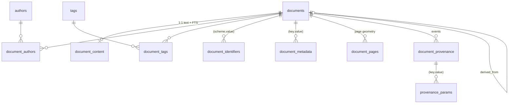
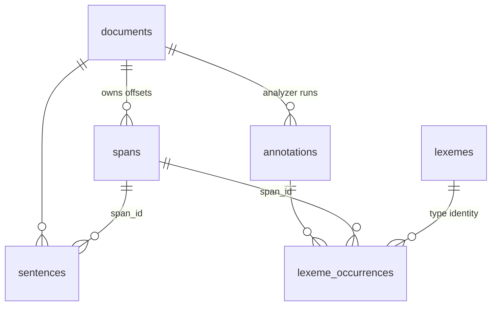
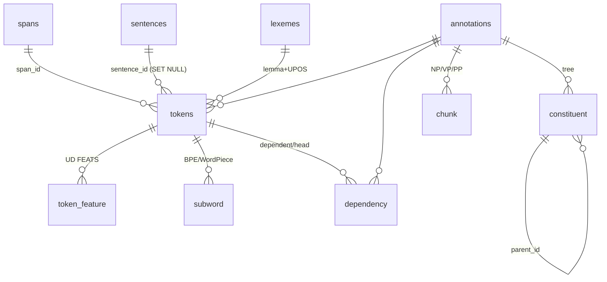
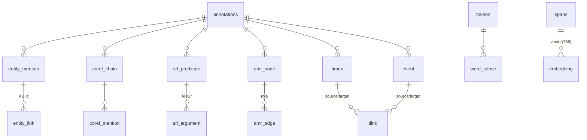
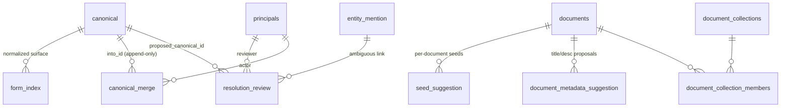
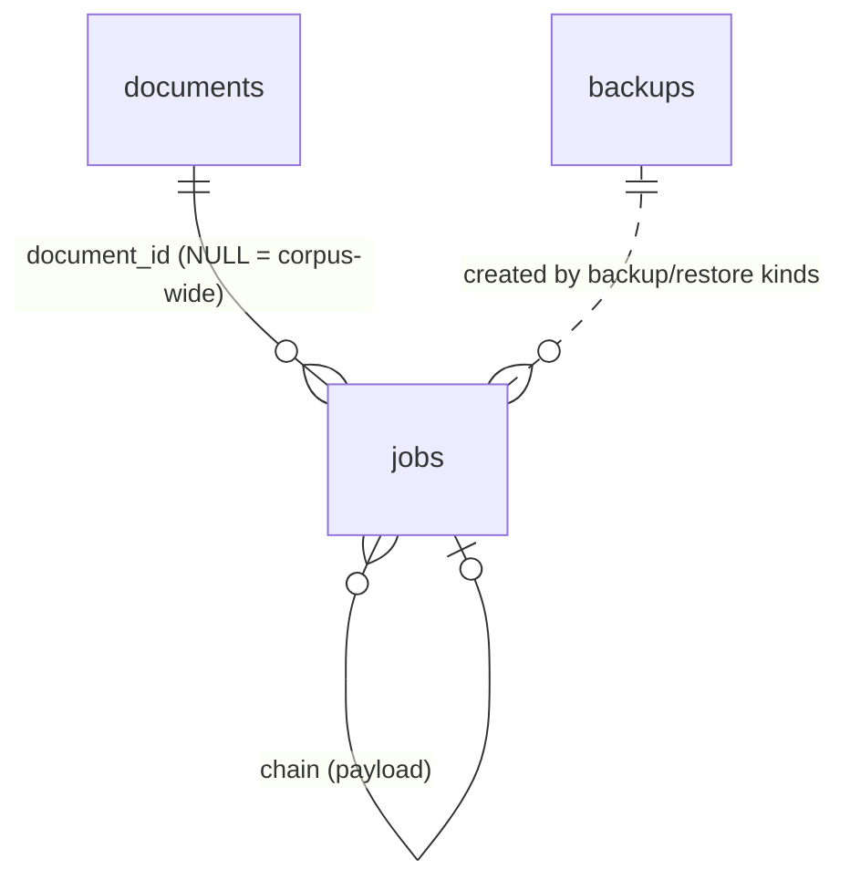
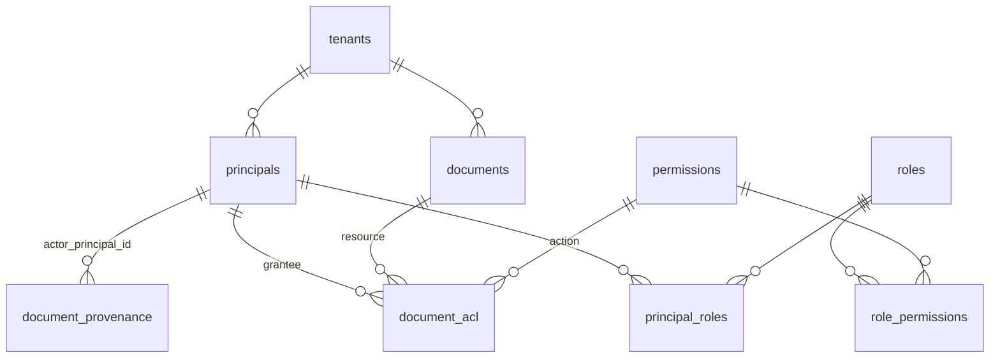
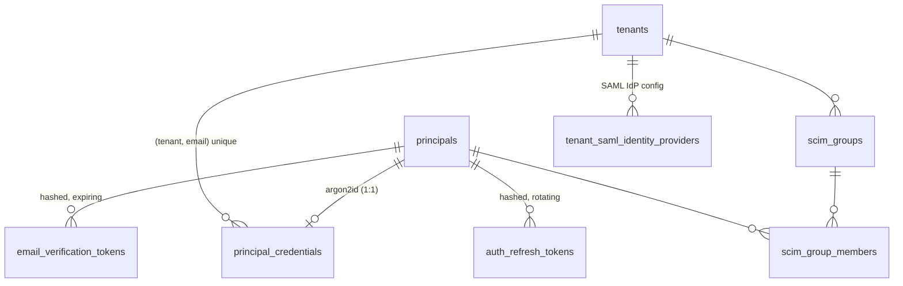

# doc-ray — Database ERD & Data Dictionary

**Schema version `1.52.0`** (SemVer) · 144 migrations applied

> Generated from the live schema by `scripts/gen_data_dictionary.py`. Do not edit by hand — re-run the generator.

## 1. Overview

**doc-ray** is a document-ingestion and NLP-corpus store on **PostgreSQL 16**
(with the **pgvector** and **pg_trgm** extensions) plus **MinIO/S3** for the
original bytes. A document is ingested (any of pdf/txt/md/html/epub/docx),
its text and metadata extracted, then annotated by real spaCy into the full
20-layer NLP stack. Everything queryable lives in Postgres; blobs never do.

**Design principles**

- **4NF normalization.** No arrays or JSON bags for independent multivalued
  facts — each becomes its own relation whose key determines a single value.
  Anything derivable is a view, not a stored column.
- **Stand-off annotation over a shared span registry.** Character offsets are
  a first-class entity (`spans`); every layer references a span by FK instead
  of repeating `(document_id, char_start, char_end)`.
- **Dual identity.** Top-level entities use `uuid` (`documents`, `spans`,
  `principals`); high-volume, time-ordered annotation rows use a **ULID**
  domain (Crockford base32, 26 chars) so `ORDER BY id` is time order.
- **Layer-aware runs.** An `annotations` row is one analyzer run over a
  document, scoped by `(layer, tool)`, so many tools/layers coexist without
  collision. Deleting a document cascades through the entire graph.
- **Document-level RBAC via RLS.** Access is decided per document and inherited
  by every document-scoped table through row-level-security policies.


## 2. Conventions

| Convention | Detail |
|---|---|
| `ulid` domain | `char(26)` matching `^[0-7][0-9A-HJKMNP-TV-Z]{25}$` (Crockford base32; excludes I/L/O/U). Sorts in creation-time order. |
| `uuid` ids | `gen_random_uuid()` defaults on top-level entities. |
| Content addressing | `content_sha256` / `text_sha256` dedupe + integrity; blob body is an `s3://` URI, never a row. |
| Offsets | Half-open `[char_start, char_end)` into `document_content.full_text`; owned by `spans`. |
| `ON DELETE` | Document-owned edges CASCADE (or SET NULL for advisory links); references to global dimensions (`lexemes`, `authors`, `tags`, `documents.derived_from`) do not. |
| Timestamps | `timestamptz`, default `now()`. |


## 3. Entity-Relationship Diagrams

_Rendered as Mermaid; attributes are catalogued in §5. Diagrams are grouped by domain for legibility (the full schema is one connected graph)._

### Document entity, 4NF satellites & provenance



### Segmentation, span registry & the annotation backbone



### Tokens, morphology & syntax



### Entities, reference, meaning, temporal & embeddings



### Canonical entities, resolution workflow & curation



### Jobs & operations



### Access control (RBAC) — decided per document, inherited via RLS



### Authentication & identity provisioning




## 4. Domains & enumerated types

- **domain `ulid`** = `character(26)` — `CHECK ((VALUE ~ '^[0-7][0-9A-HJKMNP-TV-Z]{25}$'::text))`
- **enum `provenance_kind`** ∈ { 'acquired', 'stored', 'extracted', 'decomposed', 'segmented', 'embedded', 'indexed', 'redacted', 'translated', 'superseded', 'annotated', 'vision_captioned' }


## 5. Data dictionary

### 5.1 Document entity & bibliographic identity

The document is a first-class entity. Independent multivalued facts (authors, tags, identifiers,
format metadata) are decomposed to their own relations (4NF); blobs live in object storage, only an
`s3://` pointer + sha256 are stored.

#### `documents`

| Column | Type | Null | Key | Default | Notes |
|---|---|---|---|---|---|
| `id` | uuid |  | PK | `gen_random_uuid()` |  |
| `title` | text |  |  |  |  |
| `doc_type` | text |  |  |  |  |
| `source_uri` | text |  |  |  |  |
| `content_sha256` | character(64) |  | UQ |  |  |
| `byte_size` | bigint |  |  |  |  |
| `page_count` | integer | yes |  |  |  |
| `status` | text |  |  | `'pending'::text` |  |
| `error` | text | yes |  |  |  |
| `created_at` | timestamp with time zone |  |  | `now()` |  |
| `updated_at` | timestamp with time zone |  |  | `now()` |  |
| `subtitle` | text | yes |  |  |  |
| `language` | text | yes |  |  |  |
| `publisher` | text | yes |  |  |  |
| `published_on` | date | yes |  |  |  |
| `license` | text | yes |  |  |  |
| `mime_type` | text | yes |  |  |  |
| `char_count` | integer | yes |  |  |  |
| `text_sha256` | character(64) | yes |  |  |  |
| `derived_from` | uuid | yes | FK→documents |  |  |
| `revision` | integer |  |  | `1` |  |
| `original_filename` | text | yes |  |  |  |
| `description` | text | yes |  |  |  |
| `lifecycle_state` | text |  |  | `'active'::text` |  |
| `archived_at` | timestamp with time zone | yes |  |  |  |
| `deleted_at` | timestamp with time zone | yes |  |  |  |
| `tenant_id` | uuid |  | FK→tenants | `docray_default_tenant_id()` |  |
| `owner_principal_id` | uuid | yes | FK→principals |  | Owning principal (the uploader). NULL = unowned: admin-only today, reserved for the org corpus. |
| `visibility` | text |  |  | `'private'::text` | private = owner/ACL/admin only; org = readable by every principal in the tenant. Default private. |
| `default_lens_id` | uuid | yes | FK→document_collections |  |  |

- **Primary key:** (id)
- **Unique:** UNIQUE (content_sha256)
- **FK:** FOREIGN KEY (default_lens_id) REFERENCES document_collections(id) ON DELETE SET NULL
- **FK:** FOREIGN KEY (derived_from) REFERENCES documents(id) ON DELETE SET NULL
- **FK:** FOREIGN KEY (owner_principal_id) REFERENCES principals(id) ON DELETE SET NULL
- **FK:** FOREIGN KEY (tenant_id) REFERENCES tenants(id)
- **Check:** CHECK ((lifecycle_state = ANY (ARRAY['active'::text, 'archived'::text, 'deleted'::text])))
- **Check:** CHECK ((((lifecycle_state = 'active'::text) AND (archived_at IS NULL) AND (deleted_at IS NULL)) OR ((lifecycle_state = 'archived'::text) AND (archived_at IS NOT NULL) AND (deleted_at IS NULL)) OR ((lifecycle_state = 'deleted'::text) AND (deleted_at IS NOT NULL))))
- **Check:** CHECK ((visibility = ANY (ARRAY['private'::text, 'org'::text])))
- **Index** `documents_content_sha256_key`: public.documents USING btree (content_sha256)
- **Index** `documents_owner_principal_idx`: public.documents USING btree (owner_principal_id) WHERE (owner_principal_id IS NOT NULL)
- **Index** `idx_documents_default_lens`: public.documents USING btree (default_lens_id) WHERE (default_lens_id IS NOT NULL)
- **Index** `idx_documents_derived_from`: public.documents USING btree (derived_from)
- **Index** `idx_documents_lifecycle_state`: public.documents USING btree (lifecycle_state, updated_at DESC)
- **Index** `idx_documents_status`: public.documents USING btree (status)
- **Index** `idx_documents_tenant`: public.documents USING btree (tenant_id)
- **Index** `idx_documents_type_created`: public.documents USING btree (doc_type, created_at DESC)
- **RLS:** enabled — read/write policies via *id (self)* (FORCED)

#### `document_content`

| Column | Type | Null | Key | Default | Notes |
|---|---|---|---|---|---|
| `document_id` | uuid |  | PK, FK→documents |  |  |
| `full_text` | text | yes |  |  |  |
| `fts` | tsvector | yes |  |  |  |

- **Primary key:** (document_id)
- **FK:** FOREIGN KEY (document_id) REFERENCES documents(id) ON DELETE CASCADE
- **Index** `idx_content_fts`: public.document_content USING gin (fts)
- **RLS:** enabled — read/write policies via *document_id* (FORCED)

#### `authors`

| Column | Type | Null | Key | Default | Notes |
|---|---|---|---|---|---|
| `id` | bigint |  | PK | `nextval('authors_id_seq'::regclass)` |  |
| `name` | text |  | UQ |  |  |

- **Primary key:** (id)
- **Unique:** UNIQUE (name)
- **Index** `authors_name_key`: public.authors USING btree (name)

#### `document_authors`

| Column | Type | Null | Key | Default | Notes |
|---|---|---|---|---|---|
| `document_id` | uuid |  | PK, FK→documents |  |  |
| `author_id` | bigint |  | PK, FK→authors |  |  |
| `position` | integer |  |  | `0` |  |

- **Primary key:** (document_id, author_id)
- **FK:** FOREIGN KEY (author_id) REFERENCES authors(id)
- **FK:** FOREIGN KEY (document_id) REFERENCES documents(id) ON DELETE CASCADE
- **Index** `idx_document_authors_author`: public.document_authors USING btree (author_id)
- **RLS:** enabled — read/write policies via *document_id* (FORCED)

#### `tags`

| Column | Type | Null | Key | Default | Notes |
|---|---|---|---|---|---|
| `id` | bigint |  | PK | `nextval('tags_id_seq'::regclass)` |  |
| `tag` | text |  | UQ |  |  |

- **Primary key:** (id)
- **Unique:** UNIQUE (tag)
- **Index** `tags_tag_key`: public.tags USING btree (tag)

#### `document_tags`

| Column | Type | Null | Key | Default | Notes |
|---|---|---|---|---|---|
| `document_id` | uuid |  | PK, FK→documents |  |  |
| `tag_id` | bigint |  | PK, FK→tags |  |  |

- **Primary key:** (document_id, tag_id)
- **FK:** FOREIGN KEY (document_id) REFERENCES documents(id) ON DELETE CASCADE
- **FK:** FOREIGN KEY (tag_id) REFERENCES tags(id)
- **Index** `idx_document_tags_tag`: public.document_tags USING btree (tag_id)
- **RLS:** enabled — read/write policies via *document_id* (FORCED)

#### `document_identifiers`

| Column | Type | Null | Key | Default | Notes |
|---|---|---|---|---|---|
| `document_id` | uuid |  | PK, FK→documents |  |  |
| `scheme` | text |  | PK |  |  |
| `value` | text |  | PK |  |  |

- **Primary key:** (document_id, scheme, value)
- **FK:** FOREIGN KEY (document_id) REFERENCES documents(id) ON DELETE CASCADE
- **RLS:** enabled — read/write policies via *document_id* (FORCED)

#### `document_metadata`

| Column | Type | Null | Key | Default | Notes |
|---|---|---|---|---|---|
| `document_id` | uuid |  | PK, FK→documents |  |  |
| `key` | text |  | PK |  |  |
| `value` | text |  |  |  |  |

- **Primary key:** (document_id, key)
- **FK:** FOREIGN KEY (document_id) REFERENCES documents(id) ON DELETE CASCADE
- **RLS:** enabled — read/write policies via *document_id* (FORCED)

#### `document_pages`

| Column | Type | Null | Key | Default | Notes |
|---|---|---|---|---|---|
| `id` | uuid |  | PK | `gen_random_uuid()` |  |
| `document_id` | uuid |  | FK→documents, UQ |  |  |
| `page_number` | integer |  | UQ |  |  |
| `page_width` | double precision |  |  |  |  |
| `page_height` | double precision |  |  |  |  |
| `has_text` | boolean |  |  | `false` |  |
| `text_run_count` | integer |  |  | `0` |  |

- **Primary key:** (id)
- **Unique:** UNIQUE (document_id, page_number)
- **FK:** FOREIGN KEY (document_id) REFERENCES documents(id) ON DELETE CASCADE
- **Check:** CHECK ((has_text OR (text_run_count = 0)))
- **Check:** CHECK (((NOT has_text) OR (text_run_count > 0)))
- **Check:** CHECK ((page_height > (0)::double precision))
- **Check:** CHECK ((page_number > 0))
- **Check:** CHECK ((page_width > (0)::double precision))
- **Check:** CHECK ((text_run_count >= 0))
- **Index** `document_pages_document_id_page_number_key`: public.document_pages USING btree (document_id, page_number)
- **Index** `idx_document_pages_document_page`: public.document_pages USING btree (document_id, page_number)
- **RLS:** enabled — read/write policies via *document_id* (FORCED)

#### `document_layout_runs`

| Column | Type | Null | Key | Default | Notes |
|---|---|---|---|---|---|
| `id` | uuid |  | PK | `gen_random_uuid()` |  |
| `document_id` | uuid |  | FK→documents, UQ |  |  |
| `ordinal` | integer |  | UQ |  |  |
| `page_number` | integer |  |  |  |  |
| `page_width` | double precision | yes |  |  |  |
| `page_height` | double precision | yes |  |  |  |
| `char_start` | integer |  |  |  |  |
| `char_end` | integer |  |  |  |  |
| `bbox_x0` | double precision |  |  |  |  |
| `bbox_y0` | double precision |  |  |  |  |
| `bbox_x1` | double precision |  |  |  |  |
| `bbox_y1` | double precision |  |  |  |  |
| `text` | text |  |  | `''::text` |  |

- **Primary key:** (id)
- **Unique:** UNIQUE (document_id, ordinal)
- **FK:** FOREIGN KEY (document_id) REFERENCES documents(id) ON DELETE CASCADE
- **Check:** CHECK ((char_end >= char_start))
- **Check:** CHECK ((bbox_x1 >= bbox_x0))
- **Check:** CHECK ((bbox_y1 >= bbox_y0))
- **Check:** CHECK (((page_height IS NULL) OR (page_height > (0)::double precision)))
- **Check:** CHECK ((page_number > 0))
- **Check:** CHECK (((page_width IS NULL) OR (page_width > (0)::double precision)))
- **Index** `document_layout_runs_document_id_ordinal_key`: public.document_layout_runs USING btree (document_id, ordinal)
- **Index** `idx_document_layout_runs_document_page`: public.document_layout_runs USING btree (document_id, page_number, ordinal)
- **Index** `idx_document_layout_runs_document_range`: public.document_layout_runs USING btree (document_id, char_start, char_end)
- **RLS:** enabled — read/write policies via *document_id* (FORCED)

### 5.2 Provenance (append-only lineage)

Every processing/lineage event on a document, with its parameters normalized out of a JSON bag into
`(event, key) -> value`. `document_metadata_history` is the analogous append-only trail for editable
title/description/tags edits (BL-058) — a distinct concern from pipeline/ingest events, RLS-scoped
and read-granted the same way.

#### `document_provenance`

| Column | Type | Null | Key | Default | Notes |
|---|---|---|---|---|---|
| `id` | ulid |  | PK |  |  |
| `document_id` | uuid |  | FK→documents |  |  |
| `kind` | provenance_kind |  |  |  |  |
| `tool` | text | yes |  |  |  |
| `tool_version` | text | yes |  |  |  |
| `occurred_at` | timestamp with time zone |  |  | `now()` |  |
| `actor` | text | yes |  |  |  |
| `input_sha256` | character(64) | yes |  |  |  |
| `output_sha256` | character(64) | yes |  |  |  |
| `note` | text | yes |  |  |  |
| `actor_principal_id` | uuid | yes | FK→principals |  |  |

- **Primary key:** (id)
- **FK:** FOREIGN KEY (actor_principal_id) REFERENCES principals(id) ON DELETE SET NULL
- **FK:** FOREIGN KEY (document_id) REFERENCES documents(id) ON DELETE CASCADE
- **Index** `idx_provenance_doc`: public.document_provenance USING btree (document_id, id)
- **Index** `idx_provenance_kind`: public.document_provenance USING btree (kind)
- **RLS:** enabled — read/write policies via *document_id* (FORCED)

#### `provenance_params`

| Column | Type | Null | Key | Default | Notes |
|---|---|---|---|---|---|
| `event_id` | ulid |  | PK, FK→document_provenance |  |  |
| `key` | text |  | PK |  |  |
| `value` | text |  |  |  |  |

- **Primary key:** (event_id, key)
- **FK:** FOREIGN KEY (event_id) REFERENCES document_provenance(id) ON DELETE CASCADE
- **RLS:** enabled — read/write policies via *event_id → document_provenance* (FORCED)

#### `document_metadata_history`

| Column | Type | Null | Key | Default | Notes |
|---|---|---|---|---|---|
| `id` | ulid |  | PK |  |  |
| `document_id` | uuid |  | FK→documents |  |  |
| `field` | text |  |  |  |  |
| `old_value` | text | yes |  |  |  |
| `new_value` | text | yes |  |  |  |
| `changed_at` | timestamp with time zone |  |  | `now()` |  |
| `actor` | text | yes |  |  |  |
| `actor_principal_id` | uuid | yes | FK→principals |  |  |

- **Primary key:** (id)
- **FK:** FOREIGN KEY (actor_principal_id) REFERENCES principals(id) ON DELETE SET NULL
- **FK:** FOREIGN KEY (document_id) REFERENCES documents(id) ON DELETE CASCADE
- **Check:** CHECK ((field = ANY (ARRAY['title'::text, 'description'::text, 'tags'::text, 'authors'::text, 'lifecycle_state'::text])))
- **Index** `idx_metadata_history_doc`: public.document_metadata_history USING btree (document_id, id)
- **RLS:** enabled — read/write policies via *document_id* (FORCED)

### 5.3 Segmentation & the span registry

Character offsets are a first-class, addressable entity (`spans`); every stand-off annotation
references a span by FK rather than repeating offset triples. Sentences are ULID-keyed and reference
a span.

#### `spans`

| Column | Type | Null | Key | Default | Notes |
|---|---|---|---|---|---|
| `id` | uuid |  | PK | `gen_random_uuid()` |  |
| `document_id` | uuid |  | FK→documents, UQ |  |  |
| `char_start` | integer |  | UQ |  |  |
| `char_end` | integer |  | UQ |  |  |
| `page_number` | integer | yes |  |  |  |
| `bbox_x0` | double precision | yes |  |  |  |
| `bbox_y0` | double precision | yes |  |  |  |
| `bbox_x1` | double precision | yes |  |  |  |
| `bbox_y1` | double precision | yes |  |  |  |

- **Primary key:** (id)
- **Unique:** UNIQUE (document_id, char_start, char_end)
- **FK:** FOREIGN KEY (document_id) REFERENCES documents(id) ON DELETE CASCADE
- **Check:** CHECK ((char_end >= char_start))
- **Check:** CHECK ((((page_number IS NULL) AND (bbox_x0 IS NULL) AND (bbox_y0 IS NULL) AND (bbox_x1 IS NULL) AND (bbox_y1 IS NULL)) OR ((page_number > 0) AND (bbox_x0 IS NOT NULL) AND (bbox_y0 IS NOT NULL) AND (bbox_x1 IS NOT NULL) AND (bbox_y1 IS NOT NULL) AND (bbox_x1 >= bbox_x0) AND (bbox_y1 >= bbox_y0)))) NOT VALID
- **Index** `idx_spans_document_page`: public.spans USING btree (document_id, page_number, char_start) WHERE (page_number IS NOT NULL)
- **Index** `spans_document_id_char_start_char_end_key`: public.spans USING btree (document_id, char_start, char_end)
- **RLS:** enabled — read/write policies via *document_id* (FORCED)

#### `sentences`

| Column | Type | Null | Key | Default | Notes |
|---|---|---|---|---|---|
| `id` | ulid |  | PK |  |  |
| `document_id` | uuid |  | FK→documents, UQ |  |  |
| `ordinal` | integer |  | UQ |  |  |
| `text` | text |  |  |  |  |
| `created_at` | timestamp with time zone |  |  | `now()` |  |
| `span_id` | uuid |  | FK→spans |  |  |

- **Primary key:** (id)
- **Unique:** UNIQUE (document_id, ordinal)
- **FK:** FOREIGN KEY (document_id) REFERENCES documents(id) ON DELETE CASCADE
- **FK:** FOREIGN KEY (span_id) REFERENCES spans(id) ON DELETE CASCADE
- **Index** `idx_sentences_document`: public.sentences USING btree (document_id, ordinal)
- **Index** `idx_sentences_span`: public.sentences USING btree (span_id)
- **Index** `idx_sentences_text_trgm`: public.sentences USING gin (text gin_trgm_ops)
- **Index** `sentences_document_id_ordinal_key`: public.sentences USING btree (document_id, ordinal)
- **RLS:** enabled — read/write policies via *document_id* (FORCED)

### 5.4 Lexeme & annotation backbone

`lexemes` is analyzer-independent type identity; `annotations` is one analyzer run over a document
scoped by `(layer, tool)`; `lexeme_occurrences` is the materialized projection of token-level lexeme
links that the webapp/API render for lexeme and KWIC reads.

#### `lexemes`

| Column | Type | Null | Key | Default | Notes |
|---|---|---|---|---|---|
| `uid` | text |  | PK |  |  |
| `lang` | text |  | UQ |  |  |
| `pos` | text |  | UQ |  |  |
| `lemma` | text |  | UQ |  |  |

- **Primary key:** (uid)
- **Unique:** UNIQUE (lang, pos, lemma)
- **Index** `idx_lexemes_lang_pos`: public.lexemes USING btree (lang, pos)
- **Index** `idx_lexemes_lemma_trgm`: public.lexemes USING gin (lemma gin_trgm_ops)
- **Index** `lexemes_lang_pos_lemma_key`: public.lexemes USING btree (lang, pos, lemma)

#### `annotations`

| Column | Type | Null | Key | Default | Notes |
|---|---|---|---|---|---|
| `id` | ulid |  | PK |  |  |
| `document_id` | uuid |  | FK→documents, UQ |  |  |
| `created_at` | timestamp with time zone |  |  | `now()` |  |
| `layer` | text |  | UQ |  |  |
| `tool` | text |  | UQ |  |  |
| `tool_version` | text | yes |  |  |  |

- **Primary key:** (id)
- **Unique:** UNIQUE (document_id, layer, tool)
- **FK:** FOREIGN KEY (document_id) REFERENCES documents(id) ON DELETE CASCADE
- **Index** `annotations_doc_layer_tool_key`: public.annotations USING btree (document_id, layer, tool)
- **RLS:** enabled — read/write policies via *document_id* (FORCED)

#### `lexeme_occurrences`

| Column | Type | Null | Key | Default | Notes |
|---|---|---|---|---|---|
| `annotation_id` | ulid |  | PK, FK→annotations |  |  |
| `lexeme_uid` | text |  | FK→lexemes |  |  |
| `span_id` | uuid |  | PK, FK→spans |  |  |

- **Primary key:** (annotation_id, span_id)
- **FK:** FOREIGN KEY (annotation_id) REFERENCES annotations(id) ON DELETE CASCADE
- **FK:** FOREIGN KEY (lexeme_uid) REFERENCES lexemes(uid)
- **FK:** FOREIGN KEY (span_id) REFERENCES spans(id) ON DELETE CASCADE
- **Index** `idx_lexeme_occurrences_span`: public.lexeme_occurrences USING btree (span_id)
- **Index** `idx_occ_lexeme`: public.lexeme_occurrences USING btree (lexeme_uid)
- **RLS:** enabled — read/write policies via *annotation_id → annotations* (FORCED)

### 5.5 Tokens, morphology & subwords (NLP layers 3–7)

The token is the addressable unit syntax/morphology reference. UD FEATS and BPE/WordPiece pieces
decompose into child relations (no arrays, no pipe-strings).

#### `tokens`

| Column | Type | Null | Key | Default | Notes |
|---|---|---|---|---|---|
| `id` | ulid |  | PK |  |  |
| `annotation_id` | ulid |  | FK→annotations, UQ |  |  |
| `span_id` | uuid |  | FK→spans, UQ |  |  |
| `sentence_id` | ulid | yes | FK→sentences |  |  |
| `ordinal` | integer |  |  |  |  |
| `lexeme_uid` | text | yes | FK→lexemes |  | Optional link to the analyzer-independent lexeme (type layer). NULL for tokens with no lemma/lexeme (punctuation, symbols, whitespace). |
| `upos` | text | yes |  |  | Universal POS — authoritative token-level POS. Present for every token, including lexeme-less ones (PUNCT/SYM/SPACE). When lexeme_uid is set, it equals lexemes.pos; the annotator maintains this agreement. |
| `xpos` | text | yes |  |  |  |

- **Primary key:** (id)
- **Unique:** UNIQUE (annotation_id, span_id)
- **FK:** FOREIGN KEY (annotation_id) REFERENCES annotations(id) ON DELETE CASCADE
- **FK:** FOREIGN KEY (lexeme_uid) REFERENCES lexemes(uid)
- **FK:** FOREIGN KEY (sentence_id) REFERENCES sentences(id) ON DELETE SET NULL
- **FK:** FOREIGN KEY (span_id) REFERENCES spans(id) ON DELETE CASCADE
- **Index** `idx_tokens_annotation`: public.tokens USING btree (annotation_id, ordinal)
- **Index** `idx_tokens_lexeme`: public.tokens USING btree (lexeme_uid)
- **Index** `idx_tokens_sentence`: public.tokens USING btree (sentence_id)
- **Index** `idx_tokens_span`: public.tokens USING btree (span_id)
- **Index** `tokens_annotation_id_span_id_key`: public.tokens USING btree (annotation_id, span_id)
- **RLS:** enabled — read/write policies via *annotation_id → annotations* (FORCED)

#### `token_feature`

| Column | Type | Null | Key | Default | Notes |
|---|---|---|---|---|---|
| `token_id` | ulid |  | PK, FK→tokens |  |  |
| `feature` | text |  | PK |  |  |
| `value` | text |  |  |  |  |

- **Primary key:** (token_id, feature)
- **FK:** FOREIGN KEY (token_id) REFERENCES tokens(id) ON DELETE CASCADE
- **RLS:** enabled — read/write policies via *token_id → tokens → annotations* (FORCED)

#### `subword`

| Column | Type | Null | Key | Default | Notes |
|---|---|---|---|---|---|
| `token_id` | ulid |  | PK, FK→tokens |  |  |
| `position` | integer |  | PK |  |  |
| `piece` | text |  |  |  |  |

- **Primary key:** (token_id, "position")
- **FK:** FOREIGN KEY (token_id) REFERENCES tokens(id) ON DELETE CASCADE
- **RLS:** enabled — read/write policies via *token_id → tokens → annotations* (FORCED)

### 5.6 Syntax — shallow & deep (layers 8–10)

Chunking (BIO collapsed to spans), constituency (adjacency-list tree), and dependency (each token
has exactly one head → a function).

#### `chunk`

| Column | Type | Null | Key | Default | Notes |
|---|---|---|---|---|---|
| `id` | ulid |  | PK |  |  |
| `annotation_id` | ulid |  | FK→annotations |  |  |
| `span_id` | uuid |  | FK→spans |  |  |
| `chunk_type` | text |  |  |  |  |
| `surface` | text |  |  |  |  |

- **Primary key:** (id)
- **FK:** FOREIGN KEY (annotation_id) REFERENCES annotations(id) ON DELETE CASCADE
- **FK:** FOREIGN KEY (span_id) REFERENCES spans(id) ON DELETE CASCADE
- **Index** `idx_chunk_annotation`: public.chunk USING btree (annotation_id)
- **Index** `idx_chunk_span`: public.chunk USING btree (span_id)
- **RLS:** enabled — read/write policies via *annotation_id → annotations* (FORCED)

#### `constituent`

| Column | Type | Null | Key | Default | Notes |
|---|---|---|---|---|---|
| `id` | ulid |  | PK |  |  |
| `annotation_id` | ulid |  | FK→annotations |  |  |
| `parent_id` | ulid | yes | FK→constituent |  |  |
| `label` | text |  |  |  |  |
| `span_id` | uuid | yes | FK→spans |  |  |

- **Primary key:** (id)
- **FK:** FOREIGN KEY (annotation_id) REFERENCES annotations(id) ON DELETE CASCADE
- **FK:** FOREIGN KEY (parent_id) REFERENCES constituent(id) ON DELETE CASCADE
- **FK:** FOREIGN KEY (span_id) REFERENCES spans(id) ON DELETE CASCADE
- **Index** `idx_constituent_annotation`: public.constituent USING btree (annotation_id)
- **Index** `idx_constituent_parent`: public.constituent USING btree (parent_id)
- **Index** `idx_constituent_span`: public.constituent USING btree (span_id)
- **RLS:** enabled — read/write policies via *annotation_id → annotations* (FORCED)

#### `dependency`

| Column | Type | Null | Key | Default | Notes |
|---|---|---|---|---|---|
| `annotation_id` | ulid |  | PK, FK→annotations |  |  |
| `dependent_token_id` | ulid |  | PK, FK→tokens |  |  |
| `head_token_id` | ulid | yes | FK→tokens |  |  |
| `deprel` | text |  |  |  |  |

- **Primary key:** (annotation_id, dependent_token_id)
- **FK:** FOREIGN KEY (annotation_id) REFERENCES annotations(id) ON DELETE CASCADE
- **FK:** FOREIGN KEY (dependent_token_id) REFERENCES tokens(id) ON DELETE CASCADE
- **FK:** FOREIGN KEY (head_token_id) REFERENCES tokens(id) ON DELETE SET NULL
- **Index** `idx_dependency_dependent`: public.dependency USING btree (dependent_token_id)
- **Index** `idx_dependency_head`: public.dependency USING btree (head_token_id)
- **RLS:** enabled — read/write policies via *annotation_id → annotations* (FORCED)

### 5.7 Entities & reference (layers 11–13)

Named-entity mentions, entity linking to a KB, and coreference chains. `entity_mention` is rebuilt
from scratch by every annotate run, so human fixes live in `entity_mention_correction` — keyed by a
stable span, re-applied by the pipeline on each pass (Block A).

#### `entity_mention`

| Column | Type | Null | Key | Default | Notes |
|---|---|---|---|---|---|
| `id` | ulid |  | PK |  |  |
| `annotation_id` | ulid |  | FK→annotations |  |  |
| `span_id` | uuid |  | FK→spans |  |  |
| `entity_type` | text |  |  |  |  |
| `surface` | text |  |  |  |  |
| `confidence` | real | yes |  |  | Explainable review triage rank, not a calibrated probability; lower is reviewed first. |
| `confidence_method` | text | yes |  |  | Producer of confidence, currently heuristic:v1; reserved for future model:<name> scores. |
| `confidence_reasons` | text[] |  |  | `'{}'::text[]` | Deterministic human-readable reasons that must accompany the confidence value. |

- **Primary key:** (id)
- **FK:** FOREIGN KEY (annotation_id) REFERENCES annotations(id) ON DELETE CASCADE
- **FK:** FOREIGN KEY (span_id) REFERENCES spans(id) ON DELETE CASCADE
- **Check:** CHECK (((confidence >= (0)::double precision) AND (confidence <= (1)::double precision)))
- **Index** `idx_entity_mention_annotation`: public.entity_mention USING btree (annotation_id)
- **Index** `idx_entity_mention_annotation_confidence`: public.entity_mention USING btree (annotation_id, confidence, id) WHERE (confidence IS NOT NULL)
- **Index** `idx_entity_mention_span`: public.entity_mention USING btree (span_id)
- **Index** `idx_entity_mention_type_surface`: public.entity_mention USING btree (entity_type, surface)
- **RLS:** enabled — read/write policies via *annotation_id → annotations* (FORCED)

#### `entity_mention_correction`

| Column | Type | Null | Key | Default | Notes |
|---|---|---|---|---|---|
| `id` | uuid |  | PK | `gen_random_uuid()` |  |
| `document_id` | uuid |  | FK→documents |  |  |
| `action` | text |  |  |  |  |
| `char_start` | integer | yes |  |  |  |
| `char_end` | integer | yes |  |  |  |
| `entity_type` | text | yes |  |  |  |
| `surface` | text | yes |  |  |  |
| `new_char_start` | integer | yes |  |  |  |
| `new_char_end` | integer | yes |  |  |  |
| `original_type` | text | yes |  |  |  |
| `rationale` | text | yes |  |  |  |
| `reviewer` | uuid | yes | FK→principals |  |  |
| `created_at` | timestamp with time zone |  |  | `now()` |  |
| `surface_original_type` | text | yes |  |  | Mandatory current-type matcher for exact surface rules; NULL for span actions. |

- **Primary key:** (id)
- **FK:** FOREIGN KEY (document_id) REFERENCES documents(id) ON DELETE CASCADE
- **FK:** FOREIGN KEY (reviewer) REFERENCES principals(id) ON DELETE SET NULL
- **Check:** CHECK (((action <> 'add'::text) OR (entity_type IS NOT NULL)))
- **Check:** CHECK (((action <> 'adjust_span'::text) OR ((new_char_start IS NOT NULL) AND (new_char_end IS NOT NULL) AND (new_char_end >= new_char_start))))
- **Check:** CHECK (((action <> 'reclassify_surface'::text) OR ((entity_type IS NOT NULL) AND (entity_type <> surface_original_type))))
- **Check:** CHECK (((action <> 'reclassify'::text) OR (entity_type IS NOT NULL)))
- **Check:** CHECK ((((action = ANY (ARRAY['reclassify'::text, 'reject'::text, 'add'::text, 'adjust_span'::text])) AND (char_start IS NOT NULL) AND (char_end IS NOT NULL)) OR ((action = ANY (ARRAY['reclassify_surface'::text, 'reject_surface'::text])) AND (char_start IS NULL) AND (char_end IS NULL) AND (surface IS NOT NULL) AND (btrim(surface) <> ''::text) AND (surface_original_type IS NOT NULL) AND (btrim(surface_original_type) <> ''::text))))
- **Check:** CHECK ((action = ANY (ARRAY['reclassify'::text, 'reject'::text, 'add'::text, 'adjust_span'::text, 'reclassify_surface'::text, 'reject_surface'::text])))
- **Check:** CHECK ((char_end >= char_start))
- **Index** `idx_em_correction_doc_span`: public.entity_mention_correction USING btree (document_id, char_start, char_end, created_at DESC)
- **Index** `idx_em_correction_doc_surface`: public.entity_mention_correction USING btree (document_id, surface, surface_original_type, created_at, id) WHERE (action = ANY (ARRAY['reclassify_surface'::text, 'reject_surface'::text]))
- **RLS:** enabled — read/write policies via *document_id* (FORCED)

#### `entity_link`

| Column | Type | Null | Key | Default | Notes |
|---|---|---|---|---|---|
| `mention_id` | ulid |  | PK, FK→entity_mention |  |  |
| `scheme` | text |  | PK |  |  |
| `kb_id` | text |  |  |  |  |
| `confidence` | real | yes |  |  |  |

- **Primary key:** (mention_id, scheme)
- **FK:** FOREIGN KEY (mention_id) REFERENCES entity_mention(id) ON DELETE CASCADE
- **RLS:** enabled — read/write policies via *mention_id → entity_mention → annotations* (FORCED)

#### `coref_chain`

| Column | Type | Null | Key | Default | Notes |
|---|---|---|---|---|---|
| `id` | ulid |  | PK |  |  |
| `annotation_id` | ulid |  | FK→annotations |  |  |
| `document_id` | uuid |  | FK→documents |  |  |

- **Primary key:** (id)
- **FK:** FOREIGN KEY (annotation_id) REFERENCES annotations(id) ON DELETE CASCADE
- **FK:** FOREIGN KEY (document_id) REFERENCES documents(id) ON DELETE CASCADE
- **Index** `idx_coref_chain_annotation`: public.coref_chain USING btree (annotation_id)
- **Index** `idx_coref_chain_document`: public.coref_chain USING btree (document_id)
- **RLS:** enabled — read/write policies via *document_id* (FORCED)

#### `coref_mention`

| Column | Type | Null | Key | Default | Notes |
|---|---|---|---|---|---|
| `chain_id` | ulid |  | PK, FK→coref_chain |  |  |
| `span_id` | uuid |  | PK, FK→spans |  |  |

- **Primary key:** (chain_id, span_id)
- **FK:** FOREIGN KEY (chain_id) REFERENCES coref_chain(id) ON DELETE CASCADE
- **FK:** FOREIGN KEY (span_id) REFERENCES spans(id) ON DELETE CASCADE
- **Index** `idx_coref_mention_span`: public.coref_mention USING btree (span_id)
- **RLS:** enabled — read/write policies via *span_id → spans* (FORCED)

### 5.8 Genre classification (SLP Block C)

A document's genre axis — fiction / non_fiction / mixed / unknown — orthogonal to its file format
(`documents.doc_type`). A heuristic classifier writes a `pending` guess; a human confirms it
(`method='human'`). This is the input to the per-entity-type resolution policy
(`doc_ray.domain.genre_policy`): fictional types resolve inside the work's lens, real-world types
globally. The policy is defined here; Block D (#8) applies it.

#### `document_classification`

| Column | Type | Null | Key | Default | Notes |
|---|---|---|---|---|---|
| `document_id` | uuid |  | PK, FK→documents |  |  |
| `genre` | text |  |  |  |  |
| `subtype` | text | yes |  |  |  |
| `confidence` | real | yes |  |  |  |
| `method` | text |  |  |  |  |
| `status` | text |  |  | `'pending'::text` |  |
| `reviewer` | uuid | yes | FK→principals |  |  |
| `rationale` | text | yes |  |  |  |
| `created_at` | timestamp with time zone |  |  | `now()` |  |
| `updated_at` | timestamp with time zone |  |  | `now()` |  |

- **Primary key:** (document_id)
- **FK:** FOREIGN KEY (document_id) REFERENCES documents(id) ON DELETE CASCADE
- **FK:** FOREIGN KEY (reviewer) REFERENCES principals(id) ON DELETE SET NULL
- **Check:** CHECK (((confidence >= (0)::double precision) AND (confidence <= (1)::double precision)))
- **Check:** CHECK ((genre = ANY (ARRAY['fiction'::text, 'non_fiction'::text, 'mixed'::text, 'unknown'::text])))
- **Check:** CHECK ((status = ANY (ARRAY['pending'::text, 'confirmed'::text, 'rejected'::text])))
- **RLS:** enabled — read/write policies via *document_id* (FORCED)

### 5.9 Projection engine (SLP Block D)

Lens-scoped entity identity as a derived, refreshable view: `entity_projection` is one row per
(mention, projecting lens) holding `project(mention, lens)` — `scope` local/global, a nullable
`canonical_id` (NULL = explicitly unresolved), and a `proposed`/`confirmed`/`rejected` review
status. `lens_local_entity` is the stable registry that mints one `canonical` row per (lens,
surface, type) so a rebuild is reproducible; `entity_projection_review` records human confirm/reject
keyed by the stable span (survives re-annotation). A lens projects only when
`document_collections.projects` is set (FR-2 designation). All are derived from the substrate + lens
+ policy and never mutate it (invariants 1–2). The per-lens entity landscape lives in the Block F
rollups.

#### `entity_projection`

| Column | Type | Null | Key | Default | Notes |
|---|---|---|---|---|---|
| `mention_id` | ulid |  | PK, FK→entity_mention |  |  |
| `lens_id` | uuid |  | PK, FK→document_collections |  |  |
| `document_id` | uuid |  | FK→documents |  |  |
| `canonical_id` | bigint | yes | FK→canonical |  |  |
| `scope` | text |  |  |  |  |
| `confidence` | real | yes |  |  |  |
| `method` | text |  |  |  |  |
| `status` | text |  |  | `'proposed'::text` |  |
| `refreshed_at` | timestamp with time zone |  |  | `now()` |  |

- **Primary key:** (mention_id, lens_id)
- **FK:** FOREIGN KEY (canonical_id) REFERENCES canonical(id) ON DELETE SET NULL
- **FK:** FOREIGN KEY (document_id) REFERENCES documents(id) ON DELETE CASCADE
- **FK:** FOREIGN KEY (lens_id) REFERENCES document_collections(id) ON DELETE CASCADE
- **FK:** FOREIGN KEY (mention_id) REFERENCES entity_mention(id) ON DELETE CASCADE
- **Check:** CHECK (((confidence >= (0)::double precision) AND (confidence <= (1)::double precision)))
- **Check:** CHECK ((scope = ANY (ARRAY['local'::text, 'global'::text])))
- **Check:** CHECK ((status = ANY (ARRAY['proposed'::text, 'confirmed'::text, 'rejected'::text])))
- **Index** `idx_entity_projection_document_lens`: public.entity_projection USING btree (document_id, lens_id)
- **Index** `idx_entity_projection_lens_canonical`: public.entity_projection USING btree (lens_id, canonical_id)
- **RLS:** enabled — read/write policies via *document_id* (FORCED)

#### `lens_local_entity`

| Column | Type | Null | Key | Default | Notes |
|---|---|---|---|---|---|
| `lens_id` | uuid |  | PK, FK→document_collections |  |  |
| `surface_norm` | text |  | PK |  |  |
| `entity_type` | text |  | PK |  |  |
| `canonical_id` | bigint |  | FK→canonical |  |  |
| `created_at` | timestamp with time zone |  |  | `now()` |  |

- **Primary key:** (lens_id, surface_norm, entity_type)
- **FK:** FOREIGN KEY (canonical_id) REFERENCES canonical(id) ON DELETE CASCADE
- **FK:** FOREIGN KEY (lens_id) REFERENCES document_collections(id) ON DELETE CASCADE
- **Index** `idx_lens_local_entity_canonical`: public.lens_local_entity USING btree (canonical_id)
- **RLS:** enabled — read/write policies via *admin-only (batch-owned local-identity registry)* (FORCED)

#### `entity_projection_review`

| Column | Type | Null | Key | Default | Notes |
|---|---|---|---|---|---|
| `id` | uuid |  | PK | `gen_random_uuid()` |  |
| `document_id` | uuid |  | FK→documents |  |  |
| `lens_id` | uuid |  | FK→document_collections |  |  |
| `char_start` | integer |  |  |  |  |
| `char_end` | integer |  |  |  |  |
| `entity_type` | text |  |  |  |  |
| `decision` | text |  |  |  |  |
| `reviewer` | uuid | yes | FK→principals |  |  |
| `rationale` | text | yes |  |  |  |
| `created_at` | timestamp with time zone |  |  | `now()` |  |

- **Primary key:** (id)
- **FK:** FOREIGN KEY (document_id) REFERENCES documents(id) ON DELETE CASCADE
- **FK:** FOREIGN KEY (lens_id) REFERENCES document_collections(id) ON DELETE CASCADE
- **FK:** FOREIGN KEY (reviewer) REFERENCES principals(id) ON DELETE SET NULL
- **Check:** CHECK ((char_end >= char_start))
- **Check:** CHECK ((decision = ANY (ARRAY['confirmed'::text, 'rejected'::text])))
- **Index** `idx_epr_doc_lens_span`: public.entity_projection_review USING btree (document_id, lens_id, char_start, char_end, created_at DESC)
- **RLS:** enabled — read/write policies via *document_id* (FORCED)

### 5.10 Hyper-context rollups (SLP Block F)

Corpus-wide sensemaking precomputed from the projections (D-024 — never a live aggregate on a read
path): `lens_entity_rollup` is a lens's significant entities with mention/document volume, the
observed type profile + consistency, and the first-seen sentence ordinal (it supersedes the thin
Block-D lens_entity_stats and backs `lensEntities`); `lens_entity_relation` is undirected sentence-
level co-occurrence pairs (stored once, `from < to`) with an NPMI strength (Bouma 2009) — a
structural association measure, never a claim of a real relationship. Refreshed by a job that
strictly follows the projection refresh; bounded N-hop discovery traverses these edges (hop cap 3).
RLS scopes both by lens visibility.

#### `lens_entity_rollup`

| Column | Type | Null | Key | Default | Notes |
|---|---|---|---|---|---|
| `lens_id` | uuid |  | PK, FK→document_collections |  |  |
| `canonical_id` | bigint |  | PK, FK→canonical |  |  |
| `scope` | text |  |  |  |  |
| `mention_count` | integer |  |  |  |  |
| `document_count` | integer |  |  |  |  |
| `type_profile` | jsonb |  |  |  |  |
| `type_consistency` | real | yes |  |  |  |
| `first_seen_ordinal` | integer | yes |  |  |  |
| `refreshed_at` | timestamp with time zone |  |  | `now()` |  |

- **Primary key:** (lens_id, canonical_id)
- **FK:** FOREIGN KEY (canonical_id) REFERENCES canonical(id) ON DELETE CASCADE
- **FK:** FOREIGN KEY (lens_id) REFERENCES document_collections(id) ON DELETE CASCADE
- **Check:** CHECK ((scope = ANY (ARRAY['local'::text, 'global'::text])))
- **Index** `idx_lens_entity_rollup_rank`: public.lens_entity_rollup USING btree (lens_id, mention_count DESC, canonical_id)
- **RLS:** enabled — read/write policies via *lens_id → document_collection_members → documents* (FORCED)

#### `lens_entity_relation`

| Column | Type | Null | Key | Default | Notes |
|---|---|---|---|---|---|
| `lens_id` | uuid |  | PK, FK→document_collections |  |  |
| `from_canonical_id` | bigint |  | PK, FK→canonical |  |  |
| `to_canonical_id` | bigint |  | PK, FK→canonical |  |  |
| `cooccurrence_count` | integer |  |  |  |  |
| `strength` | real |  |  |  |  |
| `refreshed_at` | timestamp with time zone |  |  | `now()` |  |

- **Primary key:** (lens_id, from_canonical_id, to_canonical_id)
- **FK:** FOREIGN KEY (from_canonical_id) REFERENCES canonical(id) ON DELETE CASCADE
- **FK:** FOREIGN KEY (lens_id) REFERENCES document_collections(id) ON DELETE CASCADE
- **FK:** FOREIGN KEY (to_canonical_id) REFERENCES canonical(id) ON DELETE CASCADE
- **Check:** CHECK ((from_canonical_id < to_canonical_id))
- **Index** `idx_lens_relation_from`: public.lens_entity_relation USING btree (lens_id, from_canonical_id, strength DESC)
- **Index** `idx_lens_relation_to`: public.lens_entity_relation USING btree (lens_id, to_canonical_id, strength DESC)
- **RLS:** enabled — read/write policies via *lens_id → document_collection_members → documents* (FORCED)

### 5.11 Allusion edges (SLP Block E)

Typed, directional cross-lens links that record a relationship without asserting identity:
`entity_allusion` says one entity *alludes to / depicts / references / is adapted from / inspired
by* another (e.g. a novel's Paris → the real Paris) across lenses, carrying a confidence, method,
review status, and evidence document. An edge changes NOTHING about projection or canonical identity
(invariant 2) and is never transitive. A curation table the API writes directly (docray_client);
machine-proposed edges land `proposed` for review. Its RLS is cross-lens: an edge is visible only
when the caller can see BOTH endpoint lenses and the evidence document, so it never reveals an
entity in an unreadable lens.

#### `entity_allusion`

| Column | Type | Null | Key | Default | Notes |
|---|---|---|---|---|---|
| `id` | uuid |  | PK | `gen_random_uuid()` |  |
| `from_canonical_id` | bigint |  | FK→canonical, UQ |  |  |
| `from_lens_id` | uuid |  | FK→document_collections, UQ |  |  |
| `to_canonical_id` | bigint |  | FK→canonical, UQ |  |  |
| `to_lens_id` | uuid |  | FK→document_collections, UQ |  |  |
| `edge_type` | text |  | UQ |  |  |
| `confidence` | real | yes |  |  |  |
| `method` | text |  |  |  |  |
| `status` | text |  |  | `'proposed'::text` |  |
| `reviewer` | uuid | yes | FK→principals |  |  |
| `rationale` | text | yes |  |  |  |
| `evidence_document_id` | uuid | yes | FK→documents |  |  |
| `created_at` | timestamp with time zone |  |  | `now()` |  |

- **Primary key:** (id)
- **Unique:** UNIQUE (from_canonical_id, from_lens_id, to_canonical_id, to_lens_id, edge_type)
- **FK:** FOREIGN KEY (evidence_document_id) REFERENCES documents(id) ON DELETE SET NULL
- **FK:** FOREIGN KEY (from_canonical_id) REFERENCES canonical(id) ON DELETE CASCADE
- **FK:** FOREIGN KEY (from_lens_id) REFERENCES document_collections(id) ON DELETE CASCADE
- **FK:** FOREIGN KEY (reviewer) REFERENCES principals(id) ON DELETE SET NULL
- **FK:** FOREIGN KEY (to_canonical_id) REFERENCES canonical(id) ON DELETE CASCADE
- **FK:** FOREIGN KEY (to_lens_id) REFERENCES document_collections(id) ON DELETE CASCADE
- **Check:** CHECK (((from_canonical_id <> to_canonical_id) OR (from_lens_id <> to_lens_id)))
- **Check:** CHECK (((confidence >= (0)::double precision) AND (confidence <= (1)::double precision)))
- **Check:** CHECK ((edge_type = ANY (ARRAY['alludes_to'::text, 'depicts'::text, 'references'::text, 'adapted_from'::text, 'inspired_by'::text])))
- **Check:** CHECK ((status = ANY (ARRAY['proposed'::text, 'confirmed'::text, 'rejected'::text])))
- **Index** `entity_allusion_from_canonical_id_from_lens_id_to_canonical_key`: public.entity_allusion USING btree (from_canonical_id, from_lens_id, to_canonical_id, to_lens_id, edge_type)
- **Index** `idx_entity_allusion_evidence`: public.entity_allusion USING btree (evidence_document_id) WHERE (evidence_document_id IS NOT NULL)
- **Index** `idx_entity_allusion_from`: public.entity_allusion USING btree (from_canonical_id, from_lens_id)
- **Index** `idx_entity_allusion_to`: public.entity_allusion USING btree (to_canonical_id, to_lens_id)
- **RLS:** enabled — read/write policies via *both lenses via document_collection_members + evidence_document_id* (FORCED)

### 5.12 Canonical entities & resolution

The tenant-global canonical entity registry mentions link to: `canonical` rows carry KB identity +
an HNSW-indexed name embedding, `form_index` maps normalized surface forms to canonicals,
`canonical_merge` is the append-only merge audit, and `seed_suggestion`/`resolution_review` are the
operator workflow queues for seeding and ambiguous-link review.

#### `canonical`

| Column | Type | Null | Key | Default | Notes |
|---|---|---|---|---|---|
| `id` | bigint |  | PK | `nextval('canonical_id_seq'::regclass)` |  |
| `wikidata_id` | text | yes | UQ |  |  |
| `preferred` | text |  |  |  |  |
| `entity_type` | text |  |  |  |  |
| `description` | text | yes |  |  |  |
| `lang_primary` | text | yes |  |  |  |
| `embedding` | vector(768) | yes |  |  |  |
| `created_at` | timestamp with time zone |  |  | `now()` |  |
| `updated_at` | timestamp with time zone |  |  | `now()` |  |

- **Primary key:** (id)
- **Unique:** UNIQUE (wikidata_id)
- **Index** `canonical_wikidata_id_key`: public.canonical USING btree (wikidata_id)
- **Index** `idx_canonical_embedding_hnsw`: public.canonical USING hnsw (embedding vector_cosine_ops)
- **Index** `idx_canonical_type`: public.canonical USING btree (entity_type)

#### `form_index`

| Column | Type | Null | Key | Default | Notes |
|---|---|---|---|---|---|
| `form_norm` | text |  | PK |  |  |
| `form_surface` | text |  |  |  |  |
| `canonical_id` | bigint |  | PK, FK→canonical |  |  |
| `lang` | text |  | PK | `''::text` |  |
| `form_type` | text |  |  |  |  |
| `confidence` | real |  |  | `1.0` |  |
| `occurrences` | integer |  |  | `0` |  |
| `source_types` | text[] |  |  | `'{}'::text[]` |  |
| `first_seen` | timestamp with time zone |  |  | `now()` |  |

- **Primary key:** (form_norm, canonical_id, lang)
- **FK:** FOREIGN KEY (canonical_id) REFERENCES canonical(id) ON DELETE CASCADE
- **Index** `idx_form_by_canonical`: public.form_index USING btree (canonical_id)
- **Index** `idx_form_lookup`: public.form_index USING btree (form_norm)

#### `canonical_merge`

| Column | Type | Null | Key | Default | Notes |
|---|---|---|---|---|---|
| `from_id` | bigint |  | PK |  |  |
| `into_id` | bigint |  | PK, FK→canonical |  |  |
| `actor` | uuid | yes | FK→principals |  |  |
| `reason` | text | yes |  |  |  |
| `merged_at` | timestamp with time zone |  | PK | `now()` |  |

- **Primary key:** (from_id, into_id, merged_at)
- **FK:** FOREIGN KEY (actor) REFERENCES principals(id) ON DELETE SET NULL
- **FK:** FOREIGN KEY (into_id) REFERENCES canonical(id) ON DELETE CASCADE

#### `seed_suggestion`

| Column | Type | Null | Key | Default | Notes |
|---|---|---|---|---|---|
| `id` | ulid |  | PK |  |  |
| `document_id` | uuid |  | FK→documents, UQ |  |  |
| `term` | text |  | UQ |  |  |
| `occurrences` | integer |  |  | `0` |  |
| `source` | text |  |  | `'mention'::text` |  |
| `qid` | text | yes |  |  |  |
| `label` | text | yes |  |  |  |
| `description` | text | yes |  |  |  |
| `entity_type` | text | yes |  |  |  |
| `status` | text |  |  | `'pending'::text` |  |
| `created_at` | timestamp with time zone |  |  | `now()` |  |
| `decided_at` | timestamp with time zone | yes |  |  |  |

- **Primary key:** (id)
- **Unique:** UNIQUE (document_id, term)
- **FK:** FOREIGN KEY (document_id) REFERENCES documents(id) ON DELETE CASCADE
- **Check:** CHECK ((status = ANY (ARRAY['pending'::text, 'approved'::text, 'rejected'::text, 'seeded'::text])))
- **Index** `idx_seed_suggestion_doc`: public.seed_suggestion USING btree (document_id, status)
- **Index** `seed_suggestion_document_id_term_key`: public.seed_suggestion USING btree (document_id, term)
- **RLS:** enabled — read/write policies via *document_id* (FORCED)

#### `resolution_review`

| Column | Type | Null | Key | Default | Notes |
|---|---|---|---|---|---|
| `id` | ulid |  | PK |  |  |
| `mention_id` | ulid |  | FK→entity_mention |  |  |
| `candidates` | jsonb |  |  | `'[]'::jsonb` |  |
| `proposed_canonical_id` | bigint | yes | FK→canonical |  |  |
| `confidence` | real | yes |  |  |  |
| `status` | text |  |  | `'pending'::text` |  |
| `reason` | text | yes |  |  |  |
| `reviewer` | uuid | yes | FK→principals |  |  |
| `created_at` | timestamp with time zone |  |  | `now()` |  |
| `decided_at` | timestamp with time zone | yes |  |  |  |

- **Primary key:** (id)
- **FK:** FOREIGN KEY (mention_id) REFERENCES entity_mention(id) ON DELETE CASCADE
- **FK:** FOREIGN KEY (proposed_canonical_id) REFERENCES canonical(id) ON DELETE SET NULL
- **FK:** FOREIGN KEY (reviewer) REFERENCES principals(id) ON DELETE SET NULL
- **Check:** CHECK (((decided_at IS NULL) OR (status <> 'pending'::text)))
- **Check:** CHECK ((status = ANY (ARRAY['pending'::text, 'approved'::text, 'rejected'::text, 'merged'::text])))
- **Index** `idx_resolution_review_mention`: public.resolution_review USING btree (mention_id)
- **Index** `idx_resolution_review_status`: public.resolution_review USING btree (status, id)
- **RLS:** enabled — read/write policies via *mention_id → entity_mention → annotations* (FORCED)

### 5.13 Meaning, discourse, temporal & sentiment (layers 14–19)

Semantic role labeling, word-sense disambiguation, AMR meaning graphs, PDTB discourse relations,
TimeML (TIMEX/EVENT/TLINK), and sentiment.

#### `srl_predicate`

| Column | Type | Null | Key | Default | Notes |
|---|---|---|---|---|---|
| `id` | ulid |  | PK |  |  |
| `annotation_id` | ulid |  | FK→annotations |  |  |
| `token_id` | ulid |  | FK→tokens |  |  |
| `frame` | text |  |  |  |  |

- **Primary key:** (id)
- **FK:** FOREIGN KEY (annotation_id) REFERENCES annotations(id) ON DELETE CASCADE
- **FK:** FOREIGN KEY (token_id) REFERENCES tokens(id) ON DELETE CASCADE
- **Index** `idx_srl_predicate_annotation`: public.srl_predicate USING btree (annotation_id)
- **Index** `idx_srl_predicate_token`: public.srl_predicate USING btree (token_id)
- **RLS:** enabled — read/write policies via *annotation_id → annotations* (FORCED)

#### `srl_argument`

| Column | Type | Null | Key | Default | Notes |
|---|---|---|---|---|---|
| `predicate_id` | ulid |  | PK, FK→srl_predicate |  |  |
| `span_id` | uuid |  | PK, FK→spans |  |  |
| `role` | text |  |  |  |  |

- **Primary key:** (predicate_id, span_id)
- **FK:** FOREIGN KEY (predicate_id) REFERENCES srl_predicate(id) ON DELETE CASCADE
- **FK:** FOREIGN KEY (span_id) REFERENCES spans(id) ON DELETE CASCADE
- **Index** `idx_srl_argument_span`: public.srl_argument USING btree (span_id)
- **RLS:** enabled — read/write policies via *span_id → spans* (FORCED)

#### `word_sense`

| Column | Type | Null | Key | Default | Notes |
|---|---|---|---|---|---|
| `token_id` | ulid |  | PK, FK→tokens |  |  |
| `annotation_id` | ulid |  | FK→annotations |  |  |
| `sense_key` | text |  |  |  |  |

- **Primary key:** (token_id)
- **FK:** FOREIGN KEY (annotation_id) REFERENCES annotations(id) ON DELETE CASCADE
- **FK:** FOREIGN KEY (token_id) REFERENCES tokens(id) ON DELETE CASCADE
- **Index** `idx_word_sense_annotation`: public.word_sense USING btree (annotation_id)
- **RLS:** enabled — read/write policies via *annotation_id → annotations* (FORCED)

#### `amr_node`

| Column | Type | Null | Key | Default | Notes |
|---|---|---|---|---|---|
| `id` | ulid |  | PK |  |  |
| `annotation_id` | ulid |  | FK→annotations |  |  |
| `sentence_id` | ulid | yes | FK→sentences |  |  |
| `concept` | text |  |  |  |  |

- **Primary key:** (id)
- **FK:** FOREIGN KEY (annotation_id) REFERENCES annotations(id) ON DELETE CASCADE
- **FK:** FOREIGN KEY (sentence_id) REFERENCES sentences(id) ON DELETE SET NULL
- **Index** `idx_amr_node_annotation`: public.amr_node USING btree (annotation_id)
- **Index** `idx_amr_node_sentence`: public.amr_node USING btree (sentence_id)
- **RLS:** enabled — read/write policies via *annotation_id → annotations* (FORCED)

#### `amr_edge`

| Column | Type | Null | Key | Default | Notes |
|---|---|---|---|---|---|
| `id` | ulid |  | PK |  |  |
| `parent_node_id` | ulid |  | FK→amr_node |  |  |
| `child_node_id` | ulid |  | FK→amr_node |  |  |
| `role` | text |  |  |  |  |

- **Primary key:** (id)
- **FK:** FOREIGN KEY (child_node_id) REFERENCES amr_node(id) ON DELETE CASCADE
- **FK:** FOREIGN KEY (parent_node_id) REFERENCES amr_node(id) ON DELETE CASCADE
- **Index** `idx_amr_edge_child`: public.amr_edge USING btree (child_node_id)
- **RLS:** enabled — read/write policies via *parent_node_id → amr_node → annotations* (FORCED)

#### `discourse_relation`

| Column | Type | Null | Key | Default | Notes |
|---|---|---|---|---|---|
| `id` | ulid |  | PK |  |  |
| `annotation_id` | ulid |  | FK→annotations |  |  |
| `connective_span_id` | uuid | yes | FK→spans |  |  |
| `arg1_span_id` | uuid |  | FK→spans |  |  |
| `arg2_span_id` | uuid |  | FK→spans |  |  |
| `sense` | text |  |  |  |  |

- **Primary key:** (id)
- **FK:** FOREIGN KEY (annotation_id) REFERENCES annotations(id) ON DELETE CASCADE
- **FK:** FOREIGN KEY (arg1_span_id) REFERENCES spans(id) ON DELETE CASCADE
- **FK:** FOREIGN KEY (arg2_span_id) REFERENCES spans(id) ON DELETE CASCADE
- **FK:** FOREIGN KEY (connective_span_id) REFERENCES spans(id) ON DELETE CASCADE
- **Index** `idx_discourse_relation_annotation`: public.discourse_relation USING btree (annotation_id)
- **Index** `idx_discourse_relation_arg1_span`: public.discourse_relation USING btree (arg1_span_id)
- **Index** `idx_discourse_relation_arg2_span`: public.discourse_relation USING btree (arg2_span_id)
- **Index** `idx_discourse_relation_connective_span`: public.discourse_relation USING btree (connective_span_id)
- **RLS:** enabled — read/write policies via *annotation_id → annotations* (FORCED)

#### `timex`

| Column | Type | Null | Key | Default | Notes |
|---|---|---|---|---|---|
| `id` | ulid |  | PK |  |  |
| `annotation_id` | ulid |  | FK→annotations |  |  |
| `span_id` | uuid |  | FK→spans |  |  |
| `timex_type` | text |  |  |  |  |
| `value` | text | yes |  |  |  |

- **Primary key:** (id)
- **FK:** FOREIGN KEY (annotation_id) REFERENCES annotations(id) ON DELETE CASCADE
- **FK:** FOREIGN KEY (span_id) REFERENCES spans(id) ON DELETE CASCADE
- **Index** `idx_timex_annotation`: public.timex USING btree (annotation_id)
- **Index** `idx_timex_span`: public.timex USING btree (span_id)
- **RLS:** enabled — read/write policies via *annotation_id → annotations* (FORCED)

#### `event`

| Column | Type | Null | Key | Default | Notes |
|---|---|---|---|---|---|
| `id` | ulid |  | PK |  |  |
| `annotation_id` | ulid |  | FK→annotations |  |  |
| `token_id` | ulid |  | FK→tokens |  |  |
| `event_class` | text | yes |  |  |  |

- **Primary key:** (id)
- **FK:** FOREIGN KEY (annotation_id) REFERENCES annotations(id) ON DELETE CASCADE
- **FK:** FOREIGN KEY (token_id) REFERENCES tokens(id) ON DELETE CASCADE
- **Index** `idx_event_annotation`: public.event USING btree (annotation_id)
- **Index** `idx_event_token`: public.event USING btree (token_id)
- **RLS:** enabled — read/write policies via *annotation_id → annotations* (FORCED)

#### `tlink`

| Column | Type | Null | Key | Default | Notes |
|---|---|---|---|---|---|
| `id` | ulid |  | PK |  |  |
| `annotation_id` | ulid |  | FK→annotations |  |  |
| `relation` | text |  |  |  |  |
| `source_event_id` | ulid | yes | FK→event |  |  |
| `source_timex_id` | ulid | yes | FK→timex |  |  |
| `target_event_id` | ulid | yes | FK→event |  |  |
| `target_timex_id` | ulid | yes | FK→timex |  |  |

- **Primary key:** (id)
- **FK:** FOREIGN KEY (annotation_id) REFERENCES annotations(id) ON DELETE CASCADE
- **FK:** FOREIGN KEY (source_event_id) REFERENCES event(id) ON DELETE CASCADE
- **FK:** FOREIGN KEY (source_timex_id) REFERENCES timex(id) ON DELETE CASCADE
- **FK:** FOREIGN KEY (target_event_id) REFERENCES event(id) ON DELETE CASCADE
- **FK:** FOREIGN KEY (target_timex_id) REFERENCES timex(id) ON DELETE CASCADE
- **Check:** CHECK ((num_nonnulls(source_event_id, source_timex_id) = 1))
- **Check:** CHECK ((num_nonnulls(target_event_id, target_timex_id) = 1))
- **Index** `idx_tlink_annotation`: public.tlink USING btree (annotation_id)
- **Index** `idx_tlink_source_event`: public.tlink USING btree (source_event_id)
- **Index** `idx_tlink_source_timex`: public.tlink USING btree (source_timex_id)
- **Index** `idx_tlink_target_event`: public.tlink USING btree (target_event_id)
- **Index** `idx_tlink_target_timex`: public.tlink USING btree (target_timex_id)
- **RLS:** enabled — read/write policies via *annotation_id → annotations* (FORCED)

#### `sentiment`

| Column | Type | Null | Key | Default | Notes |
|---|---|---|---|---|---|
| `id` | ulid |  | PK |  |  |
| `annotation_id` | ulid |  | FK→annotations |  |  |
| `span_id` | uuid |  | FK→spans |  |  |
| `polarity` | text |  |  |  |  |
| `score` | real | yes |  |  |  |
| `target_span_id` | uuid | yes | FK→spans |  |  |

- **Primary key:** (id)
- **FK:** FOREIGN KEY (annotation_id) REFERENCES annotations(id) ON DELETE CASCADE
- **FK:** FOREIGN KEY (span_id) REFERENCES spans(id) ON DELETE CASCADE
- **FK:** FOREIGN KEY (target_span_id) REFERENCES spans(id) ON DELETE CASCADE
- **Index** `idx_sentiment_annotation`: public.sentiment USING btree (annotation_id)
- **Index** `idx_sentiment_span`: public.sentiment USING btree (span_id)
- **Index** `idx_sentiment_target_span`: public.sentiment USING btree (target_span_id)
- **RLS:** enabled — read/write policies via *annotation_id → annotations* (FORCED)

### 5.14 Distributed representations (layer 20)

pgvector embeddings over spans, ANN-indexed with HNSW (cosine).

#### `embedding`

| Column | Type | Null | Key | Default | Notes |
|---|---|---|---|---|---|
| `span_id` | uuid |  | PK, FK→spans |  |  |
| `model` | text |  | PK |  |  |
| `vector` | vector(768) |  |  |  | Fixed 768-d (bge-base default). pgvector HNSW requires a fixed dimension; a different-dimension model needs its own embedding table + HNSW index. |

- **Primary key:** (span_id, model)
- **FK:** FOREIGN KEY (span_id) REFERENCES spans(id) ON DELETE CASCADE
- **Index** `idx_embedding_hnsw`: public.embedding USING hnsw (vector vector_cosine_ops)
- **RLS:** enabled — read/write policies via *span_id → spans* (FORCED)

### 5.15 Collections & curation

Operator-facing curation surfaces: manual and smart (rule-driven) document collections, and the
reviewed-suggestion queue for LLM/heuristic metadata proposals (BL-058).

#### `document_collections`

| Column | Type | Null | Key | Default | Notes |
|---|---|---|---|---|---|
| `id` | uuid |  | PK | `gen_random_uuid()` |  |
| `name` | text |  | UQ |  |  |
| `description` | text |  |  | `''::text` |  |
| `kind` | text |  |  |  |  |
| `rule` | jsonb |  |  | `'{}'::jsonb` |  |
| `created_at` | timestamp with time zone |  |  | `now()` |  |
| `updated_at` | timestamp with time zone |  |  | `now()` |  |
| `is_scope` | boolean |  |  | `false` |  |
| `parent_lens_id` | uuid | yes | FK→document_collections |  |  |
| `projects` | boolean |  |  | `false` |  |

- **Primary key:** (id)
- **Unique:** UNIQUE (name)
- **FK:** FOREIGN KEY (parent_lens_id) REFERENCES document_collections(id) ON DELETE SET NULL
- **Check:** CHECK (((projects IS FALSE) OR (is_scope IS TRUE)))
- **Check:** CHECK (((kind = 'smart'::text) OR (rule = '{}'::jsonb)))
- **Check:** CHECK ((kind = ANY (ARRAY['manual'::text, 'smart'::text])))
- **Index** `document_collections_name_key`: public.document_collections USING btree (name)
- **Index** `idx_document_collections_kind`: public.document_collections USING btree (kind, name)
- **Index** `idx_document_collections_parent_lens`: public.document_collections USING btree (parent_lens_id) WHERE (parent_lens_id IS NOT NULL)
- **Index** `idx_document_collections_projects`: public.document_collections USING btree (id) WHERE projects
- **Index** `idx_document_collections_rule`: public.document_collections USING gin (rule jsonb_path_ops)
- **Index** `idx_document_collections_scope`: public.document_collections USING btree (name, id) WHERE is_scope

#### `document_collection_members`

| Column | Type | Null | Key | Default | Notes |
|---|---|---|---|---|---|
| `collection_id` | uuid |  | PK, FK→document_collections |  |  |
| `document_id` | uuid |  | PK, FK→documents |  |  |
| `added_at` | timestamp with time zone |  |  | `now()` |  |

- **Primary key:** (collection_id, document_id)
- **FK:** FOREIGN KEY (collection_id) REFERENCES document_collections(id) ON DELETE CASCADE
- **FK:** FOREIGN KEY (document_id) REFERENCES documents(id) ON DELETE CASCADE
- **Index** `idx_collection_members_collection_added`: public.document_collection_members USING btree (collection_id, added_at DESC)
- **Index** `idx_collection_members_document`: public.document_collection_members USING btree (document_id, collection_id)
- **RLS:** enabled — read/write policies via *document_id* (FORCED)

#### `document_metadata_suggestion`

| Column | Type | Null | Key | Default | Notes |
|---|---|---|---|---|---|
| `id` | ulid |  | PK |  |  |
| `document_id` | uuid |  | FK→documents, UQ |  |  |
| `field` | text |  | UQ |  |  |
| `current_value` | text | yes |  |  |  |
| `suggested_value` | text |  | UQ |  |  |
| `confidence` | real |  |  |  |  |
| `reason` | text |  |  |  |  |
| `source` | text |  |  | `'verified-deterministic'::text` |  |
| `status` | text |  |  | `'pending'::text` |  |
| `created_at` | timestamp with time zone |  |  | `now()` |  |
| `decided_at` | timestamp with time zone | yes |  |  |  |

- **Primary key:** (id)
- **Unique:** UNIQUE (document_id, field, suggested_value)
- **FK:** FOREIGN KEY (document_id) REFERENCES documents(id) ON DELETE CASCADE
- **Check:** CHECK (((confidence >= (0)::double precision) AND (confidence <= (1)::double precision)))
- **Check:** CHECK ((field = ANY (ARRAY['title'::text, 'tags'::text, 'duplicate'::text])))
- **Check:** CHECK ((length(btrim(reason)) > 0))
- **Check:** CHECK ((status = ANY (ARRAY['pending'::text, 'approved'::text, 'rejected'::text])))
- **Check:** CHECK ((length(btrim(suggested_value)) > 0))
- **Index** `document_metadata_suggestion_document_id_field_suggested_va_key`: public.document_metadata_suggestion USING btree (document_id, field, suggested_value)
- **Index** `idx_document_metadata_suggestion_doc`: public.document_metadata_suggestion USING btree (document_id, status, confidence DESC)
- **RLS:** enabled — read/write policies via *document_id* (FORCED)

### 5.16 Access control — RBAC & row-level security

Principals, roles, permissions and per-document ACLs. Every document-scoped table above is protected
by tenant-scoped RLS keyed on these (see §Access control).

#### `tenants`

Tenant partition catalogue; the default tenant preserves existing deployments.

| Column | Type | Null | Key | Default | Notes |
|---|---|---|---|---|---|
| `id` | uuid |  | PK | `gen_random_uuid()` |  |
| `slug` | text |  | UQ |  |  |
| `display_name` | text |  |  |  |  |
| `disabled_at` | timestamp with time zone | yes |  |  |  |
| `created_at` | timestamp with time zone |  |  | `now()` |  |

- **Primary key:** (id)
- **Unique:** UNIQUE (slug)
- **Check:** CHECK ((slug ~ '^[a-z0-9][a-z0-9-]*$'::text))
- **Index** `tenants_slug_key`: public.tenants USING btree (slug)

#### `principals`

| Column | Type | Null | Key | Default | Notes |
|---|---|---|---|---|---|
| `id` | uuid |  | PK | `gen_random_uuid()` |  |
| `kind` | text |  |  | `'human'::text` |  |
| `display_name` | text |  | UQ |  |  |
| `external_subject` | text | yes |  |  |  |
| `disabled_at` | timestamp with time zone | yes |  |  |  |
| `created_at` | timestamp with time zone |  |  | `now()` |  |
| `db_role` | name | yes | UQ |  |  |
| `tenant_id` | uuid |  | FK→tenants | `docray_default_tenant_id()` |  |
| `managed_by` | text | yes |  |  |  |
| `managed_source_id` | text | yes |  |  |  |
| `active` | boolean |  |  | `true` |  |

- **Primary key:** (id)
- **Unique:** UNIQUE (db_role)
- **Unique:** UNIQUE (display_name)
- **FK:** FOREIGN KEY (tenant_id) REFERENCES tenants(id)
- **Check:** CHECK (((db_role IS NULL) OR (db_role <> ALL (ARRAY['docray'::name, 'docray_client'::name, 'docray_api'::name]))))
- **Check:** CHECK ((kind = ANY (ARRAY['human'::text, 'service'::text])))
- **Check:** CHECK (((managed_by IS NULL) OR (managed_by = 'scim'::text)))
- **Index** `idx_principals_managed_source`: public.principals USING btree (tenant_id, managed_by, managed_source_id) WHERE ((managed_by IS NOT NULL) AND (managed_source_id IS NOT NULL))
- **Index** `idx_principals_tenant`: public.principals USING btree (tenant_id)
- **Index** `principals_db_role_key`: public.principals USING btree (db_role)
- **Index** `principals_display_name_key`: public.principals USING btree (display_name)

#### `roles`

| Column | Type | Null | Key | Default | Notes |
|---|---|---|---|---|---|
| `id` | bigint |  | PK | `nextval('roles_id_seq'::regclass)` |  |
| `name` | text |  | UQ |  |  |

- **Primary key:** (id)
- **Unique:** UNIQUE (name)
- **Index** `roles_name_key`: public.roles USING btree (name)

#### `permissions`

| Column | Type | Null | Key | Default | Notes |
|---|---|---|---|---|---|
| `id` | bigint |  | PK | `nextval('permissions_id_seq'::regclass)` |  |
| `action` | text |  | UQ |  |  |

- **Primary key:** (id)
- **Unique:** UNIQUE (action)
- **Index** `permissions_action_key`: public.permissions USING btree (action)

#### `role_permissions`

| Column | Type | Null | Key | Default | Notes |
|---|---|---|---|---|---|
| `role_id` | bigint |  | PK, FK→roles |  |  |
| `permission_id` | bigint |  | PK, FK→permissions |  |  |

- **Primary key:** (role_id, permission_id)
- **FK:** FOREIGN KEY (permission_id) REFERENCES permissions(id) ON DELETE CASCADE
- **FK:** FOREIGN KEY (role_id) REFERENCES roles(id) ON DELETE CASCADE

#### `principal_roles`

| Column | Type | Null | Key | Default | Notes |
|---|---|---|---|---|---|
| `principal_id` | uuid |  | PK, FK→principals |  |  |
| `role_id` | bigint |  | PK, FK→roles |  |  |

- **Primary key:** (principal_id, role_id)
- **FK:** FOREIGN KEY (principal_id) REFERENCES principals(id) ON DELETE CASCADE
- **FK:** FOREIGN KEY (role_id) REFERENCES roles(id) ON DELETE CASCADE

#### `document_acl`

| Column | Type | Null | Key | Default | Notes |
|---|---|---|---|---|---|
| `document_id` | uuid |  | PK, FK→documents |  |  |
| `principal_id` | uuid |  | PK, FK→principals |  |  |
| `permission` | text |  | PK, FK→permissions |  |  |
| `granted_at` | timestamp with time zone |  |  | `now()` |  |
| `granted_by` | uuid | yes | FK→principals |  |  |

- **Primary key:** (document_id, principal_id, permission)
- **FK:** FOREIGN KEY (document_id) REFERENCES documents(id) ON DELETE CASCADE
- **FK:** FOREIGN KEY (granted_by) REFERENCES principals(id)
- **FK:** FOREIGN KEY (permission) REFERENCES permissions(action)
- **FK:** FOREIGN KEY (principal_id) REFERENCES principals(id) ON DELETE CASCADE
- **Index** `idx_document_acl_document`: public.document_acl USING btree (document_id)
- **Index** `idx_document_acl_principal`: public.document_acl USING btree (principal_id)
- **RLS:** enabled — read/write policies via *?* (FORCED)

### 5.17 Authentication & identity provisioning

Local self-service auth (argon2id credentials, e-mail verification, refresh tokens — migration 074),
account preferences and email-change requests, OAuth 2.1 authorization-code/PKCE client state, plus
enterprise identity: SCIM-provisioned groups and tenant-scoped SAML identity providers. Admin stays
operator-seeded; self-registered principals get the reader role only.

#### `principal_credentials`

| Column | Type | Null | Key | Default | Notes |
|---|---|---|---|---|---|
| `principal_id` | uuid |  | PK, FK→principals |  |  |
| `tenant_id` | uuid |  | FK→tenants, UQ |  |  |
| `email_normalized` | text |  | UQ |  |  |
| `password_hash` | text |  |  |  |  |
| `password_algo` | text |  |  | `'argon2id'::text` |  |
| `email_verified_at` | timestamp with time zone | yes |  |  |  |
| `disabled_at` | timestamp with time zone | yes |  |  |  |
| `failed_login_count` | integer |  |  | `0` |  |
| `last_failed_login_at` | timestamp with time zone | yes |  |  |  |
| `last_login_at` | timestamp with time zone | yes |  |  |  |
| `created_at` | timestamp with time zone |  |  | `now()` |  |
| `updated_at` | timestamp with time zone |  |  | `now()` |  |

- **Primary key:** (principal_id)
- **Unique:** UNIQUE (tenant_id, email_normalized)
- **FK:** FOREIGN KEY (principal_id) REFERENCES principals(id) ON DELETE CASCADE
- **FK:** FOREIGN KEY (tenant_id) REFERENCES tenants(id) ON DELETE CASCADE
- **Check:** CHECK ((email_normalized = lower(email_normalized)))
- **Check:** CHECK ((failed_login_count >= 0))
- **Check:** CHECK ((password_algo = 'argon2id'::text))
- **Check:** CHECK ((password_hash ~~ '$argon2%'::text))
- **Index** `idx_principal_credentials_email`: public.principal_credentials USING btree (email_normalized)
- **Index** `principal_credentials_tenant_id_email_normalized_key`: public.principal_credentials USING btree (tenant_id, email_normalized)

#### `email_verification_tokens`

| Column | Type | Null | Key | Default | Notes |
|---|---|---|---|---|---|
| `token_hash` | text |  | PK |  |  |
| `principal_id` | uuid |  | FK→principals |  |  |
| `expires_at` | timestamp with time zone |  |  |  |  |
| `consumed_at` | timestamp with time zone | yes |  |  |  |
| `created_at` | timestamp with time zone |  |  | `now()` |  |

- **Primary key:** (token_hash)
- **FK:** FOREIGN KEY (principal_id) REFERENCES principals(id) ON DELETE CASCADE
- **Check:** CHECK ((length(token_hash) = 64))
- **Index** `idx_email_verification_tokens_principal`: public.email_verification_tokens USING btree (principal_id)

#### `auth_refresh_tokens`

| Column | Type | Null | Key | Default | Notes |
|---|---|---|---|---|---|
| `token_id` | text |  | PK |  |  |
| `family_id` | text |  |  |  |  |
| `principal_id` | uuid |  | FK→principals |  |  |
| `subject` | text |  |  |  |  |
| `scopes` | text[] |  |  |  |  |
| `expires_at` | timestamp with time zone |  |  |  |  |
| `status` | text |  |  | `'active'::text` |  |
| `created_at` | timestamp with time zone |  |  | `now()` |  |
| `updated_at` | timestamp with time zone |  |  | `now()` |  |

- **Primary key:** (token_id)
- **FK:** FOREIGN KEY (principal_id) REFERENCES principals(id) ON DELETE CASCADE
- **Check:** CHECK ((status = ANY (ARRAY['active'::text, 'rotated'::text, 'revoked'::text, 'expired'::text])))
- **Index** `idx_auth_refresh_tokens_family`: public.auth_refresh_tokens USING btree (family_id)
- **Index** `idx_auth_refresh_tokens_principal`: public.auth_refresh_tokens USING btree (principal_id)

#### `web_auth_sessions`

| Column | Type | Null | Key | Default | Notes |
|---|---|---|---|---|---|
| `session_id` | text |  | PK |  |  |
| `principal_id` | text |  |  |  |  |
| `subject` | text |  |  |  |  |
| `bearer_token` | text | yes |  |  |  |
| `issued_at` | timestamp with time zone |  |  | `now()` |  |
| `expires_at` | timestamp with time zone |  |  |  |  |

- **Primary key:** (session_id)
- **Index** `idx_web_auth_sessions_expires`: public.web_auth_sessions USING btree (expires_at)
- **Index** `idx_web_auth_sessions_principal`: public.web_auth_sessions USING btree (principal_id)

#### `principal_preferences`

| Column | Type | Null | Key | Default | Notes |
|---|---|---|---|---|---|
| `principal_id` | uuid |  | PK, FK→principals |  |  |
| `theme` | text |  |  | `'system'::text` |  |
| `default_reader_view` | text |  |  | `'annotated'::text` |  |
| `rows_per_page` | integer |  |  | `50` |  |
| `updated_at` | timestamp with time zone |  |  | `now()` |  |

- **Primary key:** (principal_id)
- **FK:** FOREIGN KEY (principal_id) REFERENCES principals(id) ON DELETE CASCADE
- **Check:** CHECK ((default_reader_view = ANY (ARRAY['annotated'::text, 'plain'::text])))
- **Check:** CHECK (((rows_per_page >= 10) AND (rows_per_page <= 200)))
- **Check:** CHECK ((theme = ANY (ARRAY['system'::text, 'light'::text, 'dark'::text])))

#### `email_change_requests`

| Column | Type | Null | Key | Default | Notes |
|---|---|---|---|---|---|
| `token_hash` | text |  | PK |  |  |
| `principal_id` | uuid |  | FK→principals |  |  |
| `new_email_normalized` | text |  |  |  |  |
| `expires_at` | timestamp with time zone |  |  |  |  |
| `consumed_at` | timestamp with time zone | yes |  |  |  |
| `created_at` | timestamp with time zone |  |  | `now()` |  |

- **Primary key:** (token_hash)
- **FK:** FOREIGN KEY (principal_id) REFERENCES principals(id) ON DELETE CASCADE
- **Check:** CHECK ((new_email_normalized = lower(new_email_normalized)))
- **Check:** CHECK ((length(token_hash) = 64))
- **Index** `idx_email_change_requests_principal`: public.email_change_requests USING btree (principal_id)

#### `oauth_clients`

| Column | Type | Null | Key | Default | Notes |
|---|---|---|---|---|---|
| `client_id` | text |  | PK |  |  |
| `client_secret_hash` | text | yes |  |  |  |
| `redirect_uris` | text[] |  |  |  |  |
| `client_name` | text | yes |  |  |  |
| `token_endpoint_auth_method` | text |  |  | `'none'::text` |  |
| `grant_types` | text[] |  |  | `ARRAY['authorization_code'::text, 'refresh_token'::text]` |  |
| `scope` | text |  |  | `'read'::text` |  |
| `created_at` | timestamp with time zone |  |  | `now()` |  |
| `principal_id` | uuid | yes | FK→principals |  |  |

- **Primary key:** (client_id)
- **FK:** FOREIGN KEY (principal_id) REFERENCES principals(id) ON DELETE SET NULL
- **Check:** CHECK ((cardinality(redirect_uris) > 0))
- **Check:** CHECK ((token_endpoint_auth_method = ANY (ARRAY['none'::text, 'client_secret_post'::text, 'client_secret_basic'::text])))

#### `oauth_authorization_codes`

| Column | Type | Null | Key | Default | Notes |
|---|---|---|---|---|---|
| `code_hash` | text |  | PK |  |  |
| `client_id` | text |  | FK→oauth_clients |  |  |
| `redirect_uri` | text |  |  |  |  |
| `code_challenge` | text |  |  |  |  |
| `code_challenge_method` | text |  |  | `'S256'::text` |  |
| `principal_id` | uuid |  | FK→principals |  |  |
| `subject` | text |  |  |  |  |
| `scope` | text |  |  | `'read'::text` |  |
| `resource` | text | yes |  |  |  |
| `expires_at` | timestamp with time zone |  |  |  |  |
| `consumed_at` | timestamp with time zone | yes |  |  |  |
| `created_at` | timestamp with time zone |  |  | `now()` |  |

- **Primary key:** (code_hash)
- **FK:** FOREIGN KEY (client_id) REFERENCES oauth_clients(client_id) ON DELETE CASCADE
- **FK:** FOREIGN KEY (principal_id) REFERENCES principals(id) ON DELETE CASCADE
- **Check:** CHECK ((code_challenge_method = 'S256'::text))
- **Check:** CHECK ((length(code_hash) = 64))
- **Index** `idx_oauth_authorization_codes_client`: public.oauth_authorization_codes USING btree (client_id)
- **Index** `idx_oauth_authorization_codes_expires`: public.oauth_authorization_codes USING btree (expires_at)

#### `scim_groups`

| Column | Type | Null | Key | Default | Notes |
|---|---|---|---|---|---|
| `id` | uuid |  | PK | `gen_random_uuid()` |  |
| `tenant_id` | uuid |  | FK→tenants, UQ |  |  |
| `source_id` | text |  | UQ |  |  |
| `display_name` | text |  |  |  |  |
| `active` | boolean |  |  | `true` |  |
| `created_at` | timestamp with time zone |  |  | `now()` |  |
| `updated_at` | timestamp with time zone |  |  | `now()` |  |

- **Primary key:** (id)
- **Unique:** UNIQUE (tenant_id, source_id)
- **FK:** FOREIGN KEY (tenant_id) REFERENCES tenants(id) ON DELETE CASCADE
- **Index** `scim_groups_tenant_id_source_id_key`: public.scim_groups USING btree (tenant_id, source_id)

#### `scim_group_members`

| Column | Type | Null | Key | Default | Notes |
|---|---|---|---|---|---|
| `group_id` | uuid |  | PK, FK→scim_groups |  |  |
| `principal_id` | uuid |  | PK, FK→principals |  |  |

- **Primary key:** (group_id, principal_id)
- **FK:** FOREIGN KEY (group_id) REFERENCES scim_groups(id) ON DELETE CASCADE
- **FK:** FOREIGN KEY (principal_id) REFERENCES principals(id) ON DELETE CASCADE

#### `tenant_saml_identity_providers`

| Column | Type | Null | Key | Default | Notes |
|---|---|---|---|---|---|
| `tenant_id` | uuid |  | PK, FK→tenants |  |  |
| `entity_id` | text |  |  |  |  |
| `metadata_url` | text | yes |  |  |  |
| `metadata_xml` | text | yes |  |  |  |
| `sso_url` | text | yes |  |  |  |
| `x509_cert_pem` | text | yes |  |  |  |
| `service_provider_entity_id` | text |  |  |  |  |
| `acs_url` | text | yes |  |  |  |
| `allow_unsigned_assertions` | boolean |  |  | `false` |  |
| `jit_provisioning` | boolean |  |  | `false` |  |
| `created_at` | timestamp with time zone |  |  | `now()` |  |
| `updated_at` | timestamp with time zone |  |  | `now()` |  |

- **Primary key:** (tenant_id)
- **FK:** FOREIGN KEY (tenant_id) REFERENCES tenants(id) ON DELETE CASCADE
- **Check:** CHECK (((metadata_url IS NOT NULL) OR (metadata_xml IS NOT NULL)))
- **Index** `idx_tenant_saml_idp_entity`: public.tenant_saml_identity_providers USING btree (entity_id)

### 5.18 Billing & payment operations

Tenant-scoped Stripe customer accounts, current subscription snapshots, and the signed webhook event
ledger that backs Checkout, Portal, entitlement decisions, and payment audit views.

#### `tenant_billing_accounts`

| Column | Type | Null | Key | Default | Notes |
|---|---|---|---|---|---|
| `tenant_id` | uuid |  | PK, FK→tenants |  |  |
| `stripe_customer_id` | text | yes | UQ |  |  |
| `billing_email` | text | yes |  |  |  |
| `created_by_principal_id` | uuid | yes | FK→principals |  |  |
| `created_at` | timestamp with time zone |  |  | `now()` |  |
| `updated_at` | timestamp with time zone |  |  | `now()` |  |

- **Primary key:** (tenant_id)
- **Unique:** UNIQUE (stripe_customer_id)
- **FK:** FOREIGN KEY (created_by_principal_id) REFERENCES principals(id) ON DELETE SET NULL
- **FK:** FOREIGN KEY (tenant_id) REFERENCES tenants(id) ON DELETE CASCADE
- **Index** `tenant_billing_accounts_stripe_customer_id_key`: public.tenant_billing_accounts USING btree (stripe_customer_id)
- **RLS:** enabled — read/write policies via *tenant_id = docray_current_tenant() and docray_is_admin()* (FORCED)

#### `tenant_subscriptions`

| Column | Type | Null | Key | Default | Notes |
|---|---|---|---|---|---|
| `tenant_id` | uuid |  | PK, FK→tenants |  |  |
| `stripe_customer_id` | text |  |  |  |  |
| `stripe_subscription_id` | text | yes | UQ |  |  |
| `stripe_price_id` | text | yes |  |  |  |
| `status` | text |  |  | `'none'::text` |  |
| `current_period_end` | timestamp with time zone | yes |  |  |  |
| `cancel_at_period_end` | boolean |  |  | `false` |  |
| `latest_invoice_id` | text | yes |  |  |  |
| `checkout_session_id` | text | yes |  |  |  |
| `last_stripe_event_id` | text | yes |  |  |  |
| `updated_at` | timestamp with time zone |  |  | `now()` |  |

- **Primary key:** (tenant_id)
- **Unique:** UNIQUE (stripe_subscription_id)
- **FK:** FOREIGN KEY (tenant_id) REFERENCES tenants(id) ON DELETE CASCADE
- **Index** `idx_tenant_subscriptions_customer`: public.tenant_subscriptions USING btree (stripe_customer_id)
- **Index** `idx_tenant_subscriptions_status`: public.tenant_subscriptions USING btree (status)
- **Index** `tenant_subscriptions_stripe_subscription_id_key`: public.tenant_subscriptions USING btree (stripe_subscription_id)
- **RLS:** enabled — read/write policies via *tenant_id = docray_current_tenant() and docray_is_admin()* (FORCED)

#### `stripe_webhook_events`

| Column | Type | Null | Key | Default | Notes |
|---|---|---|---|---|---|
| `stripe_event_id` | text |  | PK |  |  |
| `event_type` | text |  |  |  |  |
| `livemode` | boolean |  |  | `false` |  |
| `payload` | jsonb |  |  |  |  |
| `processed_at` | timestamp with time zone | yes |  |  |  |
| `created_at` | timestamp with time zone |  |  | `now()` |  |

- **Primary key:** (stripe_event_id)
- **Index** `idx_stripe_webhook_events_client_ref_time`: public.stripe_webhook_events USING btree (((payload #>> '{data,object,client_reference_id}'::text[])), created_at DESC)
- **Index** `idx_stripe_webhook_events_object_customer_time`: public.stripe_webhook_events USING btree (((payload #>> '{data,object,customer}'::text[])), created_at DESC)
- **Index** `idx_stripe_webhook_events_object_tenant_time`: public.stripe_webhook_events USING btree (((payload #>> '{data,object,metadata,tenant_id}'::text[])), created_at DESC)
- **Index** `idx_stripe_webhook_events_type_time`: public.stripe_webhook_events USING btree (event_type, created_at DESC)
- **RLS:** enabled — read/write policies via *signed Stripe webhook ledger, app-owned* (FORCED)

### 5.19 Security audit trail

Append-only access and authentication events: who did what, against which target, from which source
address, and whether it succeeded or was denied.

#### `audit_events`

| Column | Type | Null | Key | Default | Notes |
|---|---|---|---|---|---|
| `id` | uuid |  | PK | `gen_random_uuid()` |  |
| `tenant_id` | uuid | yes | FK→tenants |  |  |
| `actor_principal_id` | uuid | yes | FK→principals |  |  |
| `actor_subject` | text | yes |  |  |  |
| `action` | text |  |  |  |  |
| `target_type` | text |  |  |  |  |
| `target_id` | text | yes |  |  |  |
| `outcome` | text |  |  |  |  |
| `source_ip` | text | yes |  |  |  |
| `request_id` | text | yes |  |  |  |
| `details` | jsonb |  |  | `'{}'::jsonb` |  |
| `occurred_at` | timestamp with time zone |  |  | `now()` |  |

- **Primary key:** (id)
- **FK:** FOREIGN KEY (actor_principal_id) REFERENCES principals(id) ON DELETE SET NULL
- **FK:** FOREIGN KEY (tenant_id) REFERENCES tenants(id) ON DELETE SET NULL
- **Check:** CHECK ((outcome = ANY (ARRAY['success'::text, 'failure'::text, 'denied'::text])))
- **Index** `idx_audit_events_action`: public.audit_events USING btree (action, occurred_at DESC)
- **Index** `idx_audit_events_actor`: public.audit_events USING btree (actor_principal_id, actor_subject, occurred_at DESC)
- **Index** `idx_audit_events_source_ip`: public.audit_events USING btree (source_ip, occurred_at DESC)
- **Index** `idx_audit_events_target`: public.audit_events USING btree (target_type, target_id, occurred_at DESC)
- **Index** `idx_audit_events_tenant`: public.audit_events USING btree (tenant_id, occurred_at DESC)
- **Index** `idx_audit_events_time`: public.audit_events USING btree (occurred_at DESC)
- **RLS:** enabled — read/write policies via *insert-only security audit log* (FORCED)

### 5.20 Evaluation & drift artifacts

Corpus snapshots, evaluation runs, metric rows, and gold samples make quality and drift measurements
durable and citeable instead of one-off operator observations.

#### `corpus_snapshot`

| Column | Type | Null | Key | Default | Notes |
|---|---|---|---|---|---|
| `id` | ulid |  | PK |  |  |
| `created_at` | timestamp with time zone |  |  | `now()` |  |
| `source` | text |  |  |  |  |
| `schema_version` | text |  |  |  |  |
| `document_count` | bigint |  |  |  |  |
| `sentence_count` | bigint |  |  |  |  |
| `token_count` | bigint |  |  |  |  |
| `lexeme_count` | bigint |  |  |  |  |
| `lexeme_occurrence_count` | bigint |  |  |  |  |
| `entity_mention_count` | bigint |  |  |  |  |
| `entity_link_count` | bigint |  |  |  |  |
| `review_pending_count` | bigint |  |  | `0` |  |
| `review_approved_count` | bigint |  |  | `0` |  |
| `review_rejected_count` | bigint |  |  | `0` |  |
| `tool_versions` | jsonb |  |  | `'{}'::jsonb` |  |
| `lexeme_distribution` | jsonb |  |  | `'{}'::jsonb` |  |
| `entity_distribution` | jsonb |  |  | `'{}'::jsonb` |  |
| `fact_refs` | jsonb |  |  | `'{}'::jsonb` |  |

- **Primary key:** (id)
- **Index** `idx_corpus_snapshot_created`: public.corpus_snapshot USING btree (created_at DESC)

#### `evaluation_run`

| Column | Type | Null | Key | Default | Notes |
|---|---|---|---|---|---|
| `id` | ulid |  | PK |  |  |
| `snapshot_id` | ulid |  | FK→corpus_snapshot |  |  |
| `created_at` | timestamp with time zone |  |  | `now()` |  |
| `evaluator` | text |  |  |  |  |
| `evaluator_version` | text |  |  |  |  |
| `schema_version` | text |  |  |  |  |
| `note` | text | yes |  |  |  |

- **Primary key:** (id)
- **FK:** FOREIGN KEY (snapshot_id) REFERENCES corpus_snapshot(id) ON DELETE CASCADE
- **Index** `idx_evaluation_run_snapshot`: public.evaluation_run USING btree (snapshot_id, created_at DESC)

#### `evaluation_metric`

| Column | Type | Null | Key | Default | Notes |
|---|---|---|---|---|---|
| `run_id` | ulid |  | PK, FK→evaluation_run |  |  |
| `name` | text |  | PK |  |  |
| `subject` | text |  | PK |  |  |
| `subject_id` | text |  | PK |  |  |
| `value_numeric` | double precision | yes |  |  |  |
| `value_json` | jsonb |  |  | `'{}'::jsonb` |  |
| `unit` | text |  |  | `'count'::text` |  |
| `fact_refs` | jsonb |  |  | `'{}'::jsonb` |  |

- **Primary key:** (run_id, name, subject, subject_id)
- **FK:** FOREIGN KEY (run_id) REFERENCES evaluation_run(id) ON DELETE CASCADE
- **Index** `idx_evaluation_metric_name`: public.evaluation_metric USING btree (name, subject, subject_id)

#### `gold_sample`

| Column | Type | Null | Key | Default | Notes |
|---|---|---|---|---|---|
| `id` | ulid |  | PK |  |  |
| `document_id` | uuid | yes | FK→documents |  |  |
| `span_id` | uuid | yes | FK→spans |  |  |
| `label` | text |  |  |  |  |
| `expected` | jsonb |  |  |  |  |
| `source` | text |  |  |  |  |
| `created_at` | timestamp with time zone |  |  | `now()` |  |

- **Primary key:** (id)
- **FK:** FOREIGN KEY (document_id) REFERENCES documents(id) ON DELETE CASCADE
- **FK:** FOREIGN KEY (span_id) REFERENCES spans(id) ON DELETE CASCADE
- **Index** `idx_gold_sample_label`: public.gold_sample USING btree (label, created_at DESC)

### 5.21 Jobs & operations

The background job queue (claimed FOR UPDATE SKIP LOCKED, heartbeat + drain-aware reaping, first-
class progress), the applied-migration ledger, the schema's SemVer, and the corpus-backup catalogue.
`backups` and the `jobs` queue are excluded from every snapshot and from restore, so a restore never
clobbers the queue or the archive index it is reading from. `job_telemetry` is an append-only per-
job execution record (GPU/CPU lane, timings) for cost attribution (migration 126).

#### `jobs`

| Column | Type | Null | Key | Default | Notes |
|---|---|---|---|---|---|
| `id` | ulid |  | PK |  |  |
| `kind` | text |  |  |  |  |
| `status` | text |  |  | `'queued'::text` |  |
| `priority` | integer |  |  | `100` |  |
| `payload` | jsonb |  |  | `'{}'::jsonb` |  |
| `result` | jsonb | yes |  |  |  |
| `error` | text | yes |  |  |  |
| `attempts` | integer |  |  | `0` |  |
| `max_attempts` | integer |  |  | `3` |  |
| `document_id` | uuid | yes | FK→documents |  |  |
| `created_at` | timestamp with time zone |  |  | `now()` |  |
| `run_after` | timestamp with time zone |  |  | `now()` |  |
| `started_at` | timestamp with time zone | yes |  |  |  |
| `finished_at` | timestamp with time zone | yes |  |  |  |
| `heartbeat_at` | timestamp with time zone | yes |  |  |  |
| `locked_by` | text | yes |  |  |  |
| `progress_current` | integer | yes |  |  |  |
| `progress_total` | integer | yes |  |  |  |
| `progress_stage` | text | yes |  |  |  |
| `drain_requested_at` | timestamp with time zone | yes |  |  | Set while running when the claim-holding worker was asked to shut down; a stale-heartbeat reap of such a job requeues it without burning an attempt. |
| `enqueued_by` | uuid | yes | FK→principals |  | Principal the job acts for (the API request principal). NULL = system/worker job with no request principal. Drives the jobs read policy's owner branch. |

- **Primary key:** (id)
- **FK:** FOREIGN KEY (document_id) REFERENCES documents(id) ON DELETE CASCADE
- **FK:** FOREIGN KEY (enqueued_by) REFERENCES principals(id) ON DELETE SET NULL
- **Check:** CHECK ((attempts <= max_attempts))
- **Check:** CHECK (((finished_at IS NULL) OR (started_at IS NOT NULL)))
- **Check:** CHECK (((progress_current IS NULL) OR (progress_total IS NULL) OR (progress_current <= progress_total)))
- **Check:** CHECK (((progress_current IS NULL) OR (progress_current >= 0)))
- **Check:** CHECK (((progress_total IS NULL) OR (progress_total >= 0)))
- **Check:** CHECK ((status = ANY (ARRAY['queued'::text, 'running'::text, 'succeeded'::text, 'failed'::text, 'canceled'::text])))
- **Index** `idx_jobs_claimable`: public.jobs USING btree (priority, run_after, id) WHERE (status = 'queued'::text)
- **Index** `idx_jobs_document`: public.jobs USING btree (document_id, id)
- **Index** `idx_jobs_running_heartbeat`: public.jobs USING btree (heartbeat_at) WHERE (status = 'running'::text)
- **Index** `idx_jobs_status`: public.jobs USING btree (status, id)
- **Index** `jobs_enqueued_by_idx`: public.jobs USING btree (enqueued_by) WHERE (enqueued_by IS NOT NULL)
- **RLS:** enabled — read/write policies via *document_id (admin-only when NULL)* (FORCED)

#### `schema_migrations`

| Column | Type | Null | Key | Default | Notes |
|---|---|---|---|---|---|
| `filename` | text |  | PK |  |  |
| `applied_at` | timestamp with time zone |  |  | `now()` |  |

- **Primary key:** (filename)

#### `schema_version`

| Column | Type | Null | Key | Default | Notes |
|---|---|---|---|---|---|
| `singleton` | boolean |  | PK | `true` |  |
| `version` | text |  |  |  |  |
| `updated_at` | timestamp with time zone |  |  | `now()` |  |

- **Primary key:** (singleton)
- **Check:** CHECK (singleton)
- **Check:** CHECK ((version ~ '^[0-9]+\.[0-9]+\.[0-9]+$'::text))

#### `backups`

| Column | Type | Null | Key | Default | Notes |
|---|---|---|---|---|---|
| `id` | ulid |  | PK |  |  |
| `created_at` | timestamp with time zone |  |  | `now()` |  |
| `status` | text |  |  | `'creating'::text` |  |
| `object_key` | text | yes |  |  |  |
| `schema_version` | text | yes |  |  |  |
| `archive_bytes` | bigint | yes |  |  |  |
| `table_rows` | bigint | yes |  |  |  |
| `blob_count` | integer | yes |  |  |  |
| `blob_bytes` | bigint | yes |  |  |  |
| `doc_count` | integer | yes |  |  |  |
| `note` | text | yes |  |  |  |
| `error` | text | yes |  |  |  |
| `updated_at` | timestamp with time zone |  |  | `now()` |  |

- **Primary key:** (id)
- **Check:** CHECK ((status = ANY (ARRAY['creating'::text, 'available'::text, 'restoring'::text, 'failed'::text])))
- **Index** `idx_backups_created`: public.backups USING btree (created_at DESC)
- **RLS:** enabled — read/write policies via *docray_is_admin()* (FORCED)

#### `job_telemetry`

| Column | Type | Null | Key | Default | Notes |
|---|---|---|---|---|---|
| `id` | bigint |  | PK | `nextval('job_telemetry_id_seq'::regclass)` |  |
| `job_id` | text |  |  |  |  |
| `kind` | text |  |  |  |  |
| `lane` | text |  |  |  |  |
| `outcome` | text |  |  |  |  |
| `attempt` | integer |  |  |  |  |
| `document_id` | uuid | yes |  |  |  |
| `worker_id` | text |  |  |  |  |
| `host` | text |  |  |  |  |
| `device` | text |  |  |  |  |
| `work_units` | bigint | yes |  |  |  |
| `duration_ms` | bigint |  |  |  |  |
| `started_at` | timestamp with time zone |  |  |  |  |
| `finished_at` | timestamp with time zone |  |  | `now()` |  |

- **Primary key:** (id)
- **Check:** CHECK ((duration_ms >= 0))
- **Check:** CHECK ((lane = ANY (ARRAY['gpu'::text, 'cpu'::text])))
- **Check:** CHECK ((outcome = ANY (ARRAY['succeeded'::text, 'failed'::text, 'canceled'::text])))
- **Index** `job_telemetry_finished_at_idx`: public.job_telemetry USING btree (finished_at DESC)
- **Index** `job_telemetry_host_kind_idx`: public.job_telemetry USING btree (host, kind, finished_at DESC)
- **RLS:** enabled — read/write policies via *?* (FORCED)

### 5.22 Prism visual layer

The visual/multimodal layer over the corpus (docs/proposals/prism-visual-layer.md), document-scoped
under the same RLS as the NLP layers. Tier-1 `document_image`/`image_tier1_features` are
deterministic (no model). Tier-2 `image_embedding`/`sentence_vision_embedding` are HNSW-indexed
vectors in one shared space for cross-modal retrieval (ranking only). Tier-3 `visual_caption` holds
grounded VLM captions (only status='committed' is trusted) and `visual_review` is the human gate for
low-confidence output.

#### `document_image`

| Column | Type | Null | Key | Default | Notes |
|---|---|---|---|---|---|
| `id` | ulid |  | PK |  |  |
| `document_id` | uuid |  | FK→documents, UQ |  |  |
| `page_number` | integer |  | UQ |  |  |
| `source` | text |  | UQ |  |  |
| `xref` | integer | yes |  |  |  |
| `bbox_x0` | double precision | yes |  |  |  |
| `bbox_y0` | double precision | yes |  |  |  |
| `bbox_x1` | double precision | yes |  |  |  |
| `bbox_y1` | double precision | yes |  |  |  |
| `width_px` | integer |  |  |  |  |
| `height_px` | integer |  |  |  |  |
| `object_key` | text |  |  |  |  |
| `sha256` | character(64) |  | UQ |  |  |
| `detector` | text |  |  |  |  |
| `detector_version` | text |  |  |  |  |
| `created_at` | timestamp with time zone |  |  | `now()` |  |

- **Primary key:** (id)
- **Unique:** UNIQUE (document_id, page_number, source, sha256)
- **FK:** FOREIGN KEY (document_id) REFERENCES documents(id) ON DELETE CASCADE
- **Check:** CHECK ((height_px > 0))
- **Check:** CHECK ((page_number > 0))
- **Check:** CHECK ((source = ANY (ARRAY['embedded-raster'::text, 'rendered-region'::text, 'full-page'::text])))
- **Check:** CHECK ((width_px > 0))
- **Index** `document_image_document_id_page_number_source_sha256_key`: public.document_image USING btree (document_id, page_number, source, sha256)
- **Index** `idx_document_image_doc_page`: public.document_image USING btree (document_id, page_number)
- **RLS:** enabled — read/write policies via *document_id* (FORCED)

#### `image_tier1_features`

| Column | Type | Null | Key | Default | Notes |
|---|---|---|---|---|---|
| `id` | ulid |  | PK |  |  |
| `document_image_id` | ulid |  | FK→document_image, UQ |  |  |
| `document_id` | uuid |  | FK→documents |  |  |
| `dominant_colors` | jsonb |  |  |  |  |
| `histogram` | jsonb |  |  |  |  |
| `mean_saturation` | real |  |  |  |  |
| `mean_value` | real |  |  |  |  |
| `contrast` | real |  |  |  |  |
| `edge_density` | real |  |  |  |  |
| `image_class` | text |  |  |  |  |
| `aspect_ratio` | real |  |  |  |  |
| `width_px` | integer |  |  |  |  |
| `height_px` | integer |  |  |  |  |
| `exif` | jsonb | yes |  |  |  |
| `tool` | text |  | UQ |  |  |
| `tool_version` | text |  |  |  |  |
| `created_at` | timestamp with time zone |  |  | `now()` |  |

- **Primary key:** (id)
- **Unique:** UNIQUE (document_image_id, tool)
- **FK:** FOREIGN KEY (document_id) REFERENCES documents(id) ON DELETE CASCADE
- **FK:** FOREIGN KEY (document_image_id) REFERENCES document_image(id) ON DELETE CASCADE
- **Check:** CHECK ((image_class = ANY (ARRAY['photo'::text, 'diagram'::text, 'screenshot'::text, 'line-art'::text, 'chart'::text])))
- **Index** `idx_image_tier1_features_doc`: public.image_tier1_features USING btree (document_id)
- **Index** `image_tier1_features_document_image_id_tool_key`: public.image_tier1_features USING btree (document_image_id, tool)
- **RLS:** enabled — read/write policies via *document_id* (FORCED)

#### `image_embedding`

| Column | Type | Null | Key | Default | Notes |
|---|---|---|---|---|---|
| `document_image_id` | ulid |  | PK, FK→document_image |  |  |
| `document_id` | uuid |  | FK→documents |  |  |
| `model` | text |  | PK |  |  |
| `vector` | vector(768) |  |  |  |  |
| `preprocessing_sha256` | character(64) |  |  |  |  |
| `created_at` | timestamp with time zone |  |  | `now()` |  |

- **Primary key:** (document_image_id, model)
- **FK:** FOREIGN KEY (document_id) REFERENCES documents(id) ON DELETE CASCADE
- **FK:** FOREIGN KEY (document_image_id) REFERENCES document_image(id) ON DELETE CASCADE
- **Index** `idx_image_embedding_doc`: public.image_embedding USING btree (document_id)
- **Index** `idx_image_embedding_hnsw`: public.image_embedding USING hnsw (vector vector_cosine_ops)
- **RLS:** enabled — read/write policies via *document_id* (FORCED)

#### `sentence_vision_embedding`

| Column | Type | Null | Key | Default | Notes |
|---|---|---|---|---|---|
| `sentence_id` | ulid |  | PK, FK→sentences |  |  |
| `document_id` | uuid |  | FK→documents |  |  |
| `model` | text |  | PK |  |  |
| `vector` | vector(768) |  |  |  |  |
| `created_at` | timestamp with time zone |  |  | `now()` |  |

- **Primary key:** (sentence_id, model)
- **FK:** FOREIGN KEY (document_id) REFERENCES documents(id) ON DELETE CASCADE
- **FK:** FOREIGN KEY (sentence_id) REFERENCES sentences(id) ON DELETE CASCADE
- **Index** `idx_sentence_vision_embedding_doc`: public.sentence_vision_embedding USING btree (document_id)
- **Index** `idx_sentence_vision_embedding_hnsw`: public.sentence_vision_embedding USING hnsw (vector vector_cosine_ops)
- **RLS:** enabled — read/write policies via *document_id* (FORCED)

#### `visual_caption`

| Column | Type | Null | Key | Default | Notes |
|---|---|---|---|---|---|
| `id` | ulid |  | PK |  |  |
| `document_image_id` | ulid |  | FK→document_image, UQ |  |  |
| `document_id` | uuid |  | FK→documents |  |  |
| `caption` | text |  |  |  |  |
| `analysis` | jsonb | yes |  |  |  |
| `model` | text |  | UQ |  |  |
| `model_version` | text | yes |  |  |  |
| `grounding_score` | real |  |  |  |  |
| `grounded_against` | jsonb |  |  | `'{}'::jsonb` |  |
| `status` | text |  |  | `'review'::text` |  |
| `created_at` | timestamp with time zone |  |  | `now()` |  |

- **Primary key:** (id)
- **Unique:** UNIQUE (document_image_id, model)
- **FK:** FOREIGN KEY (document_id) REFERENCES documents(id) ON DELETE CASCADE
- **FK:** FOREIGN KEY (document_image_id) REFERENCES document_image(id) ON DELETE CASCADE
- **Check:** CHECK ((status = ANY (ARRAY['committed'::text, 'review'::text, 'rejected'::text])))
- **Index** `idx_visual_caption_committed`: public.visual_caption USING btree (document_id) WHERE (status = 'committed'::text)
- **Index** `idx_visual_caption_doc`: public.visual_caption USING btree (document_id)
- **Index** `visual_caption_document_image_id_model_key`: public.visual_caption USING btree (document_image_id, model)
- **RLS:** enabled — read/write policies via *document_id* (FORCED)

#### `visual_review`

| Column | Type | Null | Key | Default | Notes |
|---|---|---|---|---|---|
| `id` | ulid |  | PK |  |  |
| `document_image_id` | ulid |  | FK→document_image |  |  |
| `document_id` | uuid |  | FK→documents |  |  |
| `proposed` | jsonb |  |  |  |  |
| `grounding_score` | real |  |  |  |  |
| `grounding_evidence` | jsonb |  |  | `'{}'::jsonb` |  |
| `status` | text |  |  | `'pending'::text` |  |
| `reviewer` | uuid | yes | FK→principals |  |  |
| `created_at` | timestamp with time zone |  |  | `now()` |  |
| `updated_at` | timestamp with time zone |  |  | `now()` |  |

- **Primary key:** (id)
- **FK:** FOREIGN KEY (document_id) REFERENCES documents(id) ON DELETE CASCADE
- **FK:** FOREIGN KEY (document_image_id) REFERENCES document_image(id) ON DELETE CASCADE
- **FK:** FOREIGN KEY (reviewer) REFERENCES principals(id)
- **Check:** CHECK ((status = ANY (ARRAY['pending'::text, 'approved'::text, 'rejected'::text])))
- **Index** `idx_visual_review_pending`: public.visual_review USING btree (document_id) WHERE (status = 'pending'::text)
- **RLS:** enabled — read/write policies via *document_id* (FORCED)

### 5.23 Read-model rollups (D-024)

Derived aggregates over the large append-mostly fact tables, refreshed by the trusted batch writer
at the pipeline job boundary and never computed on the request path (migrations 095/098/100). Each
rollup carries its own RLS grain: `document_stats` is document-scoped and inherits the document read
policy, while `corpus_stats`, `lexeme_stats`, and `entity_frequency_stats` are tenant-scoped — one
row per tenant rather than one global row, which would leak vocabulary and entity magnitude across
tenants.

#### `document_stats`

| Column | Type | Null | Key | Default | Notes |
|---|---|---|---|---|---|
| `document_id` | uuid |  | PK, FK→documents |  |  |
| `n_sentences` | bigint |  |  | `0` |  |
| `n_lexeme_occurrences` | bigint |  |  | `0` |  |
| `updated_at` | timestamp with time zone |  |  | `now()` |  |
| `pos_counts` | jsonb |  |  | `'[]'::jsonb` |  |
| `top_verbs` | jsonb |  |  | `'[]'::jsonb` |  |
| `n_tokens` | bigint |  |  | `0` |  |

- **Primary key:** (document_id)
- **FK:** FOREIGN KEY (document_id) REFERENCES documents(id) ON DELETE CASCADE
- **RLS:** enabled — read/write policies via *?* (FORCED)

#### `corpus_stats`

| Column | Type | Null | Key | Default | Notes |
|---|---|---|---|---|---|
| `tenant_id` | uuid |  | PK, FK→tenants |  |  |
| `n_distinct_lexemes` | bigint |  |  | `0` |  |
| `computed_at` | timestamp with time zone |  |  | `now()` |  |

- **Primary key:** (tenant_id)
- **FK:** FOREIGN KEY (tenant_id) REFERENCES tenants(id) ON DELETE CASCADE
- **RLS:** enabled — read/write policies via *?* (FORCED)

#### `lexeme_stats`

| Column | Type | Null | Key | Default | Notes |
|---|---|---|---|---|---|
| `tenant_id` | uuid |  | PK, FK→tenants |  |  |
| `lexeme_uid` | text |  | PK, FK→lexemes |  |  |
| `uses` | bigint |  |  | `0` |  |

- **Primary key:** (tenant_id, lexeme_uid)
- **FK:** FOREIGN KEY (lexeme_uid) REFERENCES lexemes(uid) ON DELETE CASCADE
- **FK:** FOREIGN KEY (tenant_id) REFERENCES tenants(id) ON DELETE CASCADE
- **Index** `idx_lexeme_stats_tenant_uses`: public.lexeme_stats USING btree (tenant_id, uses DESC)
- **RLS:** enabled — read/write policies via *?* (FORCED)

#### `entity_frequency_stats`

| Column | Type | Null | Key | Default | Notes |
|---|---|---|---|---|---|
| `tenant_id` | uuid |  | PK, FK→tenants |  |  |
| `entity_text` | text |  | PK |  |  |
| `entity_type` | text |  | PK |  |  |
| `uses` | bigint |  |  | `0` |  |

- **Primary key:** (tenant_id, entity_text, entity_type)
- **FK:** FOREIGN KEY (tenant_id) REFERENCES tenants(id) ON DELETE CASCADE
- **Index** `idx_entity_freq_tenant_uses`: public.entity_frequency_stats USING btree (tenant_id, uses DESC)
- **RLS:** enabled — read/write policies via *?* (FORCED)


## 6. Views

#### `lexeme_forms`  
`security_invoker = true`

```sql
SELECT DISTINCT lexeme_uid,
    surface
   FROM lexeme_occurrence_detail;
```

#### `lexeme_keys`  
`security_invoker = true`

```sql
SELECT uid,
    (((lang || ':'::text) || pos) || ':'::text) || lemma AS canonical_key
   FROM lexemes;
```

#### `lexeme_occurrence_detail`  
`security_invoker = true`

```sql
SELECT a.document_id,
    a.tool AS analyzer,
    o.annotation_id,
    sp.char_start,
    sp.char_end,
    o.lexeme_uid,
    l.lang,
    l.pos,
    l.lemma,
    SUBSTRING(c.full_text FROM sp.char_start + 1 FOR sp.char_end - sp.char_start) AS surface
   FROM lexeme_occurrences o
     JOIN spans sp ON sp.id = o.span_id
     JOIN annotations a ON a.id::bpchar = o.annotation_id::bpchar
     JOIN lexemes l ON l.uid = o.lexeme_uid
     JOIN document_content c ON c.document_id = a.document_id;
```


## 7. Functions & triggers

| Function | Returns | Security | Lang |
|---|---|---|---|
| `docray_abac_document_write_allowed(target_document uuid)` | `TABLE(ok boolean, reason text)` | DEFINER | sql |
| `docray_attach_rls(tbl regclass, tmpl text)` | `void` | invoker | plpgsql |
| `docray_audit_tenant_for_principal(actor uuid)` | `uuid` | DEFINER | sql |
| `docray_can_share_document(doc_id uuid)` | `boolean` | DEFINER | sql |
| `docray_create_principal_login(principal uuid, role_name name, password text DEFAULT NULL::text)` | `name` | DEFINER | plpgsql |
| `docray_current_principal()` | `uuid` | DEFINER | sql |
| `docray_current_tenant()` | `uuid` | DEFINER | sql |
| `docray_default_tenant_id()` | `uuid` | DEFINER | sql |
| `docray_document_default_lens_guard()` | `trigger` | invoker | plpgsql |
| `docray_effective_actor()` | `name` | invoker | sql |
| `docray_email_for_principal(pid uuid)` | `text` | DEFINER | sql |
| `docray_is_admin()` | `boolean` | DEFINER | sql |
| `docray_lens_collection_guard()` | `trigger` | invoker | plpgsql |
| `docray_lens_default_document_count(lens_id uuid)` | `bigint` | DEFINER | sql |
| `docray_lens_global_delete_guard()` | `trigger` | invoker | plpgsql |
| `docray_membership_clears_default_lens()` | `trigger` | invoker | plpgsql |
| `docray_prevent_audit_event_mutation()` | `trigger` | invoker | plpgsql |
| `docray_principal_by_email(email text)` | `uuid` | DEFINER | sql |
| `docray_readable_documents()` | `SETOF uuid` | DEFINER | sql |
| `docray_refresh_all_corpus_stats()` | `void` | DEFINER | plpgsql |
| `docray_refresh_corpus_stats(tenant uuid)` | `void` | DEFINER | sql |
| `docray_refresh_document_stats(doc uuid)` | `void` | DEFINER | sql |
| `docray_refresh_entity_frequency_stats(tenant uuid)` | `void` | DEFINER | plpgsql |
| `docray_refresh_lexeme_stats(tenant uuid)` | `void` | DEFINER | plpgsql |
| `docray_refresh_stats_for_document(doc uuid, corpus_max_age interval DEFAULT '00:10:00'::interval)` | `void` | DEFINER | plpgsql |
| `docray_reject_manual_scim_role_edit()` | `trigger` | DEFINER | plpgsql |
| `docray_schema_version()` | `text` | invoker | sql |
| `docray_set_document_visibility(doc_id uuid, vis text)` | `void` | DEFINER | plpgsql |
| `docray_ts_config(lang text)` | `regconfig` | invoker | sql |
| `docray_writable_documents()` | `SETOF uuid` | DEFINER | sql |
| `refresh_content_fts_on_language()` | `trigger` | invoker | plpgsql |
| `set_document_content_fts()` | `trigger` | invoker | plpgsql |
| `set_updated_at()` | `trigger` | invoker | plpgsql |

- **audit_events** `trg_audit_events_append_only`: CREATE TRIGGER trg_audit_events_append_only BEFORE DELETE OR UPDATE …
- **backups** `trg_backups_updated_at`: CREATE TRIGGER trg_backups_updated_at BEFORE UPDATE …
- **canonical** `trg_canonical_updated_at`: CREATE TRIGGER trg_canonical_updated_at BEFORE UPDATE …
- **document_collection_members** `trg_membership_clears_default_lens`: CREATE TRIGGER trg_membership_clears_default_lens BEFORE DELETE …
- **document_collections** `trg_document_collections_updated_at`: CREATE TRIGGER trg_document_collections_updated_at BEFORE UPDATE …
- **document_collections** `trg_lens_collection_guard`: CREATE TRIGGER trg_lens_collection_guard BEFORE INSERT OR UPDATE OF name, is_scope, parent_lens_id …
- **document_collections** `trg_lens_global_delete_guard`: CREATE TRIGGER trg_lens_global_delete_guard BEFORE DELETE …
- **document_content** `trg_content_fts`: CREATE TRIGGER trg_content_fts BEFORE INSERT OR UPDATE OF full_text …
- **documents** `trg_document_default_lens_guard`: CREATE TRIGGER trg_document_default_lens_guard BEFORE INSERT OR UPDATE OF default_lens_id …
- **documents** `trg_documents_language_fts`: CREATE TRIGGER trg_documents_language_fts AFTER UPDATE OF language …
- **documents** `trg_documents_updated_at`: CREATE TRIGGER trg_documents_updated_at BEFORE UPDATE …
- **principal_roles** `trg_reject_manual_scim_role_edit`: CREATE TRIGGER trg_reject_manual_scim_role_edit BEFORE INSERT OR DELETE OR UPDATE …
- **tenant_billing_accounts** `trg_tenant_billing_accounts_updated_at`: CREATE TRIGGER trg_tenant_billing_accounts_updated_at BEFORE UPDATE …
- **tenant_subscriptions** `trg_tenant_subscriptions_updated_at`: CREATE TRIGGER trg_tenant_subscriptions_updated_at BEFORE UPDATE …
- **visual_review** `trg_visual_review_updated_at`: CREATE TRIGGER trg_visual_review_updated_at BEFORE UPDATE …


## 8. Access control (RBAC + RLS)

Authorization is decided **per tenant and per document** and inherited by every
document-scoped table. A principal may **read** a same-tenant document iff it is
*admin* or holds any `document_acl` row on it, and may **write** iff *admin* or
holds an `annotate`/`delete`/`admin` grant.

**Enforcement.** RLS is `ENABLE`d **and `FORCE`d** on 66 tables (incl. `jobs`
and `backups` since migration 043 — BL-064; `FORCE` applied fleet-wide by migration 106
— BL-138, so even a table owner is filtered). The `docray`
role is a **superuser**, so it **bypasses RLS** (superusers are exempt even under
`FORCE`) — the ingest pipeline and admin tooling use it, and the trusted batch writer
`docray_batch` carries `BYPASSRLS` (migration 106) for the same reason. End-user / API
traffic must run as the non-superuser role **`docray_api`** (`SET ROLE
docray_api`) and set the principal per transaction:

```sql
SET ROLE docray_api;
SET app.principal_id = '<principal uuid>';
```

**How the policies work.** Two `SECURITY DEFINER` set-returning helpers,
`docray_readable_documents()` and `docray_writable_documents()`, compute the
caller's same-tenant visible-document set **once per query**. Each table's policies then
semi-join the row's owning-document path against that set (see the *RLS path*
line in each table entry) — the planner turns this into a hashed semi-join
rather than a per-row function call, so a full scan of a million-row table
stays cheap. Reads use a `FOR SELECT` policy only; writes use separate
`FOR INSERT/UPDATE/DELETE` policies (with `WITH CHECK`) so they never
contaminate read plans.

**Trust boundary.** The HTTP API maps bearer or `X-DocRay-API-Token`
credentials to principals, then drops every request to `docray_api`. The
principal GUC is honored only for that trusted app-tier role; anonymous API
requests run as `docray_api` with no principal id rather than as the superuser.
Direct SQL users are isolated with per-principal `LOGIN` roles recorded in
`principals.db_role` and created with
`docray_create_principal_login(principal, role_name, password)`. Those roles
inherit `docray_client` and are mapped by authenticated database identity, so
setting `app.principal_id` cannot impersonate a different principal. The
derived views (`lexeme_occurrence_detail`, `lexeme_forms`, `lexeme_keys`) are
set `security_invoker = true` so they inherit the caller's RLS instead of the
owner's bypass.


## 9. Migration history

| # | Migration | What it adds |
|---|---|---|
| 001 | `001_init.sql` | documents + document_content (FTS), pg_trgm, updated_at trigger |
| 002 | `002_sentences.sql` | ulid domain; sentences (ULID PK) |
| 003 | `003_document_entity.sql` | bibliographic/lineage columns; provenance_kind enum; document_provenance |
| 004 | `004_normalize_4nf.sql` | decompose authors/tags/identifiers/metadata/params to relations |
| 005 | `005_lexemes.sql` | lexemes, annotations, lexeme_occurrences + derived views |
| 006 | `006_schema_migrations.sql` | the applied-migration ledger |
| 007 | `007_spans.sql` | shared span registry; sentences/occurrences onto span_id; layer-aware annotations |
| 008 | `008_tokens_morphology.sql` | tokens, token_feature (UD FEATS), subword |
| 009 | `009_syntax.sql` | chunk, constituent, dependency |
| 010 | `010_reference.sql` | entity_mention, entity_link, coref_chain, coref_mention |
| 011 | `011_meaning_discourse.sql` | SRL, WSD, AMR, discourse, TimeML, sentiment |
| 012 | `012_embeddings.sql` | pgvector extension; embedding + HNSW index |
| 013 | `013_fix_sentence_fk.sql` | tokens/amr_node.sentence_id → ON DELETE SET NULL |
| 014 | `014_span_fk_cascade.sql` | every span reference → ON DELETE CASCADE |
| 015 | `015_layer_fk_cascade.sql` | complete the ON DELETE graph for document-owned tables |
| 016 | `016_fts_language_aware.sql` | trigger-maintained language-aware FTS (en/pt/simple) |
| 017 | `017_schema_review_fixes.sql` | typed tlink endpoints; word_sense PK; derived_from SET NULL; catalog comments |
| 018 | `018_rbac.sql` | document-level RBAC + row-level security on 33 tables |
| 019 | `019_schema_version.sql` | schema SemVer — schema_version + docray_schema_version() |
| 020 | `020_jobs.sql` | background jobs queue (text+CHECK status, FOR UPDATE SKIP LOCKED) |
| 021 | `021_canonical.sql` | canonical entity registry (canonical + HNSW embedding index) |
| 022 | `022_form_index.sql` | form_index — normalized surface form → canonical lookup |
| 023 | `023_resolution.sql` | resolution_review + canonical_merge (frontier-resolver review store) |
| 024 | `024_schema_version_1_3_0.sql` | advance the schema SemVer to 1.3.0 |
| 025 | `025_seed_suggestion.sql` | seed_suggestion — domain-seeding curation queue |
| 026 | `026_backups.sql` | backups — corpus-snapshot archive catalogue |
| 027 | `027_fk_cascade_indexes.sql` | index the annotations delete-cascade FK paths |
| 028 | `028_document_delete_cascade_indexes.sql` | index the document delete-cascade FK paths |
| 029 | `029_schema_version_1_4_0.sql` | advance the schema SemVer to 1.4.0 |
| 030 | `030_principal_login_roles.sql` | per-principal LOGIN roles and trusted API principal assertion |
| 031 | `031_schema_version_1_5_0.sql` | advance the schema SemVer to 1.5.0 |
| 032 | `032_api_role_runtime_grants.sql` | grant API runtime access to jobs and seed suggestions under RLS |
| 033 | `033_schema_version_1_6_0.sql` | advance the schema SemVer to 1.6.0 |
| 034 | `034_annotation_table_autovacuum.sql` | autovacuum/analyze thresholds for annotation tables |
| 035 | `035_schema_version_1_7_0.sql` | advance the schema SemVer to 1.7.0 |
| 036 | `036_evaluation_drift.sql` | evaluation runs, corpus snapshots, metrics, and gold samples |
| 037 | `037_schema_version_1_8_0.sql` | advance the schema SemVer to 1.8.0 |
| 038 | `038_entity_mention_chunk_surface_columns.sql` | nullable surface columns on entity_mention and chunk (phase 1 of 038-041) |
| 039 | `039_entity_mention_surface_backfill.sql` | backfill entity_mention.surface from document_content.full_text |
| 040 | `040_chunk_surface_backfill.sql` | backfill chunk.surface from document_content.full_text |
| 041 | `041_entity_mention_chunk_surface_finalize.sql` | NOT NULL + indexes on entity_mention/chunk surface after the backfills |
| 042 | `042_schema_version_1_9_0.sql` | advance the schema SemVer to 1.9.0 |
| 043 | `043_jobs_backups_rls.sql` | Row-Level Security on jobs and backups (BL-064) |
| 044 | `044_schema_version_1_10_0.sql` | advance the schema SemVer to 1.10.0 |
| 045 | `045_document_metadata_history.sql` | editable document metadata and its per-field change history (BL-058) |
| 046 | `046_schema_version_1_11_0.sql` | advance the schema SemVer to 1.11.0 |
| 047 | `047_document_collections.sql` | manual and smart document collections (BL-057) |
| 048 | `048_schema_version_1_12_0.sql` | advance the schema SemVer to 1.12.0 |
| 049 | `049_span_page_geometry.sql` | persist page/bbox geometry for spans (BL-077) |
| 050 | `050_schema_version_1_13_0.sql` | advance the schema SemVer to 1.13.0 |
| 051 | `051_document_lifecycle.sql` | document lifecycle state, archive, and soft delete (BL-059) |
| 052 | `052_schema_version_1_14_0.sql` | advance the schema SemVer to 1.14.0 |
| 053 | `053_document_lifecycle_history_constraint.sql` | allow lifecycle_state transitions in document metadata history |
| 054 | `054_document_layout_run_page_dimensions.sql` | repair document_layout_runs page dimensions for already-migrated databases |
| 055 | `055_document_metadata_suggestions.sql` | verified document metadata suggestions for human review (BL-061) |
| 056 | `056_schema_version_1_15_0.sql` | advance the schema SemVer to 1.15.0 |
| 057 | `057_job_cancel_update_policy.sql` | admin-only cancellation update policy for queued/running jobs (BL-102) |
| 058 | `058_schema_version_1_16_0.sql` | advance the schema SemVer to 1.16.0 |
| 059 | `059_job_progress.sql` | first-class async job progress fields on jobs (BL-123) |
| 060 | `060_schema_version_1_17_0.sql` | advance the schema SemVer to 1.17.0 |
| 061 | `061_tenant_foundation.sql` | tenant catalogue plus tenant-scoped principals, documents, and RLS helpers |
| 062 | `062_security_audit_events.sql` | append-only security audit log for auth, reads, mutations, and denials |
| 063 | `063_audit_events_admin_read.sql` | tenant-admin SELECT policy and grants for audit-event search/export |
| 064 | `064_abac_sensitive_document_policy.sql` | ABAC sensitive-document write policy helper and explicit sensitive grant |
| 065 | `065_scim_provisioning.sql` | SCIM-managed principals, groups, and authoritative role-edit guard (BL-068) |
| 066 | `066_schema_version_1_18_0.sql` | advance the schema SemVer to 1.18.0 |
| 067 | `067_saml_identity_providers.sql` | tenant-scoped SAML IdP configuration and assertion-consumer settings (BL-067) |
| 068 | `068_schema_version_1_19_0.sql` | advance the schema SemVer to 1.19.0 |
| 069 | `069_document_pages.sql` | per-page PDF geometry rows, including text-free pages (BL-126) |
| 070 | `070_schema_version_1_20_0.sql` | advance the schema SemVer to 1.20.0 |
| 071 | `071_schema_version_1_21_0.sql` | advance the schema SemVer to 1.21.0 |
| 072 | `072_jobs_drain_requested_at.sql` | jobs.drain_requested_at: deploy-kill of a draining worker releases the job without spending an attempt (BL-132) |
| 073 | `073_schema_version_1_22_0.sql` | advance the schema SemVer to 1.22.0 |
| 074 | `074_local_auth.sql` | local self-service auth: principal_credentials (argon2id), email_verification_tokens, auth_refresh_tokens |
| 075 | `075_schema_version_1_23_0.sql` | advance the schema SemVer to 1.23.0 |
| 076 | `076_reader_corpus_read.sql` | docray_readable_documents() gains the role-permission read branch (reader role sees the tenant corpus) excluding sensitivity=sensitive documents |
| 077 | `077_schema_version_1_24_0.sql` | advance the schema SemVer to 1.24.0 |
| 078 | `078_drop_duplicate_spans_index.sql` | drop idx_spans_document, the redundant duplicate of the spans(document_id, char_start, char_end) unique index |
| 079 | `079_account_settings.sql` | self-service account settings and email-change request storage |
| 080 | `080_billing.sql` | tenant Stripe billing accounts, subscription snapshots, and webhook ledger |
| 081 | `081_schema_version_1_25_0.sql` | advance the schema SemVer to 1.25.0 |
| 082 | `082_oauth_clients.sql` | OAuth 2.1 dynamic clients and authorization-code/PKCE state |
| 083 | `083_billing_event_read.sql` | tenant-admin read policy for Stripe webhook payment activity |
| 084 | `084_schema_version_1_26_0.sql` | advance the schema SemVer to 1.26.0 |
| 085 | `085_tenant_catalog_client_select.sql` | repair client-role tenant catalogue read access for billing status |
| 086 | `086_schema_version_1_27_0.sql` | advance the schema SemVer to 1.27.0 |
| 087 | `087_oauth_client_service_principal.sql` | bind confidential OAuth clients to explicit service principals for client_credentials |
| 088 | `088_billing_event_retry.sql` | tenant-admin retry policy for unprocessed Stripe billing webhook events |
| 089 | `089_visual_tier1.sql` | Prism Tier-1: document_image + image_tier1_features (deterministic) |
| 090 | `090_schema_version_1_28_0.sql` | advance the schema SemVer to 1.28.0 |
| 091 | `091_visual_tier2.sql` | Prism Tier-2: image_embedding + sentence_vision_embedding (HNSW) |
| 092 | `092_schema_version_1_29_0.sql` | advance the schema SemVer to 1.29.0 |
| 093 | `093_visual_tier3.sql` | Prism Tier-3: visual_caption + visual_review (grounded VLM) |
| 094 | `094_schema_version_1_30_0.sql` | advance the schema SemVer to 1.30.0 |
| 095 | `095_corpus_stats.sql` | corpus stat-band rollups (D-024) — kill the 16s landing query |
| 096 | `096_schema_version_1_31_0.sql` | advance the schema SemVer to 1.31.0 |
| 097 | `097_canonical_client_read.sql` | grant the API/webapp role SELECT on the canonical registry |
| 098 | `098_reader_stats.sql` | reader-page rollups — stop aggregating lexeme_occurrences on read |
| 099 | `099_schema_version_1_32_0.sql` | advance the schema SemVer to 1.32.0 |
| 100 | `100_read_model_token_entity.sql` | extend the read-model rollups with token + entity counts |
| 101 | `101_schema_version_1_33_0.sql` | advance the schema SemVer to 1.33.0 |
| 102 | `102_document_ownership.sql` | documents.owner_principal_id becomes the read boundary (supersedes 076) |
| 103 | `103_schema_version_1_34_0.sql` | advance the schema SemVer to 1.34.0 |
| 104 | `104_member_role.sql` | the `member` role — a registered user who can own and curate a corpus |
| 105 | `105_schema_version_1_35_0.sql` | advance the schema SemVer to 1.35.0 |
| 106 | `106_force_rls.sql` | FORCE ROW LEVEL SECURITY on every RLS table + the docray_batch writer role |
| 107 | `107_schema_version_1_36_0.sql` | advance the schema SemVer to 1.36.0 |
| 108 | `108_document_sharing.sql` | owner-driven document sharing: grants + FORCE RLS on document_acl |
| 109 | `109_schema_version_1_37_0.sql` | advance the schema SemVer to 1.37.0 |
| 110 | `110_org_corpus.sql` | organization corpus: documents.visibility + org-read branch |
| 111 | `111_schema_version_1_38_0.sql` | advance the schema SemVer to 1.38.0 |
| 112 | `112_web_auth_sessions.sql` | durable webapp auth sessions keyed by an opaque cookie id |
| 113 | `113_jobs_trusted_writer_enqueue.sql` | jobs enqueue moves behind a definer (BL-141) |
| 114 | `114_rls_helper_bypass_owner.sql` | SECURITY DEFINER RLS helpers run with BYPASSRLS (BL-142) |
| 115 | `115_ner_corrections.sql` | durable human NER corrections keyed by a stable span (Block A) |
| 116 | `116_schema_version_1_39_0.sql` | advance the schema SemVer to 1.39.0 |
| 117 | `117_form_index_client_read.sql` | grant docray_client SELECT on form_index (BL-146 fix) |
| 118 | `118_metadata_history_authors_field.sql` | document metadata history admits the authors field |
| 119 | `119_backup_role_default_grants.sql` | docray_batch default-privilege grants for backups |
| 120 | `120_schema_version_1_40_0.sql` | advance the schema SemVer to 1.40.0 |
| 121 | `121_lens_registry.sql` | Lens Registry: is_scope/parent_lens_id/default_lens_id + global lens (Block B) |
| 122 | `122_schema_version_1_41_0.sql` | advance the schema SemVer to 1.41.0 |
| 123 | `123_resolution_review_client_read.sql` | grant + RLS on resolution_review so client reads (resolutionReview) work (#15 sweep) |
| 124 | `124_semantic_embedding_cutover.sql` | NLP Layer 20 hard cutover: purge hash-bow-768 and advance SemVer to 1.42.0 |
| 125 | `125_schema_version_1_43_0.sql` | advance the schema SemVer to 1.43.0 for epic #23 |
| 126 | `126_job_telemetry.sql` | append-only per-job execution telemetry for cost attribution |
| 127 | `127_document_classification.sql` | document_classification table (genre axis + resolution-policy input) + RLS + grants |
| 128 | `128_schema_version_1_45_0.sql` | advance the schema SemVer to 1.45.0 for genre classification |
| 129 | `129_entity_projection.sql` | projection engine (Block D): entity_projection + lens_local_entity + entity_projection_review + lens_entity_stats + collections.projects col (RLS + grants) |
| 130 | `130_schema_version_1_46_0.sql` | advance the schema SemVer to 1.46.0 for the projection engine |
| 131 | `131_allusion_edges.sql` | entity_allusion (typed cross-lens links that never assert identity, Block E) + cross-lens RLS + grants |
| 132 | `132_schema_version_1_47_0.sql` | advance the schema SemVer to 1.47.0 for allusion edges |
| 133 | `133_lens_rollups.sql` | hyper-context rollups (Block F): lens_entity_rollup + lens_entity_relation (co-occurrence NPMI) + RLS; supersedes/drops lens_entity_stats |
| 134 | `134_schema_version_1_48_0.sql` | advance the schema SemVer to 1.48.0 for hyper-context rollups |
| 135 | `135_schema_version_1_48_1.sql` | advance the schema SemVer to 1.48.1 (marker, no DDL) |
| 136 | `136_schema_version_1_48_2.sql` | advance the schema SemVer to 1.48.2 for the arXiv source adapter and ingest fixes (marker, no DDL) |
| 137 | `137_schema_version_1_49_0.sql` | advance the schema SemVer to 1.49.0 for reference intake across every surface (marker, no DDL) |
| 138 | `138_mention_confidence.sql` | nullable explainable confidence materialization on entity_mention (Block G) |
| 139 | `139_schema_version_1_50_0.sql` | advance the schema SemVer to 1.50.0 for mention-confidence review |
| 140 | `140_entity_surface_corrections.sql` | durable exact-surface/current-type NER correction rules without fake spans |
| 141 | `141_schema_version_1_51_0.sql` | advance the schema SemVer to 1.51.0 for exact-surface NER corrections |
| 142 | `142_corpus_stats_sentences.sql` | corpus_stats.n_sentences — the tenant sentence total the term-frequency sentence scan divides by, rolled up from document_stats (never counted live) |
| 143 | `143_schema_version_1_52_0.sql` | advance the schema SemVer to 1.52.0 for the measured phrase pre-flight |
| 144 | `144_operation_schedule.sql` | operation_schedule — recurring corpus-maintenance operations (visual tiers, semantic embed, geometry re-extract) with a materialized next_run_at the scheduler claims with FOR UPDATE SKIP LOCKED; admin-only, no user write policy |
